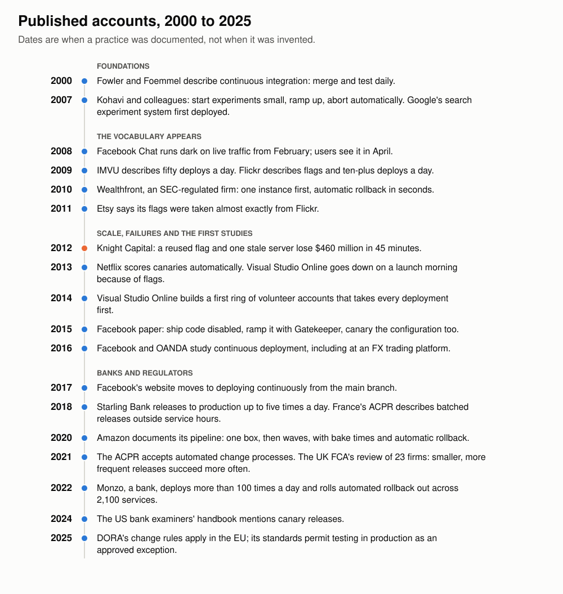
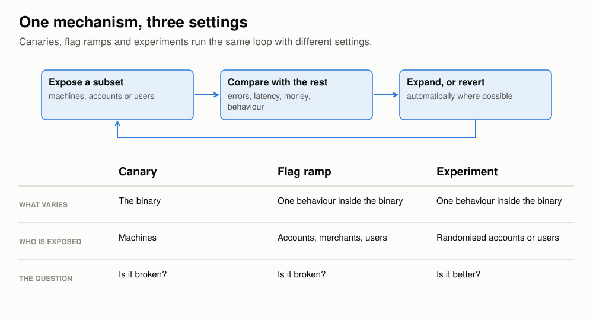
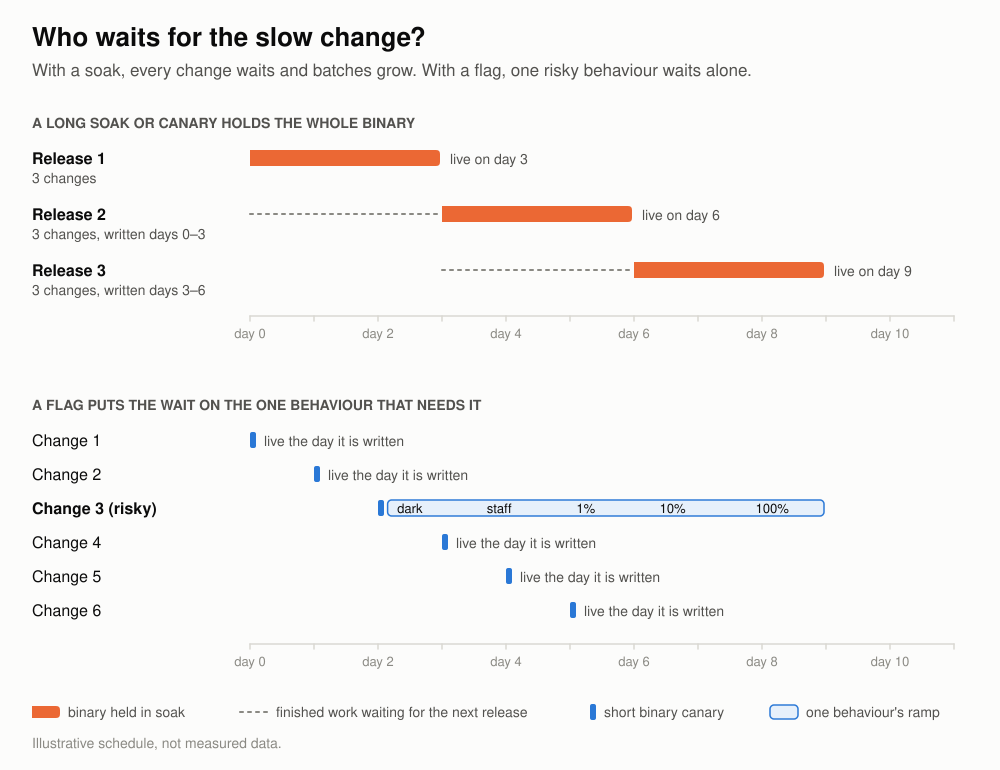
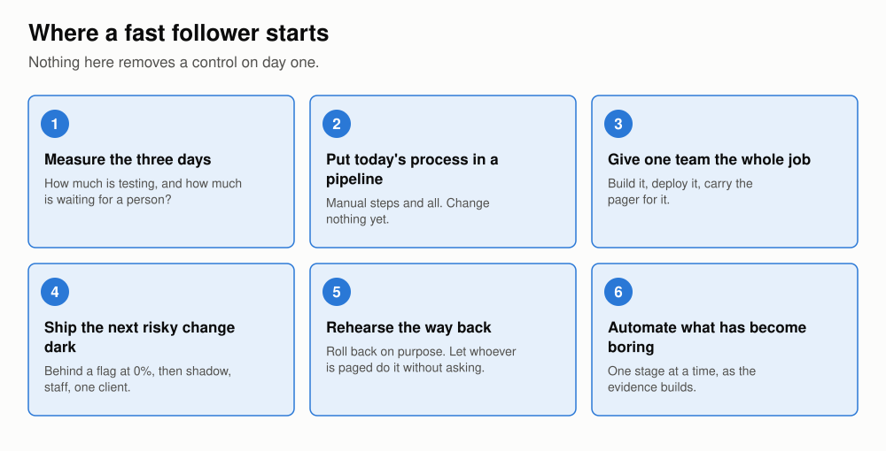

# Stop soaking, start ramping

## The case for replacing the release train with dark launches, feature flags and fast rollback

*Written for engineering managers at payments and core-banking firms that release twice a week and spend three days promoting each release through environments. Research completed November 10, 2026.*

## 1. You are behind, and that is an advantage

Your release takes three days. It is built from everything merged since the last one, promoted through environments, soaked in pre-production, approved, and then given to every client at once. It leaves on a schedule, like a train, with whatever is ready. The soak is the stretch it spends in pre-production under test traffic, to see whether anything degrades. It is a careful process, and this essay argues that you should replace it.

That is the whole claim of this essay: change, because the alternative is better overall. The alternative is to deploy small changes to production continuously, with each new behaviour switched off behind a feature flag: a setting that chooses between the old behaviour and the new without another deployment. You turn the behaviour on for nobody, then for staff, then for a few clients, then for everyone, and you make sure whoever is on call can turn it off again in seconds.

You would not be a pioneer. Facebook launched its chat system this way in 2008. Amazon, Google, Netflix and Microsoft have published their versions in detail. Uber's payments group, Square and Stripe have published staged migrations of systems that move money. Monzo and Starling have published how regulated banks release many times a day. In 2024 the handbook that US bank examiners work from described canary releases, in which a new version first takes a small share of traffic, and observed that "in a DevOps environment, the same number and type of changes can be made daily or even hourly". ([FFIEC, 2024](https://business.cch.com/BFLD/FFIEC-IT-DevelopmentAcquisitionMaintenance-Hankbook-08292024.pdf))

That makes you a fast follower. The idea has been proven by others, and their mistakes are written down. This essay uses both.

Start with evidence from your own industry. In 2021 the UK's Financial Conduct Authority published a review of how 23 financial firms had made more than a million production changes during 2019. It found that "firms that deployed smaller, more frequent releases had higher change success rates than those with longer release cycles". Changes classed as major got extra oversight and failed more than twice as often as changes overall. Change advisory boards (CABs) approved more than 90% of the major changes put to them, and at some firms had not rejected one all year, which the FCA said "raises questions over the effectiveness of CABs as an assurance mechanism". ([FCA, 2021](https://www.fca.org.uk/publications/multi-firm-reviews/implementing-technology-change))

The review reports associations, and it does not tell anyone to abolish their change board. It also carries a caveat: firms that described more of their work as DevOps had a slightly higher failure rate, on a sample too small to conclude from, and the FCA warned that frequent release is not the answer for every firm. Even so, this is a regulator's own data on regulated firms, and its main findings point away from the large, infrequent, heavily approved release.

## 2. What changed: the wait moved

The firms that left the testing period behind did not stop waiting. They moved the wait.

Netflix is the clearest example, because its starting point looked like yours. In 2012 its canaries, new versions run beside the old on a slice of traffic, lasted a week. The engineers later described what that week had become: "Canarying was devolving into verifying endurance (“nothing broke after one week of canarying, let’s push it”) rather than correct functionality." ([Netflix, 2018](https://netflixtechblog.com/full-cycle-developers-at-netflix-a08c31f83249)) Elapsed time had turned into the evidence. By 2018 a Netflix canary ran for hours and was judged by a statistical comparison against a fresh copy of the old version under the same live traffic. ([Netflix, 2018](https://netflixtechblog.com/automated-canary-analysis-at-netflix-with-kayenta-3260bc7acc69))

Amazon measured its own "before". Code took 16 days on average to get from check-in to production, and almost 14 of those days were spent waiting for a person to start a build, run a deployment or run the tests. ([Mansour, 2019](https://aws.amazon.com/builders-library/going-faster-with-continuous-delivery/))

Amazon's pipeline today is not quick. A change typically takes four or five business days to reach every Region, and the pipeline still has test stages before production. What changed is how the time is spent. The change goes first to one machine, then to one Region, then outward in waves. Each stage waits at least an hour, twelve hours after the first Region, on real customer traffic. It moves on only when alarms are quiet and enough requests have been seen. If an alarm fires, the pipeline rolls back by itself, often before the on-call engineer has been paged. And changes enter one at a time, "so we don't end up with large bundles of changes waiting". ([Liguori, 2020](https://aws.amazon.com/builders-library/automating-safe-hands-off-deployments/))

A pre-production soak asks whether a large batch survives several days in an environment that resembles production. A ramp asks whether one small change behaves correctly on production itself, for a few clients, with a way back. The second question is the one you need answered.

Staging answers a different question, however long the soak. In April 2022 Atlassian ran a maintenance script that had been tested in staging under its normal change process and peer reviewed. It deleted the sites of 775 customers, some of whom were locked out for up to 14 days. Staging had not caught the fault because the identifiers that triggered it did not exist there. ([Atlassian, 2022](https://www.atlassian.com/engineering/post-incident-review-april-2022-outage)) Waiting does not help either when the trigger never occurs. Stripe's outage of July 2019 came from a database version that had passed testing, a phased rollout and about three months in production before a rare condition exposed it. ([Stripe, 2019](https://stripe.com/rcas/2019-07-10))

## 3. Start dark

The first step of the new way is the one that most directly replaces your testing period. Deploy the code to production, and show it to nobody.

In February 2008, months before anyone could use Facebook Chat, Facebook's pages began quietly connecting to the new chat servers, asking who was online and sending simulated messages. No interface appeared. The backend was being exercised by the live site's real traffic. Visible rollout began on April 6 and reached everyone on April 23. ([Letuchy, 2008](https://engineering.fb.com/2008/05/13/web/facebook-chat/); [Letuchy, 2009, slides 11–12](https://www.erlang-factory.com/upload/presentations/31/EugeneLetuchy-ErlangatFacebook.pdf)) Facebook called it a dark launch.

"Dark launch" now covers two different things, and you want both:

- **Dormant.** The code is in production behind a flag, or inside an experiment, with its exposure set to zero. It has been merged, built, deployed and proven not to disturb what is live. Nothing calls it.
- **Shadow.** Real traffic runs through the new code. Its output is compared with the old code's output and then thrown away. No client sees the result.

By 2015 Facebook described the dormant rung as ordinary practice: engineers "release the new code into production early but in a disabled mode, and then use Gatekeeper" to widen who gets it. ([Tang et al., 2015](https://sigops.org/s/conferences/sosp/2015/current/2015-Monterey/008-tang-online.pdf)) Flickr had explained the same habit in 2009: everyone works on the main branch and deploys several times a day, and unfinished features sit in production switched off. ([Harmes, 2009](https://code.flickr.net/2009/12/02/flipping-out/)) Netflix used it to stop acceptance testing from blocking deployment: the feature stayed disabled in production while testing carried on. ([Netflix, 2013](https://netflixtechblog.com/preparing-the-netflix-api-for-deployment-786d8f58090d))

The shadow rung is where you get the observation time a soak was meant to give. When GitHub rewrote the code that merges pull requests, it ran old and new side by side in production, compared the results on tens of millions of merges, fixed mismatches for four days, and switched over after 24 hours with none. ([GitHub, 2015](https://github.blog/2015-12-15-move-fast/)) When Square moved payments to a new service, it compared what the new service and the old application returned, which "actually caught a lot of subtle bugs". ([Square, 2016](https://developer.squareup.com/blog/breaking-up-with-your-monorail/))

A shadow run lasts as long as the evidence requires. It costs no client anything, and, as section 5 explains, it holds up nobody else's work.

Dormant is not the same as tested, and the worst failures in this essay are about that difference. Code that sits in production unexercised has proven nothing. Run it in shadow, and do not leave a flag at zero and forget it. Section 9 shows what happens otherwise.

## 4. One idea, three settings

Canaries, feature flags and experiments are one mechanism: expose a subset, compare it with the rest, then expand or revert. An experiment, in this sense, gives the new behaviour to a randomly chosen group and measures the difference from everyone else.

| | Canary | Flag ramp | Experiment |
| --- | --- | --- | --- |
| What varies | The binary | One behaviour inside the binary | One behaviour inside the binary |
| Who is exposed | Some machines | Some accounts, merchants or users | Randomly chosen accounts or users |
| The question | Is it broken? | Is it broken? | Is it better? |

The history shows them converging. Google's 2010 paper on its search experiment system describes the same infrastructure carrying a feature from canary, through experiment, to gradual launch. ([Tang et al., 2010](https://research.google/pubs/overlapping-experiment-infrastructure-more-better-faster-experimentation/)) In 2007 Ron Kohavi and colleagues at Microsoft were already recommending, in a paper about experiments, that a new treatment start small, ramp up, and shut off automatically if it did harm. ([Kohavi, Henne and Sommerfield, 2007](https://exp-platform.com/Documents/GuideControlledExperiments.pdf)) At LinkedIn and Uber the experimentation platform runs the rollouts. ([LinkedIn, 2014](https://www.linkedin.com/blog/engineering/ab-testing-experimentation/xlnt-platform-driving-ab-testing-linkedin); [Uber, 2018](https://www.uber.com/us/en/blog/autonomous-rollouts-regression-analysis/)) At Booking.com, "every change... is wrapped in an experiment". ([Kaufman et al., 2017](https://arxiv.org/abs/1710.08217))

Experiments earn their place for a reason of their own: careful people are bad at predicting which changes help. At Microsoft, only about one third of well-designed experiments improved the metric they were built to improve. ([Kohavi, Crook and Longbotham, 2009](https://exp-platform.com/Documents/ExP_DMCaseStudies.pdf)) A re-implementation is a change too. A sign-off meeting cannot tell you whether the new settlement path behaves like the old one. Running both can.

Two cautions apply in finance. A safety ramp intends the same outcome for every client and limits exposure in case of a regression. A product experiment deliberately gives clients different versions to learn which is better. The second raises fair-treatment questions the first does not, so say which one you mean when you talk to risk and compliance. The UK regulator is more open to real experiments than most engineers assume: its Consumer Duty guidance says customer understanding "could be tested directly by conducting randomised controlled trials or A/B tests". ([FCA FG22/5, para. 8.44](https://www.fca.org.uk/publication/finalised-guidance/fg22-5.pdf))

The second caution is about the unit. For a payments firm the natural unit of exposure is a client, not a random slice of requests. Stripe pins each account to an API version. ([Stripe, 2017](https://stripe.com/blog/api-versioning)) Square's payments migration used randomised percentages, and its author wrote afterwards that this had hidden a regression which appeared only for a particular pair of client versions; rollouts stable to the merchant would have confined it. ([Square, 2016](https://developer.squareup.com/blog/breaking-up-with-your-monorail/))

Published ramps look like this. An Amazon "Region" is one of its geographic groups of data centres, and "one box" is a single machine.

*Sources for the figure: [Rossi, 2017](https://engineering.fb.com/2017/08/31/web/rapid-release-at-massive-scale/); [Rossi et al., 2016](https://www.eecg.toronto.edu/~stumm/Papers/Rossi-FSE-16.pdf); [Liguori, 2020](https://aws.amazon.com/builders-library/automating-safe-hands-off-deployments/); [Microsoft Learn](https://learn.microsoft.com/en-us/devops/operate/safe-deployment-practices); [Slack, 2020](https://slack.engineering/deploys-at-slack/); [Uber, 2019](https://www.uber.com/blog/migrating-functionality-between-production-systems); [Uber, 2020](https://www.uber.com/us/en/blog/money-scale-strong-data/).*

## 5. Why a long canary hurts and a long flag ramp does not

If canaries and flags are the same mechanism, why not keep your soak and call it a canary? Because of what each one makes wait.

A soak, or a long canary, holds the whole binary. While release 1 sits in pre-production for three days, everything your engineers finish goes into release 2. So release 2 is three days of changes, tested together, approved together and exposed together. When it fails, you have three days of changes to search. Google's reliability handbook states the constraint plainly: "If you release daily, you can't let your canary last for a week while running only one canary deployment at a time." ([SRE Workbook](https://sre.google/workbook/canarying-releases/))

A flag puts the wait on the one behaviour that needs it. The binary's canary can then be short, because the binary contains nothing new that is switched on. It only has to show that the build starts, serves and does not disturb what is live. The risky behaviour ramps on its own clock, for a day or a month, and nobody else's change waits for it.

This is why continuous integration and long soaks pull against each other. Integrating daily means merging to one branch daily, and that branch is only useful if it ships. Flags let unfinished work merge and deploy because it is off.

It is also why long waits do not contradict this essay. Square served all payment reads from its new service for around six weeks before it turned off writes to the old database. Adyen recommends running risk experiments for at least a month, because chargebacks arrive late. ([Adyen docs](https://docs.adyen.com/risk-management/run-ab-test-experiments)) Each is a long wait on one behaviour. A release-train soak is a shorter wait imposed on everything.

The risky change may well reach every client later than it would have on the train. Everything else arrives sooner, and the risky change arrives having been watched.

The batch is where the risk gathers. A study of continuous deployment at Facebook and at OANDA, a currency-trading platform, records a comparison close to your own situation. OANDA deployed continuously. It also licensed the same software to large banks whose policies forbade that. At the banks each release bundled thousands of changes, which raised anxiety and led to much more testing; failures were harder to isolate; and bugs judged non-critical went unfixed for many months. ([Savor et al., 2016](https://www.eecg.toronto.edu/~stumm/Papers/Savor-ICSE16.pdf)) The Financial Times, the newspaper, gives a before-and-after. It used to release about twelve times a year, and one or two of those would fail. In 2017 one of its groups made about 2,500 releases. "I'm pretty confident in 2017 we had less than 25 releases fail," said Sarah Wells, who led the work. "So that's less than a 1% failure rate." ([Wells, 2019](https://www.infoq.com/presentations/microservices-financial-times/))

## 6. The way back

A ramp limits how many clients a fault reaches. Rollback limits how long it lasts. You need both, and the second is as much a management decision as a technical one.

### Roll back to something that has already run

"Rollback" means three different things, and only two of them are safe under pressure.

The first is to switch traffic back to the old version, which is still running. Netflix was deploying this way by 2012: bring up the new version beside the old, move traffic, and keep the old one until you are sure. ([Netflix, 2012](https://netflixtechblog.com/asgard-web-based-cloud-management-and-deployment-2c9fc4e4d3a1)) The second is to redeploy the previous build exactly as it was. Both depend on a rule that Humble and Farley's *Continuous Delivery* gave for audit reasons: build the binary once, and deploy that same binary, checked by its hash, to every environment. ([Humble and Farley, 2010, ch. 5](https://www.informit.com/articles/article.aspx?p=1621865&seqNum=3)) The third, rebuilding an old revision from source in the middle of an incident, produces something that has never run before.

The gain is large. Wealthfront, an SEC-regulated investment firm, reported in 2010 that a rollback took about five seconds across its cluster. ([Wealthfront, 2010](https://eng.wealthfront.com/?p=1273)) The rule also gives you something for audit: the hash that ran in test is the hash that runs in production.

Two conditions apply. Keep the old images, under identifiers that cannot be overwritten. And remember what an image rollback does not undo: data the new version wrote, a schema it migrated, a message format it started emitting. Amazon handles such changes in two deployments. The first teaches the software to read the new format. The second, days later, starts writing it. Either can be rolled back alone. ([Pokkunuri, 2019](https://aws.amazon.com/builders-library/ensuring-rollback-safety-during-deployments/))

### Let the person who is paged decide

Then there is the question of who is allowed to do it. Google's guidance to its cloud customers is that the releasing team "rolls back first and investigates the problem second", and that nobody should be asked afterwards to justify the rollback, so long as its record describes the problem. ([Hilton, 2017](https://cloud.google.com/blog/products/gcp/reliable-releases-and-rollbacks-cre-life-lessons)) Booking.com's rule is that "Everyone in the company must be able and feel empowered to stop harmful experiments of their own accord." ([Kaufman et al., 2017](https://arxiv.org/abs/1710.08217)) Amazon, Monzo and Slack go further and let the pipeline roll back on the same signals that would page a person. ([Monzo, 2022](https://monzo.com/blog/2022/11/02/argo-rollouts-at-scale))

A rollback nobody has practised is a new, untested change made during an incident. A Google engineer put it this way: "Far too many think they have safe rollbacks, only to learn otherwise during an outage." ([Mace, 2020](https://www.oreilly.com/content/generic-mitigations/)) The same Google guidance says that if you have not rolled back in a few weeks, you should do one on purpose. Amazon tests it in the pipeline: deploy to part of the fleet, then roll back, under continuous traffic. ([Pokkunuri, 2019](https://aws.amazon.com/builders-library/ensuring-rollback-safety-during-deployments/))

Two incidents show the cost of skipping the rehearsal. In November 2014 a fault in Microsoft's Visual Studio Online service, now Azure DevOps, sat behind a feature flag, and it took the team approximately 45 minutes "to figure out how to turn it off". ([Harry, 2014](https://devblogs.microsoft.com/bharry/outage-on-monday-nov-24)) Stripe's second outage on 10 July 2019 happened because "our revert to a known stable version interacted poorly with a recently-introduced configuration change". ([Stripe, 2019](https://stripe.com/rcas/2019-07-10))

So the policy for you to write has three parts. Rolling back to the previous image and switching a flag off are pre-approved actions. Whoever is on call may take them without asking. And they are rehearsed.

## 7. What managers have to change

The tooling is a large job, but it is documented. The firms that made this change describe the harder part as changing what engineers and managers are responsible for.

**Make flags and ramps explicit, for every risky change.** This is the habit that separates the firms that do this from the firms that own the tools. The author of a change, not a release team, writes the switch, names the metric that will show the change is working, plans the ramp, and removes the flag afterwards. Google's engineering handbook is blunt: "A key to reliable continuous releases is to make sure engineers “flag guard” all changes." ([Software Engineering at Google, ch. 24](https://abseil.io/resources/swe-book/html/ch24.html)) Dropbox expected any risky change to its desktop client to be gated so it could be switched off. ([Dropbox, 2017](https://dropbox.tech/application/accelerating-iteration-velocity-on-dropboxs-desktop-client-part-2))

Expect this to be hard. It adds work to every change, and it asks engineers to plan for being wrong. In a study published in 2018, 63% of 187 practitioners surveyed used no form of canary, dark launch or gradual rollout, and the engineers interviewed mostly judged a canary's health by intuition. ([Schermann et al., 2018](https://www.ifi.uzh.ch/dam/jcr:01d34060-29fb-472e-a116-bd26c3b49f67/IST_preprint.pdf)) Booking.com reports a heavy training cost. ([Kaufman et al., 2017](https://arxiv.org/abs/1710.08217)) Microsoft's experimentation team wrote in 2009 that "Most goals in software development organizations at Microsoft are around 'shipping' products", and doubted that three years of effort had changed many people's performance goals. ([Kohavi, Crook and Longbotham, 2009](https://exp-platform.com/Documents/ExP_DMCaseStudies.pdf)) The tools you can use to change the habit are code review ("how is this turned on, measured and turned off?"), the definition of done (the flag is gone), and what you praise.

**Move the pager to the team that wrote the code.** Werner Vogels's phrase from 2006 is "You build it, you run it." ([ACM Queue, 2006](https://queue.acm.org/detail.cfm?id=1142065)) Netflix's account matters more to a manager, because it records the half-measure failing. When developers could deploy but a release specialist remained, developers deferred to the specialist and the specialist had no time to automate the job away. Full ownership worked only with central tooling teams, training and spare capacity: "Without these, teams risk overload and burnout." ([Netflix, 2018](https://netflixtechblog.com/full-cycle-developers-at-netflix-a08c31f83249))

**Move approval; do not delete it.** At Amazon, "the code review is the last manual review and approval that a code change receives from an engineer". ([Liguori, 2020](https://aws.amazon.com/builders-library/automating-safe-hands-off-deployments/)) The Financial Times dropped its change approval board and records each release automatically: "if you're doing small changes, the best person to make the decision about whether this change should go, is the person who just made that development change." ([Wells, 2019](https://www.infoq.com/presentations/microservices-financial-times/)) Starling Bank shows how far you can go while keeping human gates. In 2018 it was releasing up to five times a day, with a step in which every engineer vouches for their commits in chat, and a visible release-in-progress signal about which its slides say "our auditors loved this one". ([Starling, 2018](https://archive.qconlondon.com/system/files/presentation-slides/qcon_2018.pptx.pdf)) In 2025 it still required three approvals for each of several daily releases, one of them a business approval. ([Starling, 2025](https://technology.starlingbank.com/blog/how-we-made-everyone-a-release-engineer))

**Do not answer a failure with a gate.** This is the test of a management team. At OANDA, after a failure that "cost the company a significant amount of money within seconds", senior management reached for more approvals and "a full-blown, separate and traditional testing team". The post-mortem found that unit tests had caught the bug and been ignored among false alarms. Engineering persuaded management to wire the test results into the deploy decision. ([Savor et al., 2016](https://www.eecg.toronto.edu/~stumm/Papers/Savor-ICSE16.pdf)) Then ask what your incident reviews reward. John Allspaw's argument for blameless reviews is addressed to managers: an engineer who expects punishment stops supplying detail, and management ends up knowing less about how the work is done. ([Allspaw, 2012](https://www.etsy.com/codeascraft/blameless-postmortems))

**Fund the platform, and expect years.** Tooling teams were about 5% of engineers at Facebook and 15% at OANDA, which spent two years on continuous deployment for its critical systems. ([Savor et al., 2016](https://www.eecg.toronto.edu/~stumm/Papers/Savor-ICSE16.pdf)) Monzo says of automated rollback that "migration and tooling work was >90% of the effort". ([Monzo, 2022](https://monzo.com/blog/2022/11/02/argo-rollouts-at-scale)) Google's change in testing culture took about five years. ([Bland, 2014](https://martinfowler.com/articles/testing-culture.html)) Brian Harry, looking back on six years of change at Microsoft's Azure DevOps, wrote: "If we'd tried to do it all at once. I'm sure we would have failed." ([Harry, 2017](https://devblogs.microsoft.com/bharry/testing-in-a-cloud-delivery-cadence/))

**Keep what was kept.** The famous firms retained more than their reputations suggest. Amazon has pre-production stages and deployment windows. Google has release trains for some products and still employs test engineers. Facebook's iOS app kept a three-day soak, on employees and beta users, because an app shipped to a phone cannot be recalled. ([Rossi et al., 2016](https://www.eecg.toronto.edu/~stumm/Papers/Rossi-FSE-16.pdf)) Automated tests and review come before production in every account cited here. What these firms removed was the batch, and the assumption that time in a lower environment is evidence.

## 8. For systems that move money

Your objection is fair: a bad release at a photo site shows the wrong picture, and a bad release at your firm sends the wrong payment. Kent Beck, describing Facebook's culture of reversible decisions, set money aside himself: "Decisions affecting people's privacy, trust, and money; and decisions affecting the Facebook brand aren't reversible." ([Beck, 2015](https://newsletter.kentbeck.com/p/taming-complexity-with-reversibility))

Payments firms do not claim otherwise. They make the decision reversible and keep the exposure small.

**Shadow the payment without sending it.** You cannot call a card processor twice to see whether a new service agrees with the old one. Uber's payments group recorded the request the old system sent to the processor and the response it got. It then gave delayed copies of real requests to the new service, compared the request the new service would have sent, and replayed the recorded response. That found "dozens of argument mismatches" before any customer was moved. Then came employees, then 0.25% of users, then 1%, then 5%, one payment method at a time. ([Uber, 2019](https://www.uber.com/blog/migrating-functionality-between-production-systems))

**Count agreement, not days.** When Uber moved its ledger to a new store, the bar was that the data be "at least 99.99% complete and correct as measured by shadow validation". Its engineers did the arithmetic: at a thousand records a second, six nines of confidence takes a bit more than a day of comparisons, and seven nines about twelve days, which they judged impractical. Live shadowing also missed data that is rarely read, so they compared the stored records offline as well, 760 billion of them in one job. ([Uber, 2024](https://www.uber.com/blog/migrating-from-dynamodb-to-ledgerstore/)) Banks already know this practice as a parallel run. The US draft rule implementing Basel II required at least four consecutive quarters of computing capital the old way and the new way side by side. ([Federal Reserve, 2006](https://www.federalreserve.gov/GeneralInfo/Basel2/DraftNPR/NPR/section_3.htm))

**Treat reconciliation as a test that never stops.** Monzo runs coherence checks over payments in production and reconciles its ledger against settlement daily. ([Monzo, 2022](https://monzo.com/blog/2022/02/08/processing-payments-safely-at-scale)) Stripe reports that "99.99% of our dollar volume is fully ingested and verified within four days". ([Stripe, 2024](https://stripe.dev/blog/ledger-stripe-system-for-tracking-and-validating-money-movement)) These are slower signals than an error rate, and they set the length of a ramp stage. No source states the rule, but it follows: a change that affects settlement should hold at small exposure for at least one reconciliation cycle. Idempotent operations, which have the same effect however many times they are retried, bound the damage of a retry. An append-only ledger means a mistake is corrected by a new entry and never erased. ([Stripe, 2017](https://stripe.com/blog/idempotency); [Square, 2019](https://developer.squareup.com/blog/books-an-immutable-double-entry-accounting-database-service/))

**Answer the auditor from the rule texts.** None of the texts read for this essay requires a soak period, a release train or promotion over several days. That covers PCI DSS v4.0, the FFIEC handbook, the European Banking Authority's guidelines, the EU's Digital Operational Resilience Act and Singapore's MAS guidelines. They ask for evidence.

*Sources for the figure: [PCI DSS v4.0](https://www.pcisecuritystandards.org/documents/PCI-DSS-v4_0.pdf); [FFIEC, 2024](https://business.cch.com/BFLD/FFIEC-IT-DevelopmentAcquisitionMaintenance-Hankbook-08292024.pdf); [EBA/GL/2019/04](https://www.eba.europa.eu/sites/default/files/document_library/Publications/Guidelines/2020/GLs%20on%20ICT%20and%20security%20risk%20management/872936/Final%20draft%20Guidelines%20on%20ICT%20and%20security%20risk%20management.pdf); [Regulation (EU) 2022/2554](https://eur-lex.europa.eu/legal-content/EN/TXT/HTML/?uri=CELEX:32022R2554); [MAS TRM Guidelines, 2021](https://www.mas.gov.sg/-/media/MAS/Regulations-and-Financial-Stability/Regulatory-and-Supervisory-Framework/Risk-Management/TRM-Guidelines-18-January-2021.pdf).*

The texts do constrain you, and you should know where. Singapore's guidelines say a change advisory board "should be formed" and expect test results to be signed off. The FFIEC handbook says developers should not be the ones to validate their own work. PCI DSS, where code review is manual, wants a release approver who is neither the author nor the reviewer. The EU's technical standards under its resilience act, as read in summary for this essay, require the approver to be independent of whoever requested and built the change, and treat testing in production as an exception to be justified, approved and time-limited. And no rule text mentions feature flags, so nobody has told you how a flag change is classified.

So keep named approvers, give independent testers a real role, and bring audit and risk in to help design the pre-approved change types, including the ones for a shadow run, a flag ramp and a rollback. Expect caution from supervisors. After outages at DBS in 2023, Singapore's regulator ordered a six-month pause on non-essential changes. ([MAS, 2023](https://www.mas.gov.sg/news/media-releases/2023/mas-imposes-six-month-pause-on-dbs)) The argument that works with a supervisor is failure rate and reach per change, with evidence. It is never speed.

**Accept the dates and the clients you do not control.** Card networks release in April and October. ([PayPal Braintree](https://developer.paypal.com/braintree/articles/risk-and-security/compliance/network-updates/2024/f-2024-all)) SWIFT's standards change once a year. A message format shared with every counterparty cannot be ramped, and a central bank's settlement system gets cut over on a weekend. These remain release trains. Ship your side early and dark, and switch it on when the date arrives.

Your clients may be banks with their own notice periods, acceptance testing and sign-off. European rules require three months' notice of a change to a payment-account access interface. ([Regulation (EU) 2018/389, Art. 30(4)](https://eur-lex.europa.eu/legal-content/EN/TXT/HTML/?uri=CELEX:32018R0389)) You cannot make such a client your first cohort without its agreement. What you can ramp freely is behaviour behind an interface that does not change. For the rest, the first cohort is a client that has agreed to go first, which is how Stripe's account-pinned versions and Adyen's merchant-enabled features work.

## 9. What goes wrong when it is done halfway

The failures on record are failures of doing part of this.

**Deployed gradually, activated all at once.** Knight Capital began deploying new order-routing code on 27 July 2012, a few servers a day. The new code reused a flag that had once switched on a function unused since 2003. A technician missed one of the eight servers. Nothing exercised the path until the morning of 1 August, when it went live everywhere at once and the eighth server began running the old function. In about 45 minutes Knight made 4 million executions in 154 stocks and lost more than $460 million. The SEC faulted Knight for having no second person check the deployment, no written procedure requiring one, and 97 automated warnings that went unread before the market opened. The first response made it worse: "Knight uninstalled the new RLP code from the seven servers where it had been deployed correctly. This action worsened the problem." RLP was the new programme the code supported. ([SEC, 2013](https://www.sec.gov/litigation/admin/2013/34-70694.pdf))

Knight is usually told as a story about reckless deployment. The SEC's order describes a staged deployment of dormant code, a reused flag, and an improvised rollback. Five days in production observed nothing because nothing used the path, and three days of soak would have observed the same nothing. The SEC's remedies were a second person checking the deployment, monitoring of the warnings, and a clear rule for disconnecting. This essay's reading adds one: a ramp of the *behaviour*, on limited order flow, would have exercised the path while the damage was still small.

**The same thing, thirteen years later.** In June 2025 a Google Cloud outage came from code that had been rolled out Region by Region and was first exercised everywhere at once by a policy change. Google's remedy: "We will enforce all changes to critical binaries to be feature flag protected and disabled by default." ([Google Cloud, 2025](https://status.cloud.google.com/incidents/ow5i3PPK96RduMcb1SsW))

**One kind of change skipped the ramp.** CrowdStrike staged the rollout of its software but not of the content files that software reads. Its analysis of the July 2024 outage concludes that each such file "should be deployed in a staged rollout". ([CrowdStrike, 2024](https://www.crowdstrike.com/wp-content/uploads/2024/08/Channel-File-291-Incident-Root-Cause-Analysis-08.06.2024.pdf)) Cloudflare's 2019 outage came through a rule channel whose procedure "allowed a non-emergency rule change to go globally into production without a staged rollout". ([Cloudflare, 2019](https://blog.cloudflare.com/details-of-the-cloudflare-outage-on-july-2-2019/)) Configuration, flags, reference data and operator scripts are all changes. Ramp them too.

**The way back was never tested.** At RBS in 2012, a back-out of a batch-scheduler upgrade caused an incident that affected millions of customers. The FCA found the bank "had only tested the consequences of backing out Version 2 to Version 1", not the patched version actually running. ([FCA Final Notice, 2014](https://www.fca.org.uk/publication/final-notices/rbs-natwest-ulster-final-notice.pdf))

**The ramp ended too soon.** Roblox had used a new streaming feature on some services for months. A day after it enabled the feature on its traffic-routing service, a 73-hour outage began. ([Roblox, 2022](https://about.roblox.com/newsroom/2022/01/roblox-return-to-service-10-28-10-31-2021/)) Hold at least one stage through a full daily peak, and for batch work through a full run.

**Flags became debt.** Uber built a tool to delete stale flags and removed 1,381 of them. ([Ramanathan et al., 2020](https://manu.sridharan.net/files/ICSE20-SEIP-Piranha.pdf)) A reused flag and code nobody had removed are how Knight happened.

**One event, and no way back.** TSB moved 5.2 million customers to a new platform in a single weekend in 2018, with testing cut short and no ability to roll back. It received 225,492 complaints and was fined £48.65 million. The FCA found that fuller testing of the bank's two-data-centre configuration would likely have found the fault, so this case argues for better testing as well as for smaller steps. ([FCA Final Notice, 2022](https://www.fca.org.uk/publication/final-notices/tsb-bank-plc-2022.pdf))

None of these is a reason to keep the release train. No post-mortem found for this essay blames an outage on having ramped where a soak would have served, though nobody has run a controlled comparison either way. They are the checklist for doing the new way completely.

## 10. Where to start

Amazon brought sceptical teams along with one instruction: "encode their current release process, manual steps and all, in a pipeline", then automate a step at a time as confidence grew. ([Mansour, 2019](https://aws.amazon.com/builders-library/going-faster-with-continuous-delivery/)) That is a fast follower's route, and it removes no control on the first day.

1. **Measure your three days.** Find out how much of the time is testing and how much is waiting for a person. Amazon found that almost 14 of its 16 days were waiting.
2. **Put today's process in a pipeline**, manual approvals included. You now have the record auditors ask for, on every change.
3. **Give one team the whole job**: build, deploy, and the pager.
4. **Ship that team's next risky change dark.** Put it behind a flag at zero, run it in shadow, then give it to staff, then to one client.
5. **Rehearse the way back.** Roll back on purpose. Write the policy that lets the on-call engineer do it without asking.
6. **Automate what has become boring**, one stage at a time.

The published record has gaps, and they fall close to you:

- **No before-and-after numbers from a bank.** No bank or payments firm has released incident figures from before and after it left release trains.
- **No auditor's verdict.** No firm has published what an examiner or external auditor concluded about its new process.
- **No incumbent's account.** Monzo, Starling and Nubank were built new. No firm with a mainframe core has published how it took a release train off its money-moving systems.
- **Little on low volumes.** A 1% ramp tells you little about a flow of a few large payments a day. Nothing published says how to ramp one; shadow comparison is the closest substitute.
- **Almost nothing on period-end jobs.** Nobody describes validating changes to end-of-day, month-end and settlement jobs before the boundary arrives. A reasonable approach is to run the new job in shadow through a real period end, compare its output with the old job's, and move accounts over in small groups. That advice is assembled from neighbouring evidence.

Speed alone is no virtue either. The case here is for small changes with automated checks, limited exposure and a rehearsed way back, taken together.

Your three days protect clients by making a large batch wait in a place that is not production. The firms in this essay protect clients by making each change small, starting it dark, widening it on evidence, and keeping a rehearsed way back in the hands of whoever is on call. The second way is better overall. A regulator's data, more than fifteen years of published practice and the accounts of firms that move money for a living support it. The engineering is documented. The harder work is the change in habits described in section 7, and it falls to managers.

---

## Sources and method

Factual statements above are tied to linked sources that were read, in the same paragraph or the one before. Quotations were read in the source document itself; those first gathered through a summarising tool were checked again against the page, and the record of that check is in [quote verification A](research_notes/Testing%20gates%20to%20ramping%20culture/quote_verification_a.md) and [quote verification B](research_notes/Testing%20gates%20to%20ramping%20culture/quote_verification_b.md).

The evidence behind this essay is in three layers:

- **[The synthesis report](reports/Testing%20gates%20to%20ramping%20culture.md)** covers the move from testing periods to controlled exposure, including contrary evidence, corrections to commonly repeated claims, and gaps.
- **[The research notes](research_notes/Testing%20gates%20to%20ramping%20culture/)** are fourteen files of source-by-source evidence, each tagged by how it was read.
- **[The original dossiers](research/)** cover the history: Google, Facebook, the wider internet companies, payments, and the quality evidence.

Figures 1, 2, 4, 5, 9 and 13 are conceptual. Figure 5 is an illustrative schedule, not data. The numbers in the other figures come from the sources cited in the paragraphs beside them. The figures are generated by [figures/build.mjs](figures/build.mjs).

Company accounts are evidence of what a firm says it does, and they favour success stories. Survey findings are associations. Where the essay says a source "found" something, that is the source's own finding and has not been independently audited.
