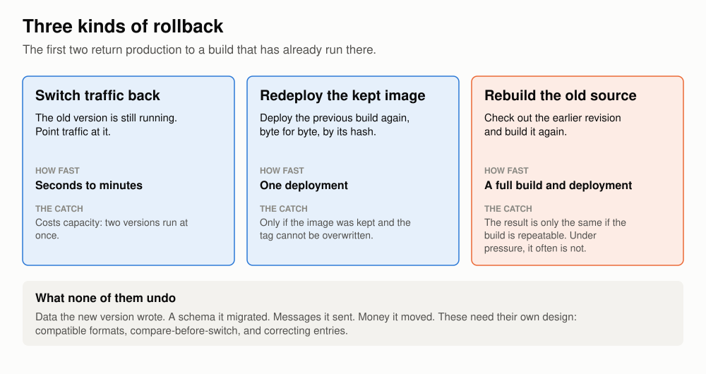

# Moving off the release train

*Why engineering teams should replace testing periods and scheduled releases with dark launches, feature flags, staged rollouts, and fast rollback.*

Some engineering organizations still deliver software the way most of the industry did twenty years ago. Changes accumulate into a scheduled release, which is promoted through a series of test environments, held in pre-production for a soak period, approved, and then released to every user at once. This is the release train, and this article argues that teams still using it should replace it.

In the model that has replaced it at most large internet companies, small changes are deployed to production continuously with their new behavior disabled. Each behavior is then enabled separately: for no one at first, then for a small group, then for everyone, with a rehearsed way to reverse each step. A growing number of banks and payments firms now work this way as well. Testing before production remains, but most of the evidence that a change is safe is gathered in production, at limited exposure.

The case for changing rests on three points, each developed below. First, the release train imposes days of delay on every change regardless of its risk, and it forces changes into batches that are harder to test and harder to debug. Second, the safety it provides is narrower than it appears, because a soak in a test environment cannot observe real dependencies, code paths that nothing exercises, or faults whose trigger has not yet occurred. Third, separating deployment from release removes the trade-off between speed and safety that the train creates, provided the supporting practices are adopted in full.

This is primarily a change in engineering practice and culture: engineers have to write changes that can be turned off, teams have to operate what they deploy, approval has to move from scheduled meetings to recorded evidence, and rollback has to become a routine operation. Those changes are harder than the tooling, and they take up a large part of this article.

The first half covers the release train and its costs, how the industry arrived at the alternative, the techniques involved and the limits of each, what changes for the people involved, and how these efforts fail. The second half applies the argument to systems that move money. They are the hardest case, which makes them a useful test: a model that can be applied safely to payments can be applied elsewhere. Sources are linked throughout, and most are engineering posts and papers written by the teams that did the work.

Three terms are used precisely throughout: to **deploy** is to put code into production, to **release** is to expose new behavior to users, and a **train** is a scheduled bundle that does both at once.

## The release train

### How it works

A release train runs on a schedule, which may be monthly, weekly, or several times a week. Everything merged since the previous cut is bundled into a release candidate. The candidate is promoted through a series of environments, typically integration, performance and pre-production, with automated and manual tests at each stage. It is then held in pre-production for a fixed soak period, approved by a change board, and released in a scheduled window.


The cadence has varied widely: Microsoft's product teams in the 1990s [built daily and stabilized at milestones](https://www.cs.umd.edu/~atif/Teaching/Spring2003/cusumano.pdf) that were months apart, Facebook's website shipped [a weekly release](https://people.engr.tamu.edu/pcr/courses/csce431/fall19/reading/FacebookDevelopment.pdf), cut on Sunday and pushed on Tuesday, into the 2010s, and mobile applications ran on cycles of several weeks.

This article uses a running example of two trains a week, each taking three days from cut to release, with the three days divided roughly as follows.

The first day is deployment to an integration environment and an automated regression pack run against simulators for external dependencies. That is a few hours of machine time, much of which could run in parallel.

The second day is a performance run, usually preceded by an environment reset and a data refresh that take longer than the test itself, followed by an overnight batch cycle.

The third day is evidence assembly, change approval, and the wait for a release window.

Only part of that time is work; the remainder is spent waiting for an environment, an approver, or a release window. When Amazon measured its own pipeline, before automating it, code took an average of 16 days to get from check-in to production, and for almost 14 of those days it was [waiting for someone to start a build, perform a deployment or run a test](https://aws.amazon.com/builders-library/going-faster-with-continuous-delivery/). A twice-weekly train will have a far better ratio, but it would be surprising if the work came to more than one day of the three.


### The purpose of the soak

The soak does real work, and any argument for replacing it has to start from an accurate description of that work.

A soak exists to cross boundaries that a short test never reaches:

- database and message-queue connections that only misbehave after hours of idleness
- memory, file handles and log volumes that creep
- queues that slowly deepen
- date rollovers and other time-triggered work
- batch jobs running to completion on new code while online traffic continues
- whether the release still holds peak throughput

Those are real classes of fault, and a short canary misses most of them. The argument of this article concerns where that waiting happens and how much has to wait; it does not propose abandoning the checks.

Four things in the three days cannot be removed, only moved:

- One full batch cycle on the new code.
- One daily peak, because capacity regressions do not show at three in the morning.
- Test windows with external partners, which run on the partner's calendar.
- A second person's judgment on any high-risk change.

The rest can be compressed, and much of it is queueing.

### Lead time

With two evenly spaced trains a week, a finished change waits a little under two days on average for the next one and then spends three days in promotion. That is about five days from finished to live, and seven if it has just missed a train. A one-line fix waits as long as a change to core business logic.

Five days sounds tolerable until it is multiplied across the kinds of work a team does. The right-hand column below is an estimate of what the same work looks like once deployment and release are separated; the rest of the post explains where it comes from.

| Kind of work | On the train | Deployed daily, released separately |
| --- | --- | --- |
| An ordinary change, which is most of them | About 5 days from finished to live | In production the next business day, on every node the day after |
| A fault found in production | 5 days, or a hotfix that skips most of the three days | The same as an ordinary change, through the normal path |
| A feature that needs three rounds of feedback from production | About 15 days of waiting | About 3 |
| A high-risk change | 5 days, then every client at once | Evidence from production the next day; full release in four to eight weeks |

The last row shows a high-risk change taking longer under the new model, which is intended. The gain comes from the other three rows, where ordinary work no longer queues behind the risky change.

The hotfix row reflects a common arrangement. A train usually comes with an emergency path that skips most of the three days. Its existence shows that the three days are sometimes more than a change needs, and it means that the changes made under the most pressure receive the least verification.

### Batching

The train's second cost is the batch. Each one carries half a week of other people's changes, so when a release misbehaves, the first job is to work out which change did it.

A schedule with a cut-off also changes how people behave near it. LinkedIn's mobile team, releasing monthly behind a four-day manual regression pass, [described engineers rushing code in before the deadline](https://engineering.linkedin.com/blog/2016/02/3x3--speeding-up-mobile-releases) because missing it cost a month. Facebook measured the result on its own mobile releases and found that code pushed on the day of the cut was [of lower quality than code pushed on other days](https://www.eecg.toronto.edu/~stumm/Papers/Rossi-FSE-16.pdf). The effect will be weaker when missing the train costs half a week and not a month, but it is the same mechanism.

Batching also keeps unfinished work out of the main branch. A change that takes three weeks cannot board a train until it is complete, so it lives on a branch and drifts from everyone else's work until it is merged.

The clearest account of what large batches do in a financial setting comes from OANDA, a currency-trading platform. OANDA deployed its own platform continuously, and also licensed the same software to large banks whose policies did not allow continuous updates, so the banks took it in periodic releases. In [a paper written with Facebook engineers](https://www.eecg.toronto.edu/~stumm/Papers/Savor-ICSE16.pdf), OANDA's people describe what happened at the banks: each release bundled thousands of changes, the size of the release raised anxiety and led to much more extensive testing, failures were significantly harder to isolate, and bugs judged non-critical went unfixed for many months because a fix had to wait for a release.

### Why the train cannot simply run faster

The obvious fix is to shorten the three days or run the train daily. Neither works.

Shortening the three days means cutting the soak, which means no longer looking for the faults the soak finds.

Running the train daily with the same three days means three trains in promotion at once. That needs three sets of environments and three times the partner test windows. A fault found on the third day of one train is already in the two behind it. Every change still waits three days, and every release still reaches every client in the same instant.

Within the train model, speed and safety really do trade against each other, and a responsible team chooses safety. The trade only exists because the train deploys and releases in one act. The caution that a risky change deserves gets spent on the whole train, so everything on the train waits for it.

Google's Site Reliability Workbook states the constraint in one sentence: ["If you release daily, you can't let your canary last for a week while running only one canary deployment at a time."](https://sre.google/workbook/canarying-releases/)

### Limits of pre-production testing

The soak finds one class of fault well. There are at least three it cannot find, however long it runs.

The first is how real dependencies behave. Pre-production talks to simulators and stubs, and a simulator can confirm that a request is well formed and that scripted error and timeout cases are handled. It cannot show how a real third party responds to real traffic.

The second is any path that nothing exercises. Time in an environment proves nothing about code that is not being called. Knight Capital's new order-routing code went onto its production servers in stages from July 27, 2012, five days before it was first used. The [SEC's order against the firm](https://www.sec.gov/litigation/admin/2013/34-70694.pdf) records no incident in that time, because nothing was yet using the code. On the morning it was activated, the firm took on unwanted positions in about 45 minutes that cost it more than $460 million. That story comes up again later, because it is really about flags and deployment. The point here is narrower: five days in production observed nothing, and three days of soak would have observed the same nothing.

The third is a fault whose trigger has not happened yet. Stripe's outage of July 2019 came from a database version that had [passed testing, a phased rollout and about three months in production](https://stripe.com/rcas/2019-07-10) before a rare combination of conditions exposed it. Elapsed time, in any environment, does not find a fault whose trigger does not occur.

Staging environments also differ from production in the data they hold. In April 2022 Atlassian ran a maintenance script that had been tested in staging under its normal change process and peer reviewed. It deleted the sites of 775 customers, some of whom were locked out for up to 14 days. [Atlassian's review](https://www.atlassian.com/engineering/post-incident-review-april-2022-outage) explains that staging could not have caught it, because the identifiers that triggered the fault did not exist there.

A long wait can also lose its purpose. Netflix's engineers, looking back at 2012, [wrote that their week-long canaries](https://netflixtechblog.com/full-cycle-developers-at-netflix-a08c31f83249) were "devolving into verifying endurance (“nothing broke after one week of canarying, let’s push it”) rather than correct functionality".

Finally, the size of a change matters more than the scrutiny it gets. In 2021 the UK's Financial Conduct Authority published [a review of how 23 financial firms had made more than a million production changes](https://www.fca.org.uk/publications/multi-firm-reviews/implementing-technology-change) during 2019. Changes the firms classed as major, which generally received more oversight, failed at 3.8%, against 1.6% for changes as a whole. Change advisory boards approved more than 90% of the major changes they reviewed, and at some firms did not reject a single one all year. The FCA's own summary was that "firms that deployed smaller, more frequent releases had higher change success rates than those with longer release cycles".


These findings are associations, as the review itself notes. Major changes are riskier by nature, and it also found a slightly higher failure rate at firms that described more of their work as DevOps, on a sample too small to support a conclusion. But it is a regulator looking at regulated firms and finding that failure concentrates in large changes, and that heavy approval did not offset it.

## How the industry got here

The practice is not new. It was not invented in one place; it grew out of two separate lines of work that met around 2008.

### Integration and experiments

The first line was about merging. In 2000 Martin Fowler and Matthew Foemmel wrote up [continuous integration](https://martinfowler.com/articles/originalContinuousIntegration.html): everyone merges to one branch at least daily, and an automated build and test run tells them quickly whether their work fits together. It solved the problem of changes that had diverged for too long, but it did not address putting each change into production.

The second line was about exposure: web companies had learned to show a change to some users and not others, and to measure the difference. By 2007 Ron Kohavi and colleagues at Microsoft were recommending, in [a guide to running experiments](https://exp-platform.com/Documents/GuideControlledExperiments.pdf), that a new treatment start with a small share of users, ramp up gradually, and be shut off automatically if it did harm. That is a safety mechanism described inside a paper about measurement.

Google's search team built that connection into its infrastructure. Its [2010 paper on experiment infrastructure](https://research.google/pubs/overlapping-experiment-infrastructure-more-better-faster-experimentation/) describes a system first deployed in 2007 in which code shipped in binary pushes, while experiments and launches were controlled by separate, faster pushes of data and configuration. A feature moved through a canary, an experiment and a gradual launch before it became the default, so the binary and the behavior were already on different schedules.

### Dark launches and flags

In 2008 Facebook used the same separation for load. Two months before anyone could use Facebook Chat, the site's pages began [connecting to the new chat servers](https://engineering.fb.com/2008/05/13/web/facebook-chat/) and sending simulated messages, so that the backend carried production load while no interface was visible, which Facebook called a dark launch. Visible rollout began on April 6 and reached everyone on April 23.

The technique became public vocabulary in 2009, when John Allspaw and Paul Hammond gave a talk at the Velocity conference called [10+ Deploys Per Day](https://paulhammond.org/2009/06/velocity/10deploys.pdf) about Flickr, and later that year Ross Harmes described [how Flickr used feature flags](https://code.flickr.net/2009/12/02/flipping-out/): everyone worked on the main branch, the site deployed several times a day, and unfinished features sat in production switched off. Timothy Fitz described [IMVU deploying about fifty times a day](https://timothyfitz.com/2009/02/10/continuous-deployment-at-imvu-doing-the-impossible-fifty-times-a-day/) behind an automated test suite, with deployment to a subset of machines first and automatic rollback. In 2011 Etsy's Chad Dickerson wrote that [Etsy's flags were taken almost directly from Flickr's](https://www.etsy.com/codeascraft/how-does-etsy-manage-development-and-operations), brought over by engineers who had worked at both.

Wealthfront is an early example from regulated finance. In 2010 the firm, which is regulated by the SEC, described [a deployment system](https://eng.wealthfront.com/?p=1273) in which the engineer who committed a change released it, the rollout went to one instance first and then outward, and a failed health check rolled everything back in about five seconds across a cluster of ten machines.

### Scale, and the first hard lessons

From 2012 the published accounts describe larger systems and are more open about failures. Netflix described [an automated canary score](https://netflixtechblog.com/deploying-the-netflix-api-79b6176cc3f0) for its API in 2013. Microsoft's Visual Studio Online team had a public outage on the morning of a launch, caused by flags, and responded by building [a first ring of volunteer accounts](https://devblogs.microsoft.com/bharry/visual-studio-online-update-feb-10/) that took every deployment before anyone else. Facebook published a paper in 2015 on [how it managed configuration](https://sigops.org/s/conferences/sosp/2015/current/2015-Monterey/008-tang-online.pdf), which describes engineers who "release the new code into production early but in a disabled mode, and then use Gatekeeper" to widen exposure, and which acknowledges that configuration changes were causing a real share of incidents and needed canaries of their own.

By 2017 Facebook's website had moved from scheduled pushes to [deploying continuously from the main branch](https://engineering.fb.com/2017/08/31/web/rapid-release-at-massive-scale/), with each build going to employees, then 2% of production, then everyone. In 2020 Amazon published [a detailed description of its deployment pipelines](https://aws.amazon.com/builders-library/automating-safe-hands-off-deployments/), with a single machine first, then one region, then waves, bake times at each stage and automatic rollback.

### Banks and regulators

Firms that move money came later, and the first to write about it were the ones built new. Starling Bank [told a conference in 2018](https://archive.qconlondon.com/system/files/presentation-slides/qcon_2018.pptx.pdf) that it released to production up to five times a day. Monzo described [more than a hundred deployments a day](https://monzo.com/blog/2022/05/16/how-we-deploy-to-production-over-100-times-a-day) in 2022 and, later that year, [automated rollback across more than 2,100 services](https://monzo.com/blog/2022/11/02/argo-rollouts-at-scale).

Regulators noticed. The FCA's review, already mentioned, was published in 2021. The 2024 edition of the [handbook that US bank examiners work from](https://business.cch.com/BFLD/FFIEC-IT-DevelopmentAcquisitionMaintenance-Hankbook-08292024.pdf) mentions canary releases and observes that "in a DevOps environment, the same number and type of changes can be made daily or even hourly".

A team adopting the practice now is therefore drawing on about fifteen years of published history, including the failures.

## Separating deployment from release

### The idea

A change is written so that its new behavior sits behind a feature flag, and the flag is off when the code ships. The code is built, deployed and running in production alongside everything else, and no client sees anything different. Turning the behavior on is a separate decision, taken later, for whichever clients are chosen.

Once that is in place, the two things the train binds together come apart. Deployment can be frequent and uneventful, because deploying disabled code is meant to change nothing a client can see. Release stays deliberate, and can be more careful than it is on a train, because it applies to one behavior at a time and to as few users as required.

The long wait moves off the train and onto the one behavior that needs watching, while every other change proceeds without waiting for it.

### Flag evaluation

At its simplest a flag is a conditional that reads a value from configuration:

```python
if flags.enabled("route-small-payments-instant", client=payment.client_id):
    rail = choose_rail_v2(payment)
else:
    rail = choose_rail_v1(payment)
```

Two details matter more in a transactional system than they do on a website.

The first is when the flag is read. A payment has a life that can run for days or months: acceptance, submission, confirmation, returns, recalls, status inquiries, postings. If each of those steps reads the flag again, then switching the flag mid-life strands the payment between two behaviors. The decision has to be made once, at acceptance, and stored with the payment:

```python
# At acceptance: decide once and record the decision.
payment.rail = decide_rail(payment)   # reads the flag here, and only here
ledger.record(payment)

# Everywhere else: follow the stored decision, never the flag.
gateway_for(payment.rail).submit(payment)
```

No downstream service reads the flag again. This is a design decision that a release train never forces, because on a train the behavior changes for everyone at once and there is nothing to be consistent with.

The second is what happens when the flag service is unavailable. For a web feature, defaulting to "off" is fine. For a client who has already been moved to the new behavior, a default of "off" would silently move live payments back to the old path and then forward again when the service recovered. The safer rule is to fall back to the last known value, and to the old behavior only when there is not one.

### Kinds of flag

Pete Hodgson's article on [feature toggles](https://martinfowler.com/articles/feature-toggles.html) separates four kinds, and the distinction is useful because they have different lifetimes.

- **Release flags** hide unfinished or unproven behavior. They should live for weeks and then be deleted.
- **Experiment flags** split users between variants to measure a difference. They live as long as the experiment.
- **Operational flags**, including kill switches, let operators turn something off under load or during an incident. Some of these are permanent.
- **Permission flags** give a behavior to particular clients as a matter of product, and are long-lived by design.

Most of this article is about release flags. The other kinds use the same machinery, which is part of why flags accumulate; a problem discussed under Failure modes.

### Canaries, ramps and experiments are the same loop

Canaries, flag ramps and experiments tend to be discussed as three subjects. They are one loop with different settings: expose a subset, compare it with the rest, then widen or revert.

| | Canary | Flag ramp | Experiment |
| --- | --- | --- | --- |
| What varies | The binary | One behavior inside the binary | One behavior inside the binary |
| Who is exposed | Some machines | Some clients or accounts | Randomly chosen clients or accounts |
| The question | Is it broken? | Is it broken? | Is it better? |

For that reason the same infrastructure usually serves all three. Google's experiment system was also its launch system. [LinkedIn's experimentation platform](https://www.linkedin.com/blog/engineering/ab-testing-experimentation/xlnt-platform-driving-ab-testing-linkedin) ramps features independently of code releases. Uber built [automated rollouts with regression detection](https://www.uber.com/us/en/blog/autonomous-rollouts-regression-analysis/) on top of its experiment platform.

The difference that matters in finance is the last row. A safety ramp intends the same outcome for every client and limits exposure in case something is wrong. A product experiment deliberately gives clients different variants to learn which is better. The second raises questions about fair treatment that the first does not, so the distinction should be stated explicitly, especially to risk and compliance. Calling a ramp an "experiment" invites objections that belong only to real experiments.

### Changes a flag cannot guard

Not everything in a build can sit behind a flag. A library upgrade, a new database driver, a change to the runtime or a container base image belongs to the binary as a whole. These are exactly the changes that leak memory and exhaust connection pools, which is to say the faults a soak exists to find.

So the binary still needs time under load; what changes is where it gets it. On the new model the build goes to a small part of production first and stays there through a daily peak before it goes wider. The usual name for this wait is a **bake**, and this article uses "soak" for the wait in pre-production and "bake" for the wait in production.

In Amazon's pipeline, which is the best-documented example, each build goes to a single machine, then to one region, then outward in waves. Each stage has a minimum wait, of between one and twelve hours, and a minimum amount of real traffic that must be served before the build moves on, and an alarm rolls the build back automatically. A change typically takes [four or five business days to reach every region](https://aws.amazon.com/builders-library/automating-safe-hands-off-deployments/).

That figure shows what the model does and does not change. Amazon's elapsed time is no shorter than a three-day soak, but builds enter the pipeline one after another, each carries only the changes made since the last, and the waiting is done on real traffic at limited exposure.

Daily deployment has a side effect: if every process restarts every day, a slow leak may never get the chance to show, until a change freeze leaves a build running for two weeks. For runtime and library upgrades a deliberate multi-day soak should be retained.

## The techniques

A testing period does several jobs at once. It looks for regressions, exercises load and elapsed-time behavior, gives people a chance to accept the change, bundles approval, and provides a back-out point. The techniques below take those jobs apart: each one replaces part of what the three days do, and each has a limit that its own authors describe.

### Dark launches and shadow traffic

"Dark launch" gets used for two different things, and both are useful.

The first is **dormant** code: deployed behind a flag that is off. It has been merged, built and deployed, and has been shown not to disturb what is live, but nothing calls it. This is what lets unfinished work merge to the main branch every day. Netflix used it to stop acceptance testing from blocking deployment: the feature [stayed disabled in production](https://netflixtechblog.com/preparing-the-netflix-api-for-deployment-786d8f58090d) while testing continued.

The second is a **shadow** run: real traffic passes through the new code, the result is compared with what the old code produced, and then it is thrown away without any client seeing it. This is the part that replaces most of what a soak is expected to reveal, because it runs on production's own traffic and data.

GitHub's rewrite of the code that merges pull requests is a good example of how it goes. The team [ran the old and new implementations side by side](https://github.blog/2015-12-15-move-fast/) in production using a small library called Scientist, compared the results on tens of millions of merges, fixed mismatches for four days, and switched over after 24 hours with none. Square did something similar when it moved payment data to a new service, and reports that comparing the two paths ["actually caught a lot of subtle bugs"](https://developer.squareup.com/blog/breaking-up-with-your-monorail/).

Stripe's [migration of its subscriptions data](https://stripe.com/blog/online-migrations) shows the same idea applied to a data store. The team wrote to the old and new stores at once, backfilled existing records, compared reads from both while the old store stayed authoritative, switched reads, then switched writes, and only then removed the old path. Each step was small and could be reversed.

Banks already know a version of this as a parallel run: two systems fed the same input, with their outputs compared before the new one is trusted.

Shadow runs have three limits.

- Side effects. GitHub's own documentation says that ["Scientist is not meant to be used for any code that has side-effects"](https://github.blog/2016-02-03-scientist/). You can shadow a decision or a calculation. You cannot shadow sending a payment, so for money movement the shadow records what would have been sent and stops there.
- Cold data. When Uber moved its ledger to a new store, it set a bar that the new store be ["at least 99.99% complete and correct as measured by shadow validation"](https://www.uber.com/blog/migrating-from-dynamodb-to-ledgerstore/). Its engineers worked out that at a thousand records a second, six nines of confidence would take a bit more than a day of comparisons, and seven nines about twelve days, which they judged impractical. Live shadowing also missed records that were rarely read, so they compared stored data offline as well, 760 billion records in one job.
- Nobody reading the results. A comparison harness that writes mismatches to a table nobody looks at is a soak under a different name. The stage passes on elapsed time, which is the failure Netflix described. Every mismatch needs an owner and a deadline, and the exit condition is zero unexplained mismatches over a stated volume.

So shadowing swaps a calendar for evidence, but the evidence still takes time to collect.

### Canaries and bake time

A canary puts a new build on a small part of production and compares it with the rest before going further.

Early canaries were evaluated by hand. Netflix's account of its API in 2013 describes [a canary that ran for hours and was scored automatically](https://netflixtechblog.com/deploying-the-netflix-api-79b6176cc3f0) against the existing fleet on a set of metrics. By 2018 its [Kayenta system](https://netflixtechblog.com/automated-canary-analysis-at-netflix-with-kayenta-3260bc7acc69) compared a new cluster with a freshly launched copy of the old version under the same live traffic, and judged the difference statistically. Comparing against a fresh baseline matters, because a server that has been running for a week behaves differently from one that started ten minutes ago, for reasons that have nothing to do with the change.

Amazon's version is the one-box stage: one machine takes the new build and a small share of a region's traffic. The build stays there for at least an hour and until a minimum number of requests has been served, and it only moves on if the alarms are quiet.

Google's SRE Workbook has [the most careful account of what canaries cannot do](https://sre.google/workbook/canarying-releases/). They need representative traffic, so they are weak on paths that few requests take. For batch and other non-interactive work, a canary has to span at least "a single work unit". And the longer a canary runs, the fewer releases fit in a week. A Google engineer writing about the company's canary analysis service [states](https://queue.acm.org/detail.cfm?id=3194655) that canarying is no substitute for unit testing, integration testing or monitoring.

Two further limits apply to transactional systems.

Low volume. A 1% canary tells you little about a flow of a few hundred large payments a day. There is not enough traffic for a statistical comparison, so the exposure has to be chosen by client or payment type, and the judgment rests on correctness checks more than on rates.

Shared state. Two nodes of a ledger posting engine write to one ledger. Putting the new build on one node limits its share of traffic. It does not limit the damage a bad write can do.

### Rings and ramps

A ring is a canary with a population attached. Microsoft's Azure DevOps service [deploys through a series of rings](https://learn.microsoft.com/en-us/devops/operate/safe-deployment-practices), starting with an instance for accounts that volunteered to go first, with about a day's bake in each. Facebook's website went to employees first, then 2% of production, then everyone. Slack [deploys to its own staff, then a 2% canary, then 10, 25, 50, 75 and 100%](https://slack.engineering/deploys-at-slack/).

A ramp is the same thing done to one behavior with a flag instead of to a build.

The unit of exposure matters more than the percentages, as Square found when it moved payment records to a new service using random percentages of requests. Its engineer wrote afterwards that this had hidden a regression which only appeared for a particular combination of client software versions, and that rolling out in a way that was [stable per merchant](https://developer.squareup.com/blog/breaking-up-with-your-monorail/) would have confined it to a few.

For a firm whose clients are themselves businesses, the unit is the client. That brings a constraint a consumer website does not have: a client has to agree to go first. Stripe handles a related problem by [pinning each account to an API version](https://stripe.com/blog/api-versioning) and letting the account choose when to move.


How long to hold each step depends on how long the evidence takes to arrive. Microsoft studied this for Office and found that when an early-ring rollout moved a guardrail metric at all, [79% of those movements showed within the first three days](https://microsoft.com/en-us/research/uploads/prod/2020/06/Safe-Velocity-ICSE-SEI.pdf) and the rest by day seven. For payments the slow signals are reconciliation and period ends, and they set the pace, as later sections describe.

### Experiments

An experiment gives a randomly chosen group the new behavior and measures the difference from everyone else.

The reason to run them is that careful people are poor at predicting which changes help. At Microsoft, [only about a third of well-designed experiments](https://exp-platform.com/Documents/ExP_DMCaseStudies.pdf) improved the metric they were built to improve. A later paper from the same group describes a re-implementation of an order pipeline at Amazon that was believed to be equivalent to the old one, [lost 2% of revenue in its A/B test, and shipped after five iterations](https://exp-platform.com/Documents/2013%20controlledExperimentsAtScale.pdf). A re-implementation is a change too, and a sign-off meeting cannot tell you whether the new path behaves like the old one.

Booking.com applies this most broadly: its engineers write that ["every change... is wrapped in an experiment"](https://arxiv.org/abs/1710.08217), with more than a thousand running at once, and that anyone in the company may stop one that is doing harm.

Financial firms publish less about experiments, and what they publish is mostly about interfaces, support flows and communications. Monzo describes [a set of launch tools](https://monzo.com/blog/2023/08/03/how-we-launch-new-products-at-monzo) that includes staff testing, an opt-in group, randomized experiments and staged rollouts, and says it ran an experiment on a change to a credit product's payment dates "to make sure it didn't lead to bad outcomes".

The UK regulator is more open to this than engineers tend to assume. The FCA's [guidance on the Consumer Duty](https://www.fca.org.uk/publication/finalised-guidance/fg22-5.pdf) says that customers' understanding "could be tested directly by conducting randomised controlled trials or A/B tests", and adds that a firm which tests its communications to maximise sales should test customer understanding to the same standard.

Experiments need enough traffic to detect a difference, and results that take weeks to mature need experiments that run for weeks. For most changes to a payment platform's internals, a safety ramp is the right tool and an experiment is not needed.

### Rollback

"Rollback" means three different things, and only two of them are safe under pressure.



The first is switching traffic back. The old version is still running, and traffic is pointed at it again. Netflix was [deploying this way by 2012](https://netflixtechblog.com/asgard-web-based-cloud-management-and-deployment-2c9fc4e4d3a1): bring up the new version beside the old, move traffic across, and keep the old one until you are sure. It takes seconds to minutes, and it costs the capacity to run two versions at once.

The second is redeploying the kept build: the previous build is deployed again exactly as it was. This depends on a rule from Jez Humble and David Farley's *Continuous Delivery*: [build the binary once](https://www.informit.com/articles/article.aspx?p=1621865&seqNum=3) and deploy that same binary, identified by its hash, to every environment. They gave the rule for audit reasons, since it proves that what was tested is what runs. It also means a rollback returns production to something that has already run there.

The third is rebuilding the old source: an earlier revision is checked out and built again. The result is only the same as before if the build is perfectly repeatable, and during an incident is a bad time to find out that it is not.

Whichever kind is used, the previous build has to be able to read what the newer build wrote. With daily deployment and a bake, production is running two versions on the same queues and tables every day. Amazon's guidance on [rollback safety](https://aws.amazon.com/builders-library/ensuring-rollback-safety-during-deployments/) identifies protocol and format changes as the commonest reason a rollback fails, and handles them in two deployments: the first teaches the software to read the new format, and the second, days later, starts writing it, so that either can be rolled back alone. Amazon also tests the rollback itself: in a production-like environment under simulated traffic, the new build is deployed to half the fleet, the deployment is completed, and then it is rolled back.

A rollback that has never been run is a new, untested change made during an incident. RBS experienced this in June 2012, when it backed out an upgrade to its batch scheduler and the back-out caused the incident. The [FCA's final notice](https://www.fca.org.uk/publication/final-notices/rbs-natwest-ulster-final-notice.pdf) says the bank "had only tested the consequences of backing out Version 2 to Version 1", and what was installed was a patched variant, Version 2A; more than six million customers were affected.

Google's advice is to make rollback routine. Its guidance for cloud customers says that when a fault is suspected in a new release, Google's own releasing team ["rolls back first and investigates the problem second"](https://cloud.google.com/blog/products/gcp/reliable-releases-and-rollbacks-cre-life-lessons), and that if a few weeks have gone by without a rollback, you should do one on purpose. A Google engineer writing about [generic mitigations](https://www.oreilly.com/content/generic-mitigations/) puts the risk this way: "Far too many think they have safe rollbacks, only to learn otherwise during an outage."

Rollback restores the service and nothing else. It does nothing for data the newer build wrote, a schema it changed, a message it sent or a payment it made. There are also times when rolling back is the wrong move, such as inside a cut-off window or halfway through a batch step, and those need to be written down in advance.

Switching a flag off is a lighter reversal than any of these. Facebook [preferred it to reverting a build](https://engineering.fb.com/2017/08/31/web/rapid-release-at-massive-scale/) where it could. But it reverses one behavior, and a flag that has been fully on for months has an off path nobody has exercised.

### Automated rollback

The step after rehearsed rollback is to let the pipeline do it. Amazon's deployments roll back on alarms without anyone watching, and its engineers note that a rollback is often already under way by the time the on-call engineer has been paged. Monzo's rollbacks use the same application metrics that drive its alerts. Slack reports that [73% of its customer-facing incidents were triggered by its own changes](https://slack.engineering/deploy-safety/), and that customer impact hours fell by 90% from their peak in early 2024 to January 2025, during a program that included automatic rollbacks. Those are Slack's own figures, and the program had many parts.

Automated gates produce false alarms. Meta's paper on [its deployment system](https://www.usenix.org/conference/osdi23/presentation/grubic) reports that health checks flagged between 11.5% and 41.3% of deployments that a human then allowed to proceed. A gate that raises false alarms that often will be overridden, and Facebook's earlier configuration paper records an engineer overriding a correct canary rejection on the assumption that the tool was wrong.

The order matters as well: Slack built alerts with manual remediation first and automatic rollback second, and Monzo was deploying hundreds of times a day for years before it automated rollback.

## Ownership and culture

The mechanics are the smaller part of the work. Most of what the published accounts describe is a change in who is responsible for what.

### Authors own the flag

On a train, an engineer's job ends at the merge. Under this model the author of a change also decides what the flag guards and how the disabled path behaves, builds the shadow comparison, writes the ramp plan with its stop conditions, and deletes the flag when the ramp is done.

That is more work per change, , it asks people to plan for being wrong, and it does not happen just because a tool exists. Microsoft's experimentation team [wrote in 2009](https://exp-platform.com/Documents/ExP_DMCaseStudies.pdf), after three years of trying to spread a related habit, that most goals in the company were still about shipping, and doubted they had changed many people's objectives. Habits follow what code review asks about, what counts as done, and what is recognized at review time.

The mechanism should also be built by the engineers who use it. John Allspaw ran operations at Flickr, and when he left he wrote [a letter to the management above him](https://www.kitchensoap.com/2012/01/05/convincing-management-that-cooperation-and-collaboration-was-worth-it/) explaining how the site had stayed up while changing many times a day. He was explicit that the dark launches and flags were built by the developers and not by operations.

### Service ownership and on-call

Werner Vogels summarized the principle in 2006: ["You build it, you run it."](https://queue.acm.org/detail.cfm?id=1142065) The reasoning is that the people who feel a service's failures are the people who can fix their cause.

Netflix's account is the most useful, because it records an intermediate model failing. For a period its developers could deploy but a release specialist remained. The developers often deferred to the specialist, and the specialists found it hard to make time to automate the job. Full ownership worked, but only with central tooling teams, training and spare capacity. [The post says](https://netflixtechblog.com/full-cycle-developers-at-netflix-a08c31f83249) that without those, "teams risk overload and burnout".

Putting developers on call without dashboards they can read, access they can use, or a runbook written for them leads to attrition.

### Testers and release managers

None of this makes testers or release managers redundant, and the companies best known for this model retained more of both than is commonly assumed.

Google moved testers out of product teams' reporting lines and turned many of them into tool builders. James Whittaker, who ran testing there, [wrote that](https://testing.googleblog.com/2011/01/how-google-tests-software.html) "it's the product teams that own quality, not testers". But Google kept test engineers, and the change took about five years, driven at first [by volunteers without executive backing](https://martinfowler.com/articles/testing-culture.html).

Microsoft's Azure DevOps group merged its development and test organizations and rewrote its tests over more than two years. Brian Harry, who ran the group, [described the cost](https://devblogs.microsoft.com/bharry/testing-in-a-cloud-delivery-cadence/): a separate test discipline had given the organization a measurable, controllable investment in testing and a career path for testers, and both were given up. He also admits that eighteen months in, he started asking when it would be finished.

Facebook, which is often said to have no QA, had a release engineering team with the power to refuse and revert changes, and kept a three-day soak for its iOS app, on employees and beta users, because an app on a phone cannot be recalled.

The people who run the train today have the most knowledge of where faults occur. Their work moves to the comparison tooling, the pipeline and the review of ramp plans, and that should be communicated early.

### Approvers

Flickr's operations team held a go or no-go decision on launches, alongside the other groups involved. Allspaw's letter describes what he did with it: "A significant part of my job was working towards saying 'go', not 'no-go'." Speed was conditional on safety. In his words, "When it wasn't safe, we slowed, and everyone was fine with that happening".

A change board can work the same way: its members keep the authority to refuse, and their job becomes making it safe to say yes by approving ramp plans, setting stop conditions, and deciding which kinds of change are pre-authorized.

### Rollback authority

Whoever is on call needs the authority to switch a flag off or roll back a build without asking, and needs to be thanked for it afterwards. Google's guidance says nobody should be asked to justify a rollback as long as its record describes the problem. Booking.com's rule is that ["Everyone in the company must be able and feel empowered to stop harmful experiments of their own accord."](https://arxiv.org/abs/1710.08217)

The alternative is on record too. In November 2014 Microsoft's service had an outage of seven and a half hours caused by a change in the database service beneath it. Harry's [write-up](https://devblogs.microsoft.com/bharry/outage-on-monday-nov-24) says that once the change was identified, it took approximately 45 minutes to work out how to turn off the flag behind it, because of tooling problems and missing documentation. A kill switch that the people on call cannot find or operate is not a control.

### Responding to failure

Every one of these programs eventually has a serious incident, and the response determines whether the program continues.

OANDA had deployed continuously for several years when a major failure, in the words of the paper that describes it, "cost the company a significant amount of money within seconds". Senior management's first reaction was to ask for more approvals and a separate, traditional testing team. The post-mortem found something less convenient: the unit tests had caught the bug, and their failures had been ignored among false alarms. More approvers would have been approving a change whose own tests already said no. The engineers argued instead for a renewed focus on automated testing, and won.

The same paper records what happens when leadership changes its mind. In mid-2012, executives more inclined to traditional process took over, and although the engineering team was much the same, deployments fell by 23%.

John Allspaw's essay on [blameless post-mortems](https://www.etsy.com/codeascraft/blameless-postmortems) explains the mechanism from a manager's side. An engineer who expects to be punished stops supplying detail, and management knows less about how the work is actually done. The first question asked after a failure sets the direction of the response. "Who approved this?" produces more approvers, while "What did we know, and why did nobody act on it?" produces a better control.

The 2019 State of DevOps report found the same pattern across its survey: organizations ["often respond to problems with software releases by introducing additional process and more heavyweight approvals"](https://dora.dev/research/2019/dora-report/2019-dora-accelerate-state-of-devops-report.pdf), and its analysis suggested that this makes things worse.

### Timeline

The transition takes years. On the morning Microsoft launched Visual Studio 2013, Harry's team switched on a batch of feature flags. The service became unresponsive at peak, and switching the flags off did not bring it back. Harry [wrote it up](https://devblogs.microsoft.com/bharry/a-rough-patch/) in detail, and one lesson he drew was that the service ran as a single instance, so that, flags aside, "all customers are affected or none". Flags had given his team a switch but no small place to be wrong.

One remedy was to deploy at weekends, which he called a mitigation rather than a fix. Another was a separate instance for accounts that volunteered to take every deployment first, and Harry said his own account would be on it. By 2017, by his own account, the change had taken about six years and was not finished. His judgment was that trying to do it all at once would have failed.

LinkedIn took a different route and [stopped feature development](https://www.linkedin.com/blog/engineering/architecture/brief-history-scaling-linkedin) for a period in late 2011 to rebuild its tooling. Eight years later it wrote that many of its teams [still relied on a manual release process](https://engineering.linkedin.com/blog/2019/learnings-from-the-journey-to-continuous-deployment).

Amazon's approach to skeptical teams is the most transferable: they were told to ["encode their current release process, manual steps and all, in a pipeline"](https://aws.amazon.com/builders-library/going-faster-with-continuous-delivery/), and then to automate one step at a time as their confidence grew, so that nothing was removed on the first day.

## Failure modes

The published failures of this model are failures of doing part of it.

### Flag debt

Flags are cheap to add and expensive to keep. Every flag that is on for some clients and off for others means production is running more than one system, and the regression pack tested one. Every change made near a live flag has to work in both states. The old path stops being exercised on the day the flag reaches everyone, and after that, switching it off is an untested change.

A study of Chrome found its flags growing [from 263 to 1,040](https://users.encs.concordia.ca/~pcr/paper/Rahman2016MSR.pdf) over the releases it examined. Uber eventually [built a tool to remove stale flags](https://manu.sridharan.net/files/ICSE20-SEIP-Piranha.pdf) and deleted 1,381.

The remedy is mechanical: a flag cannot be created without an owner and an expiry date. The build warns as the date approaches and fails once it has passed. Kill switches that are meant to be permanent are registered as such. There is a cap on live release flags per service, and a flag is never reused.

### A reused flag and an incomplete deployment

Knight Capital is the standard cautionary example, and it is often described inaccurately. The SEC's order describes the following.

Knight's new code reused a flag that had once activated an old function called Power Peg, which had not been used since 2003 and had been left in the code. The new code was deployed in stages over several days. A technician did not copy it to one of the eight servers, and no second person checked. Before the market opened on August 1, the system sent 97 automated emails referring to the problem, and nobody acted on them. When orders carrying the flag arrived, seven servers ran the new code and the eighth ran Power Peg. In about 45 minutes Knight executed 4 million trades in 154 stocks and ended up with positions that cost it more than $460 million. During the incident, the firm uninstalled the new code from the seven servers where it had been deployed correctly, and in the SEC's words, "This action worsened the problem."


There are four separate lessons in that: do not reuse a flag; delete dead code; check by machine, before any flag moves, that every node is running a build that contains the flagged code; and do not improvise a rollback. The SEC's own remedies were a second person checking the deployment, monitoring of the warning messages, and a clear rule for when to disconnect.

### Dormant code activated everywhere at once

In June 2025 a Google Cloud outage came from code that had been rolled out region by region and never exercised, and was then triggered everywhere at once by a policy change. Google's [incident report](https://status.cloud.google.com/incidents/ow5i3PPK96RduMcb1SsW) says the code "did not have appropriate error handling nor was it feature flag protected", and commits that all changes to critical binaries will be "feature flag protected and disabled by default".

Gradual deployment is therefore not gradual exposure, and code that sits unexercised in production has not been tested by being there.

### Change types that bypass the ramp

CrowdStrike staged the rollout of its software but not of the content files the software reads. Its [analysis of the July 2024 outage](https://www.crowdstrike.com/wp-content/uploads/2024/08/Channel-File-291-Incident-Root-Cause-Analysis-08.06.2024.pdf) concludes that each such file "should be deployed in a staged rollout". Cloudflare's 2019 outage came through a channel for firewall rules whose procedure, [in Cloudflare's words](https://blog.cloudflare.com/details-of-the-cloudflare-outage-on-july-2-2019/), "allowed a non-emergency rule change to go globally into production without a staged rollout".

Configuration, flags, reference data and operator scripts are all changes, and any of them that can reach every system at once carries the same risk as an unstaged release.

### Failures in the safety mechanism

In December 2025 Cloudflare had another outage, of about 25 minutes affecting roughly 28% of its HTTP traffic. One of the changes involved was [a kill switch applied through a global configuration system](https://blog.cloudflare.com/5-december-2025-outage/) that reaches the whole fleet within seconds.

The flag service, the configuration system and the rollback tooling are production systems. They need their own staged rollout, and they must not depend on the things they exist to switch off.

### A ramp that ended too early

Roblox had used a new streaming feature on some of its services for months. A day after it enabled the feature on its traffic-routing service, [a 73-hour outage began](https://about.roblox.com/newsroom/2022/01/roblox-return-to-service-10-28-10-31-2021/). It had run for a day without trouble before the incident started.

At least one stage of a ramp has to span a real peak, and for batch, a full run.

### Single-event migration without rollback

The opposite failure is still the most expensive. TSB moved 5.2 million customers to a new platform over a single weekend in 2018, with testing cut short and no ability to roll back. It received 225,492 complaints and was fined £48.65 million. The [FCA's final notice](https://www.fca.org.uk/publication/final-notices/tsb-bank-plc-2022.pdf) found that fuller testing of the bank's two-data-center configuration would likely have found the fault, so the case argues for better testing as well as for smaller steps.

### Program-level failures

Beyond single incidents, there are several ways in which the overall effort stalls.

In the first, the pilot never touches a money path: a team picks an internal reporting service because it is safe, declares success after two quarters, and has learned nothing about stored decisions, irrevocable payments or reconciliation.

In the second, shadow comparisons accumulate unread, and stages pass on elapsed time.

In the third, the change board approves each ramp step as if it were a release, and the ramp takes longer than the train did.

In the last, speed becomes the goal. The 2017 State of DevOps survey found that its lowest-performing group had [sped up and reported more failures](https://dora.dev/research/2017/2017-state-of-devops-report.pdf). Deployment frequency is a symptom of small, safe changes, and when it becomes a target it is inflated with trivial deployments.

## Applying the model to systems that move money

The techniques above were developed on consumer websites, where a bad release shows a user the wrong page. The rest of this article applies them to payment and banking systems, where a bad release can send the wrong payment. The examples assume systems outside card processing: account-to-account payments, ledgers, settlement and batch.

Four things are different in these systems. A payment that has been sent cannot be recalled by switching a flag off. Clients are businesses with their own notice periods and sign-off. Batch and period-end processing cannot be sliced the way an online service can. Change control is audited, and the auditors test against a written policy.

## Worked example: moving payments to an instant rail

This section follows one change through both models. Outbound credit transfers below a threshold are to move from the batch clearing rail, A, to the instant rail, B.

The two rails differ in ways that make this riskier than it sounds. A payment on A can be pulled until the submission cut-off and settles a day or more later. A payment on B is final within seconds, at any hour, and can only be recovered by asking the beneficiary's bank to send it back. B also reaches only the banks that have joined it, has a limit per payment, and settles against a position that has to be funded in advance, weekends included.

### On the train

The change joins the next train. The regression pack runs it against simulators for both rails. It passes a performance run, a batch cycle, the soak and the change board. Then, unless a per-client switch has been built specially, it is live for every client and every payment in scope.

If something is wrong with how real banks on B respond, the team learns it from all its clients at once, and what has been sent cannot be recalled. If the release is backed out, the payments already sent over B still need their inquiries and reconciliation handled on B.

### With deployment and release separated

The work starts with the design decision described earlier. The rail is chosen once, when the payment is accepted, and written to the payment record. Inquiries, recalls and postings follow the stored rail for the life of the payment. A payment that times out on B is resolved by status inquiry and is not sent again, on either rail, while its outcome is unknown.

The change then goes through five stages. The durations given are a judgment about how long each stage's evidence takes to arrive, and a team with different rails or volumes would set them differently.

**1. Dark.** The code ships disabled. The build bakes on one node per site through a daily peak, and end-of-day runs the new code on its smallest partition first. The thing to check is that the disabled path behaves exactly as yesterday's build did.

**2. Shadow.** For all traffic, the new rule records the rail it would choose, the reachability and limit checks behind that choice, and the message it would build, and sends nothing. The recorded choices are compared with an independently written statement of the rule. This stage is held for at least seven days, timed to include a weekend and a payroll peak, and it stops on any mismatch nobody can explain.

**3. Synthetic client.** Test accounts in production send small real payments over B to accounts the firm keeps at other banks. They go through acceptance, rejection, an injected timeout resolved by status inquiry, a recall request and reconciliation. The flag is switched off mid-stream as a rehearsal. This stage runs for two business days and a weekend.

**4. One consenting client.** One payment type, with a low cap per payment and per day. The team watches rejection rates by reason code, time to confirmation, unknown outcomes, the prefunded position, and breaks in both its own reconciliation and the client's. This stage runs for five business days and the weekend they span, and it stops on any duplicate, any reconciliation break, or any outcome still unknown after an hour.

**5. Widen.** More clients, then a higher cap, never both in one step. Each step is held for a full reconciliation cycle, and one of them is held across a month-end.

Added up, that is four to eight weeks from first deployment to full release.

### Effect of switching the flag off

Switching the flag off sends new payments back to A from its next submission window, but it recalls nothing. Every payment already sent on B is final, so the exposure is bounded by the caps: the daily cap, times the number of clients enabled, times the number of days a fault goes unnoticed. The shadow run only shows what would be sent, so it is the cap that limits the damage.

Switching off after A's last cut-off of the day also means those payments wait until the next business day, which the client will notice.

### Likely failures at each stage

Each stage has a characteristic failure that can be planned for.

In shadow, nobody owns the mismatch report, and the stage passes because seven days have gone by. At the synthetic client, a Saturday payment posts to Monday's business date and breaks the settlement-account reconciliation. With the first real client, the fault may be on the client's side: a treasury system that expected next-day value. When widening, a second ramp starts on the same settlement account, and a reconciliation break can no longer be traced to either.

### Comparing the two

The routing change reaches every client later this way, by a month or more. Against that, the engineer has evidence from production the day after writing the code, no client meets an unproven rule, and every other change written in those weeks ships without waiting.

## Prerequisites

None of this is safe on a payment path until the following are in place, in rough order:

- Observability by client and by build. If you cannot see acceptance rate, rejections by reason code, timeouts and time to confirmation for one client on one build, within minutes, there is nothing to judge a ramp against. Infrastructure dashboards and a daily operations report are not enough. This is often months of work.
- Build once. One artifact, identified by its hash, promoted unchanged through every environment, with deployment automated for code, configuration and reference data alike.

- Compatibility between adjacent builds. With daily deployment and a bake, production runs two versions every day of the year, on the same queues and the same tables. Every message, record and file written by today's build has to be readable by yesterday's. The pipeline should prove that on every build with a mixed-version test, because without it rollback cannot be relied on.
- Expand and contract for schema changes. Add the new structure, write both ways, backfill, compare, switch reads, and only then remove the old one. The expand steps can ship daily, while the final removal is irreversible and belongs on a fixed date with a rehearsal.

- Idempotency end to end. Daily restarts, rollbacks and flag changes in mid-flight cause retries and redelivery. Every payment instruction needs a key that survives them. Stripe's post on [idempotency](https://stripe.com/blog/idempotency) is a good introduction to why. In the worked example the key has to be checked before the rail is chosen, because neither rail's own duplicate check can see a payment that went out on the other.
- Decisions pinned to the transaction. As above: evaluate once at acceptance, store the result, and have every later step follow the stored value.

- A flag service fit for the payment path. It evaluates locally, with no network call per payment. It falls back to the last known value on failure. Its state is consistent across sites, and changes are audited, made under dual control, and themselves rolled out a site at a time, because a flag change is an instant change to the whole fleet with no bake. It does not depend on anything it might be asked to switch off.
- A client of your own in production. A fully onboarded synthetic client, with real accounts at other institutions and real connectivity to every rail, that takes every ramp first. Keeping its postings out of financial and regulatory reporting takes longer to agree with finance than to build.

- Rehearsed ways back. Flag off, traffic shift and artifact rollback, each with a written rule for when not to use it.

Building these is where the effort goes: Monzo wrote that for automated rollback, ["migration and tooling work was >90% of the effort"](https://monzo.com/blog/2022/11/02/argo-rollouts-at-scale). The paper on Facebook and OANDA reports that Facebook had about 5% of its engineers working on tooling and OANDA 15%, and that OANDA spent two years perfecting continuous deployment for its mission-critical systems.

## Changes that should not be ramped

Some changes do not fit this model, and it is better to list them as a matter of design than to discover them one at a time.

### Batch and period ends

End-of-day runs once over the whole book. It cannot be sliced by node the way an online service can. It needs its own form of the same idea, and there are three that work.

- Partition the batch by legal entity, client or book, and run the new code on the smallest partition for a cycle before the rest.
- Run the new code in parallel against the same input, with postings and outbound files suppressed, and compare its output with the batch of record, which amounts to a shadow run for batch.
- For jobs that only run at a period end, run them every night in pre-production against a production-sized copy with the business date advanced to the boundary, so that month-end has been exercised thirty times before it occurs in production.

Period-end behavior is the weakest-documented area in everything written about this subject. No firm that deploys continuously has published how it validates changes to interest, statement or settlement jobs before the boundary arrives. A three-day soak does not cover it either, since most three-day windows contain no month-end. The three techniques above are the best available answer, and code that only runs at a period end is not proven until it has been compared across one.

### Changes that stay on a date

Five kinds of change should go out whole, on a date agreed in advance.

- Anything a client or counterparty can see in an interface: message formats, file layouts, cut-off times. The worked example changes what a client sees, in debit time and value date, which is why it needs the client's consent and an agreed start.
- Scheme and rulebook changes, which take effect on the scheme's date. The code can ship dark weeks ahead and be certified in the scheme's test environment, but activation is for everyone at once and has to be rehearsed that way.
- The final, irreversible step of a schema change, which gets a rehearsal on a production-sized copy.
- New settlement and regulatory files, since a file goes to a counterparty whole, at a cut-off, and cannot go to 1% of them. The method is to generate old and new in parallel through several cycles, including a period end, and compare.
- Cut-overs that counterparties have to make together. The Bank of England's renewal of its settlement system was [delivered in stages that could each stand alone](https://www.nao.org.uk/wp-content/uploads/2025/12/the-bank-of-englands-real-time-gross-settlement-system-renewal-programme.pdf), but the core switch had to happen over one weekend because the old and new systems could not run side by side.

### Shared components

Per-client ramping only isolates what is partitioned per client. The scheme gateway, the message broker, the ledger posting engine and the batch scheduler serve everyone, so a change to one of them reaches every client as soon as it is live.

For these, pick another axis: one payment type or amount band, one batch partition, or one node where nodes share no state. Where no axis exists, keep the change on a dated release with a rehearsal. The longer-term fix is architectural, which is to partition the shared component so that later changes can be ramped.

### One ramp at a time per signal

A ramp is only attributable while it is the only thing that changed. If two ramps touch the same settlement account in the same day and the daily reconciliation breaks, the team is back to working out which change did it, which is the problem the train had.

A workable rule is one ramp in flight per reconciliation domain per cycle, a small limit on money-path ramps across the platform, and no ramp steps in the last few business days of a month.

## Correctness controls

A flag can reverse a decision but not a payment. Kent Beck, writing about Facebook's habit of making decisions reversible, [set money aside explicitly](https://newsletter.kentbeck.com/p/taming-complexity-with-reversibility): "Decisions affecting people's privacy, trust, and money; and decisions affecting the Facebook brand aren't reversible."

Firms that move money do not claim otherwise. They put their effort into finding out whether new code is right before it is allowed to move anything, and into noticing quickly when it is not.

Reconciliation becomes a test that runs all the time. Monzo runs [coherence checks](https://monzo.com/blog/2022/02/08/processing-payments-safely-at-scale) over payments in production and reconciles its ledger against settlement daily. Stripe reports that ["99.99% of our dollar volume is fully ingested and verified within four days"](https://stripe.dev/blog/ledger-stripe-system-for-tracking-and-validating-money-movement). These are slower signals than an error rate, and they set the length of a ramp stage. A change that affects settlement should hold at small exposure for at least one reconciliation cycle before it widens.

An append-only ledger helps as well: Square describes its ledger as ["effectively append-only and immutable once stored"](https://developer.squareup.com/blog/books-an-immutable-double-entry-accounting-database-service/), with mistakes corrected by a new entry and never erased. That keeps the error visible and the correction auditable.

For anything irrevocable, the amount cap is the control, because it turns "how bad could this be" into arithmetic.

For a migration, keep the new path non-authoritative while its results are compared with the old one's, as Stripe, Square and GitHub did. Agreement is counted in records, and the count takes as long as it takes.

## Change control and audit

A common objection is that auditors and regulators require the existing process. The rules and a firm's own policy need to be considered separately, because they are not the same.

### What the rules ask for

The rules and supervisory guidance that apply to this kind of system include the US examiners' handbook, the European Banking Authority's [guidelines on ICT risk](https://www.eba.europa.eu/sites/default/files/document_library/Publications/Guidelines/2020/GLs%20on%20ICT%20and%20security%20risk%20management/872936/Final%20draft%20Guidelines%20on%20ICT%20and%20security%20risk%20management.pdf), the EU's [Digital Operational Resilience Act](https://eur-lex.europa.eu/legal-content/EN/TXT/HTML/?uri=CELEX:32022R2554) and Singapore's [technology risk guidelines](https://www.mas.gov.sg/-/media/MAS/Regulations-and-Financial-Stability/Regulatory-and-Supervisory-Framework/Risk-Management/TRM-Guidelines-18-January-2021.pdf). They ask for broadly the same things:

- a record of every change
- testing in proportion to the risk
- approval by someone with authority who is not the author
- segregation of duties
- separation of production from development
- a way back
- an audit trail

None of them asks for a soak period, a release train, or promotion over several days. The EBA stated explicitly that its guidelines do not prescribe a development method, after banks complained that a draft implied waterfall.

Some of them do ask for more than the list above. Singapore's guidelines expect a change advisory board and signed-off test results. Both they and the US handbook expect quality assurance that is independent of development. The EU's technical standards, which I have read only in summary, appear to require the approver to be independent of whoever requested and built the change. So the approvals stay, and so does a role for independent testers.

### What auditors test

Auditors do not test a firm against the rule texts. They test it against its own change policy, its control descriptions and its client contracts, and those describe the train, which is where the three days are actually written down.

So the work is to rewrite the policy, and it has to be done with risk and audit as co-authors from the start. Regulated firms have published a consistent pattern.

- Authorization is a reviewer other than the author, enforced by the pipeline. Monzo describes a policy that requires [at least one other person to review every change](https://monzo.com/blog/2022/03/31/how-we-secure-monzos-banking-platform).
- Segregation is the absence of standing human access to production, with the pipeline as the only way in. Capital One's governance lead, a former auditor, [wrote about exactly this](https://www.capitalone.com/tech/software-engineering/governance-in-a-devops-environment/), and its pipeline has [sixteen gates](https://www.capitalone.com/tech/software-engineering/focusing-on-the-devops-pipeline/), among them an automated change order and automated rollback.
- Evidence is an immutable log that ties commit, review, test results and deployment together.
- Exceptions are break-glass access with loud alerts and a review afterwards.

Starling is the most useful example for a firm on a train, because it kept its human gates and still releases daily. In 2018 its release process included a step in which every engineer vouched for their own commits in chat, and a visible release-in-progress signal about which its slides say ["our auditors loved this one"](https://archive.qconlondon.com/system/files/presentation-slides/qcon_2018.pptx.pdf). In 2025 the bank [still required three approvals for every release](https://technology.starlingbank.com/blog/how-we-made-everyone-a-release-engineer), the last of them a business approval from an engineering lead, director or executive, and was releasing several times a day.

The Financial Times is a non-financial example of the same move. Sarah Wells, who led the work, [told a conference](https://www.infoq.com/presentations/microservices-financial-times/) that the FT no longer had change approval boards: "if you're doing small changes, the best person to make the decision about whether this change should go, is the person who just made that development change." Each release is recorded automatically.

### Flag changes are changes

No rule text mentions feature flags, so nobody has told the industry how a flag change is classified. But a flag change in production alters behavior, so it falls inside any reasonable definition of a change, and a firm that lets developers flip money-moving behavior with no record and no second person has removed a control.

A classification that works:

- The code that introduces a flag goes through normal review and deployment.
- The ramp plan, with its stages, holds and stop conditions, is approved once.
- Each step of the ramp is a standard change executed under that plan, under dual control, and logged.
- Switching a flag off, and rolling back to the previous build, are pre-authorized. Whoever is on call can do either without asking, and it is reviewed afterwards.
- The state of every flag on any given date can be produced as evidence.

The failure to avoid is the opposite one. If every ramp step is raised as a normal change with three days' notice, the ramp becomes slower than the train was.

### Supervisory expectations

Supervisors tend to respond to incidents by asking for less change. After a series of outages at DBS, Singapore's regulator [ordered a six-month pause on non-essential changes](https://www.mas.gov.sg/news/media-releases/2023/mas-imposes-six-month-pause-on-dbs) in 2023. The argument that works with a supervisor is failure rate and reach per change, with evidence, and never speed.

One gap: no firm has published what an examiner or external auditor concluded about a process like this. Acceptance is implied by firms continuing to operate under supervision, and that is all the public record offers.

## Risk trade-offs

It is fair to set the new risks beside the ones being retired.

| Risk retired or reduced | Risk taken on | What controls it |
| --- | --- | --- |
| A large bundle fails and the cause is hard to find | A flag is left in place, reused or forgotten | An owner and expiry date on every flag, enforced by the build; never reuse |
| Every client meets a new behavior in the same instant | Clients run different behavior at the same time | A cap on live flags per service; one ramp per reconciliation domain at a time |
| A back-out plan is first used during an incident | A rollback meets data the old build cannot read | Mixed-version tests on every build; a rollback rehearsal every month |
| A fault waits five days for its fix | A flag is switched on before the deployment is complete | A machine check, before any flag moves, that every node runs a build containing the flagged code |
| Changes pile up behind a soak | A flag change reaches the whole fleet instantly | Flag changes rolled out a site at a time, under dual control |

## Evidence

The case that this is better rests on a few things that are well supported and a few that are not.

Well supported: small, frequent, carefully exposed change is compatible with the stability a financial firm needs. The FCA's review found smaller, more frequent releases succeeding more often. Between 2008 and 2014 Facebook's developers grew roughly twentyfold and its deployments with them, and [the paper on Facebook and OANDA](https://www.eecg.toronto.edu/~stumm/Papers/Savor-ICSE16.pdf) reports that "the number of critical issues arising from deployments was almost constant regardless of the number of deployments". One group at the Financial Times went from about twelve releases a year, of which one or two failed, to about 2,500 in 2017 with, by its own count, fewer than 25 failures.

The record also supports a second claim, which is that heavy external approval does not improve stability. The State of DevOps surveys found from 2014 onwards that external change approval slowed delivery with no measurable benefit to stability, and the FCA's finding about change boards points the same way. These are surveys and associations, not experiments.

Not available: a before-and-after incident record from a bank or payments firm that left a release train. The firms that describe releasing many times a day while moving money, Monzo and Starling among them, were built new. No firm with a mainframe core has published how it made the transition. Nobody has published how many faults a soak catches per day of waiting, or how many a canary catches.

So the published record supports the claim that this works and is safe when done completely. Whether it improves a particular firm's numbers is something only that firm's own trial can show.

## What should change

The argument of this article reduces to eight changes in practice.

1. Deploy small changes every day, with new behavior disabled by default.
2. Release each behavior separately: to no one first, then in a shadow run, then to a small named group, then to everyone.
3. Move the soak into production as a bake at limited exposure, and keep a pre-production hold only for changes that cannot be ramped.
4. Make rollback routine. Restore a retained build, rehearse the procedure, and allow on-call engineers to execute it without prior approval.
5. Make the author of a change responsible for its flag, its ramp plan and the removal of the flag afterward.
6. Make the team that writes a service responsible for deploying and operating it.
7. Move approval from scheduled meetings to peer review, pipeline evidence and pre-authorized change types, defined jointly with risk and audit.
8. Treat flags, configuration and reference data as changes, and stage them as code is staged.

None of these is sufficient alone. The failures described earlier came from adopting some of them without the others.

## Getting started

The train does not have to stop for this work to begin. The most useful first steps can run alongside it.

### Measure the current process

Six questions settle most arguments about whether there is anything to gain.

1. Of the three days, how many hours are work, and how many are waiting for an environment, a window or a person?
2. What did the soak catch in the last year, by class of fault, and what reached production in spite of it?
3. How many changes were in the train behind each of the last five incidents, and how long did it take to find the one responsible?
4. How many changes did the change board reject or send back last year?
5. How long did the last real rollback take, who authorized it, and had that path been rehearsed?
6. How do hotfixes, which skip most of the three days, compare with trains in failure rate?

If the soak turns out to be catching faults nothing else would, and most of the three days turn out to be work, there is less to gain than this article suggests, and that is useful to know.

### Put the existing process in a pipeline

Encode today's process, manual approvals included, as Amazon did. This removes no control, and it produces the record that auditors ask for on every change, and it shows where the waiting is.

### Pick one service that moves money

Choose a service the team owns outright, with no vendor package or mainframe component in its path, and that moves real money at low value. A reporting service would be safer, but it would not exercise stored decisions, irrevocable payments or reconciliation.

Agree its change policy with risk and audit before any code moves: dark deployment, shadow runs, flag steps and rollback as defined kinds of change. Find one client willing to go first, and build the prerequisites for that one service.

### Define stop conditions in advance

Reasonable stop conditions are any loss of client money, any reconciliation break traced to a ramp, or six answers at the end of two quarters that are no better than the baseline. In that last case the cost was a small team's time, and the firm knows exactly what its three days buy.

### Expand gradually

The firms that got furthest did it in bounded steps over years, and kept what worked. Amazon still has pre-production stages and deployment windows. Google still runs release trains for some products. The train does not have to be retired until the evidence from your own systems says it can be.

## Further reading

Five sources are particularly useful.

- Clare Liguori, [Automating safe, hands-off deployments](https://aws.amazon.com/builders-library/automating-safe-hands-off-deployments/). The most complete description of a production pipeline with bake times.
- The FCA's [Implementing technology change](https://www.fca.org.uk/publications/multi-firm-reviews/implementing-technology-change). A regulator's data on what makes changes fail.
- Savor et al., [Continuous Deployment at Facebook and OANDA](https://www.eecg.toronto.edu/~stumm/Papers/Savor-ICSE16.pdf). Includes a trading firm and its bank clients.
- Brian Harry, [A Rough Patch](https://devblogs.microsoft.com/bharry/a-rough-patch/). A detailed account of a public outage caused by flags.
- The SEC's order on [Knight Capital](https://www.sec.gov/litigation/admin/2013/34-70694.pdf). The primary source for the incident.

The research notes behind this article, with a source-by-source record of what was read and how, are in [research_notes](research_notes/Testing%20gates%20to%20ramping%20culture/) and [the synthesis report](reports/Testing%20gates%20to%20ramping%20culture.md). The stage durations, prerequisites and controls in this article are judgment, not citation.
