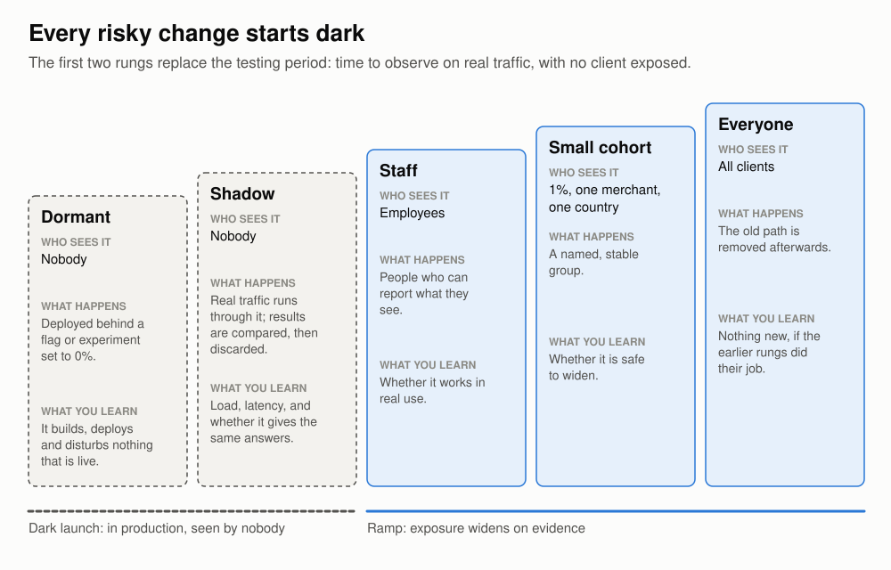
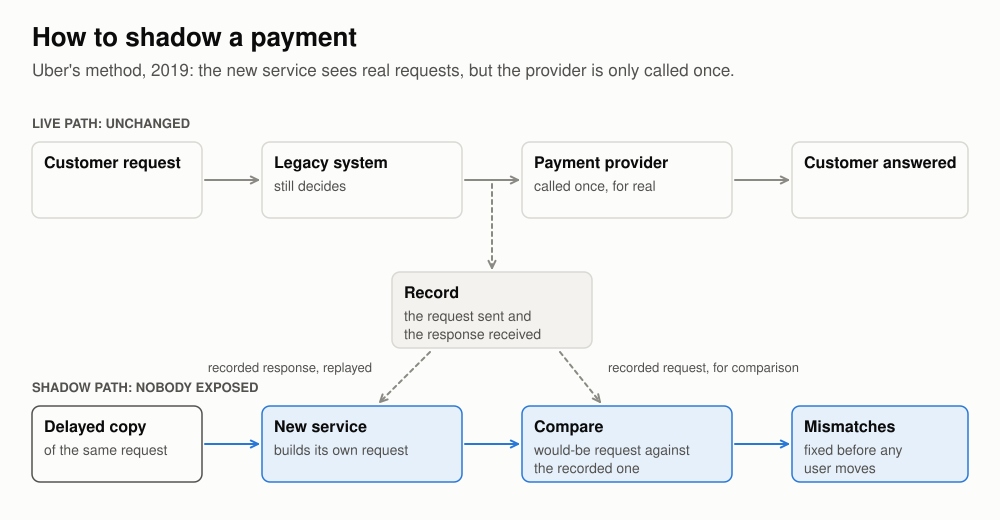

# Deploy every day, release when it is proven

## An assessment of the release-train model, with recommendations

## Summary

The business releases twice a week, and each release spends three days being promoted through environments and soaked before it reaches clients. This assessment finds that the model is sound on safety and expensive on speed: it imposes roughly five days of delay on every change regardless of risk, it forces changes into batches, and it cannot be made faster without weakening the protection it exists to provide.

The delay is a consequence of design. The model treats deploying code and releasing behaviour as a single event, so that all the caution has to be applied to the whole release at once. Firms that have separated the two, including firms that move money, deploy daily with new behaviour switched off and release each behaviour on its own, to a few clients first, on evidence. They develop substantially faster, and the best available evidence, including the UK regulator's, indicates that they do so without loss of stability.

I recommend that the business make the same change. The recommendations in the second half of this document are specific, and three matter most. Deployment should be separated from release, with every material change shipped disabled behind a flag. Each such change should be proven in production through a shadow run and a controlled ramp before it is released generally. Rollback should become a rehearsed, pre-authorised operation that the on-call engineer can execute without seeking approval. The tooling for all of this is well understood. The difficult part is the change in working practice it requires of engineers, managers, risk and audit, and the programme should be planned as a change of culture.

This assessment rests on the release model as described and on the published record of firms that have replaced it. It has not drawn on the business's own change and incident data, and the first recommendation is to assemble that data.

## Findings

### 1. Every change pays about five days, whatever its risk

A fix completed on a Wednesday morning reaches clients in the following week. It waits for the next train, which on a twice-weekly schedule is on average a little under two days away, and then spends three days in promotion and soak. The typical interval between finished and live is therefore about five days, and the worst case is seven. The interval is the same for a corrected label as for a change to the routing of outbound payments.

### 2. The delay degrades how software is developed

The cost is larger than the calendar time suggests. Finished work sits idle, and the engineer who wrote it has moved on by the time production shows whether it was right. Work larger than a few days is held on a branch that diverges from everyone else's, because it cannot join a train until it is complete. Each train carries half a week of unrelated changes, so that when a release misbehaves the first task is to establish which change is responsible.

Firms that have measured these effects report them plainly. Before Amazon automated its release process, code took an average of 16 days to travel from check-in to production, and for almost 14 of those days it was waiting for someone to start a build, perform a deployment or run a test.[^mansour] LinkedIn's mobile team, releasing monthly behind a four-day manual regression pass, saw engineers rush work in ahead of the cut-off because missing it cost a month.[^linkedin] Facebook measured the result of that behaviour and found that code pushed on the day of a release cut was of lower quality than code pushed on other days.[^rossi16] A schedule that penalises missing the train puts on board the changes that should have missed it.

### 3. The three days do real work and cannot be compressed within the model

The promotion period is not idle time to be trimmed. In a payments business it contains integration packs run against simulators for the payment schemes, a performance run and at least one batch cycle. The soak exists to cross boundaries that no short test reaches: sessions that fail only after hours of idleness, memory and file handles that creep, queues that deepen, the roll of the business date, and end-of-day jobs running on new code while online traffic continues. These are real classes of fault, and shortening the soak means ceasing to look for them.

Running the train daily with the same three days does not help. Three releases would be in promotion at any time, requiring three sets of environments and three times as many partner test windows. A fault found on the second day of one release would already be present in the two behind it. Every change would still wait three days and would still reach every client at the same moment.

### 4. The trade between speed and safety comes from coupling deployment to release

Within the present model, then, speed and safety do trade against each other, and the business has correctly chosen safety. The trade follows from one assumption built into the model: that code arriving in production and new behaviour reaching clients are the same event. Because they are the same event, the long hold has to be applied to the whole release, everything in the release waits for it, and everything written in the meantime queues behind it. Google's reliability handbook states the constraint exactly: "If you release daily, you can't let your canary last for a week while running only one canary deployment at a time."[^sre]

The assumption is not necessary. Code can be deployed with its new behaviour disabled behind a feature flag, so that it is built, deployed and running in production while no client observes any difference, and the decision to enable the behaviour is taken separately and later. This is established practice. Facebook ran its chat service on live traffic for two months in 2008 before any user could see it,[^letuchy] and by 2024 the handbook used by US bank examiners described canary releases as ordinary practice.[^ffiec]

### 5. Firms that separated the two kept their stability

The strongest evidence comes from financial services. In 2021 the Financial Conduct Authority published a review of how 23 financial firms had made more than a million production changes during 2019. It found that "firms that deployed smaller, more frequent releases had higher change success rates than those with longer release cycles". Of all changes, 1.6% failed. Of the changes that firms classed as major, which received additional oversight, 3.8% failed. Change advisory boards approved more than 90% of the major changes put before them, and at some firms rejected none during the year, which the FCA said "raises questions over the effectiveness of CABs as an assurance mechanism". Emergency changes, for which some of the normal assurance steps are expedited, led to a new incident 1.5% of the time, although the FCA notes that this may be partly because an incident was already open.[^fca]

These are associations, and they should be read with care. Major changes are riskier by definition, the FCA did not advise firms to disband their change boards, and it also found that firms describing more of their work as DevOps had a slightly higher failure rate, a result from which it drew no conclusion given the sample. The central finding stands nonetheless: a regulator examining regulated firms found failure concentrated in large changes and found no sign that heavyweight approval offset it.

The nearest thing to a controlled comparison is OANDA, a currency-trading platform that deployed to production continuously and also licensed the same software to large banks, whose policies forbade the practice and who therefore took it in periodic releases. The engineers who documented the experience report that each bank release bundled thousands of changes, that the resulting anxiety led to much more testing, that failures were harder to trace to a cause, and that bugs judged non-critical went unfixed for many months because a fix had to wait for a release.[^savor] On their account the same code, under the slower process, was harder to debug, less efficient to deliver and slower to repair.

Two further cases complete the picture. Between 2008 and 2014 Facebook's developers increased roughly twentyfold and its deployments grew with them, yet "the number of critical issues arising from deployments was almost constant regardless of the number of deployments"; the authors take this to show that quality can be managed under continuous deployment, and are careful elsewhere not to claim it as the cause of their results.[^savor] Netflix shows what a long hold can decay into. In 2012 its canaries ran for a week, and its engineers later wrote that they had been "devolving into verifying endurance (“nothing broke after one week of canarying, let’s push it”) rather than correct functionality".[^netflix] Surviving the week had become a substitute for evidence.

### 6. The evidence has limits, and they bear on how to proceed

I have found no bank or payments firm that has published its incident record from before and after it left release trains. The firms that describe releasing many times a day while moving money, Monzo and Starling among them, were built new, and I found no account from a firm with a mainframe core of taking its money-moving systems off a release train. The evidence therefore establishes that small, frequent and carefully exposed change is compatible with the stability a financial firm requires, and that the regulator's own data favours it. It does not establish what the business's own figures would be. That is a reason to proceed by measured stages, as recommended below, and not a reason to stay where it is.

## Recommendations

### 1. Establish the baseline before changing anything

The business should measure its present process against six questions. The answers will show how much there is to gain and will provide the benchmark against which every later step is judged.

1. Of the three days, for how many hours is something being done to the release, and for how many is it waiting for a window or a person?
2. What did the soak catch in the last year, by class of fault, and what reached production in spite of it?
3. How many changes were in the release behind each of the last five incidents, and how long did it take to identify the one responsible?
4. How many changes did the change board reject or send back last year?
5. How long did the last real rollback take, who authorised it, and had that path been rehearsed?
6. How do hotfixes, which bypass most of the three days, compare with train releases in failure rate?

If the soak proves to be catching faults that nothing else would, and most of the three days proves to be work, the gain will be smaller than this assessment expects, and the business should know that before it invests.

### 2. Separate deployment from release

Every material change should be written so that its new behaviour sits behind a flag that is off when the code ships. Deployment then becomes frequent and uneventful, because it changes nothing a client can see. Release remains a deliberate act, applied to one behaviour at a time and to as few clients as the business chooses, and can be more careful than it is today.

The build itself still needs a soak, because much of what a build contains cannot be placed behind a flag. A library upgrade, a new database driver, or a change to the runtime or a schema is a property of the binary as a whole, and these are the changes that produce slow leaks and exhausted connection pools. That soak should move into production. Amazon's pipeline places each build on a single machine, then in one region, then outward in waves, holding at each stage for at least one to twelve hours and until a minimum volume of real traffic has been served, and rolling back automatically if an alarm fires. Builds enter one after another, "so we don't end up with large bundles of changes waiting", and a change typically takes four or five business days to reach every region.[^liguori] The equivalent for the business is a daily build that bakes on a small slice of production through one daily peak and one batch window before it is promoted further. On that design a build is in production within a day of being cut, is judged against real traffic, and carries one day of changes where a train carries half a week's.

### 3. Prove each material change in production before releasing it

A change should climb a fixed ladder: disabled, then run in shadow, then exercised with real money at a synthetic client, then released to one consenting client, then widened. An example shows what each rung contributes. Suppose outbound account-to-account payments below a threshold amount are to be sent over the instant-payments rail, B, in place of the batch clearing rail, A.

Under the present model the change joins the next release, is exercised by the regression pack against simulators for both rails, passes through a performance run, a batch cycle, the soak and the change board, and then goes live for every client and every payment type in scope at once. Pre-production can establish that the messages are well formed and that the scripted rejection and timeout cases pass. It cannot establish how the receiving banks on rail B will respond to the real mix of payments. That is learned from production, all at once, with the fuller answer arriving in the next day's reconciliation, and if the release is backed out, the payments already sent over B still need their returns and reconciliation handled on B.

Under the recommended model the change begins with a design decision that the train never forces. The choice of rail is made once, when the payment is accepted, and is stored on the payment, so that every later event in that payment's life follows the stored choice and not the current position of the flag. The code then ships disabled in that day's build. In the shadow run the new rule computes, for all traffic, the rail it would have chosen, and that decision is logged beside what the old rule actually did, while nothing is sent over B. Within a day the team knows what share of payments would move and whether the rule behaves as intended across the real distribution of clients, amounts and destinations. This supplies most of what the soak was expected to reveal, from production's own traffic and with no client exposed.

A shadow run shows what would be sent and nothing about how the banks on B reply, so the next rung uses real money in small amounts: test accounts at a synthetic client in production send payments over B through acceptance, settlement, returns and reconciliation. Only then does a client that has agreed to go first receive the behaviour, for one type of payment and under a cap on the amount, with the stage held until those payments have settled and reconciled. Further payment types and clients follow, each stage held for at least one settlement cycle. Switching the flag off returns new payments to A, while the stored decision keeps existing payments on B until they complete, and because that reversal was rehearsed at the synthetic-client stage, its first use is not during an incident.

The routing change itself reaches every client later under this model, perhaps by several weeks. The engineer, however, has evidence from production the day after writing it, no client is exposed to an unproven rule, and every other change written that week ships without waiting. The gain in velocity comes from freeing the ordinary changes that would otherwise have queued behind the risky one.

Where money is involved, the shadow run is the decisive control, since a flag can reverse a decision and cannot reverse a payment. When Uber replaced the system that authorises its payments, it could not send each authorisation to the processor twice, so it recorded what the old system sent and received, ran delayed copies of real requests through the new service, and compared the request the new service would have issued with the one that had actually gone. The comparison surfaced "dozens of argument mismatches" before a single customer had been moved, after which Uber migrated its own employees, then a quarter of a percent of users, then one percent, then five, one payment method at a time.[^uber] Banks will recognise this as a parallel run, a practice regulators have written into capital rules: the US draft implementing Basel II required at least four quarters in which capital was computed the old way and the new way side by side.[^basel] The business should do the same thing routinely, for ordinary changes, with tooling that makes it cheap.

### 4. Ramp by client, with the client's consent

The unit of exposure should be the client and not a random share of traffic. Square learned this when it moved its payment records to a new service by random percentages of requests. Its engineer wrote afterwards that the method had concealed a regression which appeared only for a particular combination of client software versions, and which a rollout held stable per merchant would have confined to a few.[^square] Where the clients are themselves banks, with their own notice periods and sign-off, the first cohort must be a client that has agreed to go first, and changes to the interface that clients see must remain on agreed dates. What the business may ramp at its own pace is behaviour behind an interface that does not change.

### 5. Make rollback routine and pre-authorised

On a release train the way back is a back-out plan in a change record, and such plans fail when they are first used in earnest. RBS backed out an upgrade to its batch scheduler in June 2012, and the back-out itself caused the incident, because the bank "had only tested the consequences of backing out Version 2 to Version 1" whereas what had been installed was a patched variant, Version 2A. More than six million customers were affected.[^rbs]

The business should therefore treat rollback as an ordinary operation. Google advises its customers to roll back first and investigate afterwards, and to perform a rollback deliberately if several weeks have passed without one.[^hilton] Amazon tests the operation explicitly, deploying to half a fleet in a production-like environment under simulated traffic, completing the deployment and then rolling it back.[^pokkunuri] What is restored should be the previous build exactly as it ran, retained under its hash, and never a fresh build from older source. Rollback to that build, and switching a flag off, should be pre-authorised actions that the on-call engineer may take without seeking approval, subject to written rules for the occasions on which rollback is the wrong response, such as within a cut-off window or after messages have left the building.

### 6. Govern flags as controlled changes with a defined lifetime

Flags are cheap to add and expensive to keep. Every flag that is on for some clients and off for others means that production is running more than one system, whereas the regression pack and the scheme certification each tested one. Every change made near a live flag has to work in both states. The old path, which is the fallback, ceases to be exercised on the day the flag reaches every client, so that switching it off thereafter is an untested change. Chrome's flags grew from 263 to 1,040 over the releases examined in one study, and Uber eventually built a tool to delete stale flags, which removed 1,381 of them.[^rahman][^piranha]

Knight Capital shows what a neglected flag can do. In 2012 Knight reused a flag that had formerly activated a function retired in 2003, left that function in the code, and copied its new software to seven of its eight order-routing servers without anyone checking the eighth. When orders carrying the flag arrived, the eighth server executed the old function, and Knight lost more than $460 million in about 45 minutes. The instructive detail is that the new code had been going onto production servers for five days and, as far as the SEC's order records, nothing had gone wrong, because nothing was yet using it.[^knight] Time in production proved nothing about a path that was never exercised, and a soak would have proved as little. A Google Cloud outage in June 2025 had the same shape: code rolled out region by region, never exercised, and then triggered everywhere at once by a policy change.[^google]

Each flag should accordingly have an owner, a recorded purpose, a ramp plan with stop conditions, and a removal date. It should never be reused. The author of a change should be responsible for deciding what the flag guards and how the disabled state behaves, for building the shadow comparison, and for removing the flag once the ramp is complete. This is more work per change than a train requires, and it obliges engineers to plan for being wrong. Microsoft's experimentation group, after three years spent trying to spread a related habit, observed that most goals in the company were still framed around shipping, and doubted that it had altered many people's objectives.[^kohavi] The business should expect the same resistance and should change what code review asks for, what counts as finished, and what is recognised when performance is assessed.

### 7. Give the authoring team ownership, including the pager

The team that writes a service should deploy it and be paged for it. Netflix found that the intermediate arrangement left gaps: where developers could deploy but a release specialist remained, the developers deferred to the specialist, and the specialists found it hard to make time to automate the work. It also found that full ownership without tooling, training and slack risked burnout.[^netflix] The recommendation therefore carries a condition, which is that the platform and the training are funded first.

This does not make testers or release managers redundant. The comparison tooling has to be built, the pipeline owned and the ramp plans reviewed, and the people best placed to do that work are those who already know where faults hide. None of the accounts I read gives figures for how roles changed, and the business should address the question openly and early.

### 8. Rewrite the change policy with risk and audit, and keep named approvers

Approval should be relocated, not removed. Starling Bank was releasing up to five times a day in 2018 with a step in which each engineer vouched in chat for their own commits and with a visible release-in-progress signal, of which its engineers remarked that "our auditors loved this one".[^starling18] In 2025 it still required three approvals for every release, the last of them a "Business Approval" from an engineering lead, director or executive, while releasing several times a day.[^starling25]

The rule texts I have read ask for a recorded change, proportionate testing, an authorised approver (in some texts explicitly someone other than the author) and a way back. Some go further, and Singapore's guidelines expect a change advisory board and independent quality assurance. None of them asks for three days.[^rules] Auditors, however, test a firm against its own change policy, and that policy describes the process the firm has today. Risk and audit should therefore be engaged as co-authors of the new policy from the outset. They will need to define what a flag change is: who may make one, who approves it, how its state on a given date is evidenced, and what constitutes an emergency. A firm in which a developer can enable money-moving behaviour for a client with no record and no second person has recreated the conditions at Knight.

### 9. Keep a pre-production hold where a ramp does not fit

Some changes should stay on the present model. A ledger schema change cannot be hidden behind a flag: the schema must be widened, written both ways, backfilled, compared and switched before it is narrowed, and since the narrowing is irreversible it warrants a rehearsal on a production-sized copy. A new settlement file reaches a counterparty whole, at a cut-off, and cannot be sent to one percent of them, so old and new should be generated in parallel through several cycles, including a period end, and compared. Scheme mandates take effect on the schemes' dates. None of these is a candidate for a ramp.

### 10. Begin with one pilot, and expect the programme to take years

The business should start with a single service that it owns outright, with no vendor package or mainframe component in its path. The change policy for that service should be agreed with risk and audit before any code moves. One client should be recruited to go first. The pilot should run alongside the train for two quarters, with the six baseline measures counted throughout and the conditions for stopping agreed in advance. A pilot on that scale occupies a small team.

The wider programme is a larger undertaking, and the published accounts are consistent about that. OANDA spent two years perfecting continuous deployment for its mission-critical trading systems and at the time of writing had about 15% of its engineers working on tooling. It also records a failure that "cost the company a significant amount of money within seconds", after which senior management's first instinct was to demand more approvals and "a full-blown, separate and traditional testing team". The post-mortem established that unit tests had caught the bug and that their failures had been disregarded among false alarms, and the remedy the engineers secured was to make the test results part of the decision to deploy. Separately, when executives more inclined to traditional process took over in mid-2012, deployments fell by 23% although the engineering team was much the same.[^savor] The practice depends on leadership that holds its course after a failure.

Microsoft's Azure DevOps group gives the most candid account of the duration. On the morning of a major launch in 2013 the team enabled a batch of flags, the service became unresponsive at peak, and disabling the flags did not restore it. Among the lessons that Brian Harry, who ran the group, drew from the episode was that "all customers are affected or none", and within months the team had stood up a first ring, a separate instance for accounts that volunteered for the risk, on which every deployment would land first.[^harry13][^harry14a] A year later an outage ran on for approximately 45 minutes while the team worked out how to turn off the flag behind it,[^harry14] and the rebuilding of the group's tests took more than two years. Looking back over six, Harry wrote: "If we'd tried to do it all at once. I'm sure we would have failed."[^harry17] The business should take that as the planning assumption: a sequence of bounded steps, each measured against the baseline, with the release train kept running until the evidence from its own systems justifies retiring it.

## Sources

The research behind this is in [the synthesis report](reports/Testing%20gates%20to%20ramping%20culture.md) and [the research notes](research_notes/Testing%20gates%20to%20ramping%20culture/). Reviews of the previous draft are in [reviews/essay-v2](reviews/essay-v2/).

[^mansour]: Mark Mansour, [Going faster with continuous delivery](https://aws.amazon.com/builders-library/going-faster-with-continuous-delivery/), Amazon Builders' Library, 2019. The measurement was taken more than ten years earlier.
[^linkedin]: Drew Hannay, [3x3: Speeding up mobile releases](https://engineering.linkedin.com/blog/2016/02/3x3--speeding-up-mobile-releases), 2016.
[^rossi16]: Rossi et al., [Continuous Deployment of Mobile Software at Facebook](https://www.eecg.toronto.edu/~stumm/Papers/Rossi-FSE-16.pdf), FSE 2016.
[^letuchy]: Eugene Letuchy, [Facebook Chat](https://engineering.fb.com/2008/05/13/web/facebook-chat/), 2008, and [Erlang at Facebook](https://www.erlang-factory.com/upload/presentations/31/EugeneLetuchy-ErlangatFacebook.pdf), 2009, slides 11–12.
[^ffiec]: Federal Financial Institutions Examination Council, [Development, Acquisition, and Maintenance](https://business.cch.com/BFLD/FFIEC-IT-DevelopmentAcquisitionMaintenance-Hankbook-08292024.pdf), IT Examination Handbook, 2024.
[^sre]: Google, [Canarying Releases](https://sre.google/workbook/canarying-releases/), *The Site Reliability Workbook*.
[^liguori]: Clare Liguori, [Automating safe, hands-off deployments](https://aws.amazon.com/builders-library/automating-safe-hands-off-deployments/), Amazon Builders' Library, 2020.
[^fca]: Financial Conduct Authority, [Implementing technology change](https://www.fca.org.uk/publications/multi-firm-reviews/implementing-technology-change), 2021, on 2019 data.
[^savor]: Savor et al., [Continuous Deployment at Facebook and OANDA](https://www.eecg.toronto.edu/~stumm/Papers/Savor-ICSE16.pdf), ICSE 2016 Companion.
[^netflix]: Netflix Technology Blog, [Full Cycle Developers at Netflix](https://netflixtechblog.com/full-cycle-developers-at-netflix-a08c31f83249), 2018.
[^uber]: Gajera and Blinn, [Migrating Functionality Between Large-scale Production Systems Seamlessly](https://www.uber.com/blog/migrating-functionality-between-production-systems), Uber, 2019.
[^basel]: US banking agencies, [Basel II interagency draft notice of proposed rulemaking, section 3](https://www.federalreserve.gov/GeneralInfo/Basel2/DraftNPR/NPR/section_3.htm), 2006, hosted by the Federal Reserve.
[^square]: Zachary Anker, [Breaking up with your MonoRail](https://developer.squareup.com/blog/breaking-up-with-your-monorail/), Square, 2016.
[^rbs]: Financial Conduct Authority, [Final Notice to RBS, NatWest and Ulster Bank](https://www.fca.org.uk/publication/final-notices/rbs-natwest-ulster-final-notice.pdf), 2014.
[^hilton]: Adrian Hilton, [Reliable releases and rollbacks: CRE life lessons](https://cloud.google.com/blog/products/gcp/reliable-releases-and-rollbacks-cre-life-lessons), Google Cloud, 2017.
[^pokkunuri]: Sandeep Pokkunuri, [Ensuring rollback safety during deployments](https://aws.amazon.com/builders-library/ensuring-rollback-safety-during-deployments/), Amazon Builders' Library, 2019.
[^rahman]: Rahman et al., [Feature Toggles: Practitioner Practices and a Case Study](https://users.encs.concordia.ca/~pcr/paper/Rahman2016MSR.pdf), MSR 2016.
[^piranha]: Ramanathan et al., [Piranha: Reducing Feature Flag Debt at Uber](https://manu.sridharan.net/files/ICSE20-SEIP-Piranha.pdf), ICSE 2020.
[^knight]: Securities and Exchange Commission, [In the Matter of Knight Capital Americas LLC](https://www.sec.gov/litigation/admin/2013/34-70694.pdf), Release No. 70694, 2013.
[^google]: Google Cloud, [incident report for 12 June 2025](https://status.cloud.google.com/incidents/ow5i3PPK96RduMcb1SsW).
[^rules]: The FFIEC handbook cited above, the European Banking Authority's guidelines on ICT risk, the EU's Digital Operational Resilience Act, and the Monetary Authority of Singapore's technology risk guidelines. Section-by-section notes are in [audit_and_compliance.md](research_notes/Testing%20gates%20to%20ramping%20culture/audit_and_compliance.md).
[^kohavi]: Kohavi, Crook and Longbotham, [Online Experimentation at Microsoft](https://exp-platform.com/Documents/ExP_DMCaseStudies.pdf), 2009.
[^starling18]: Jason Maude, [Building a Reliable Cloud Bank in Java](https://archive.qconlondon.com/system/files/presentation-slides/qcon_2018.pptx.pdf), Starling Bank, QCon London 2018 slides.
[^starling25]: Moore and Mak, [How we made everyone a release engineer](https://technology.starlingbank.com/blog/how-we-made-everyone-a-release-engineer), Starling Bank, 2025.
[^harry13]: Brian Harry, [A Rough Patch](https://devblogs.microsoft.com/bharry/a-rough-patch/), 2013.
[^harry14a]: Brian Harry, [Visual Studio Online update, Feb 10](https://devblogs.microsoft.com/bharry/visual-studio-online-update-feb-10/), 2014.
[^harry14]: Brian Harry, [Outage on Monday Nov-24](https://devblogs.microsoft.com/bharry/outage-on-monday-nov-24), 2014.
[^harry17]: Brian Harry, [How we approach testing VSTS to enable continuous delivery](https://devblogs.microsoft.com/bharry/testing-in-a-cloud-delivery-cadence/), 2017.
