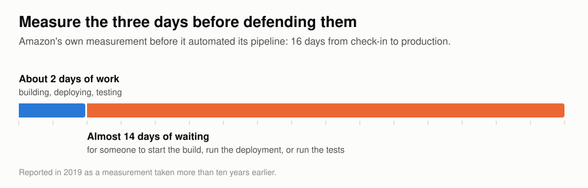
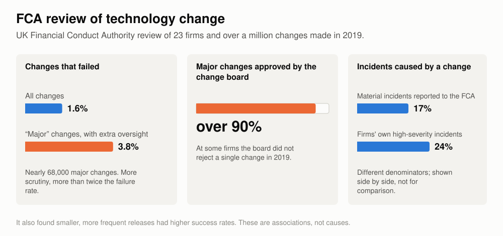
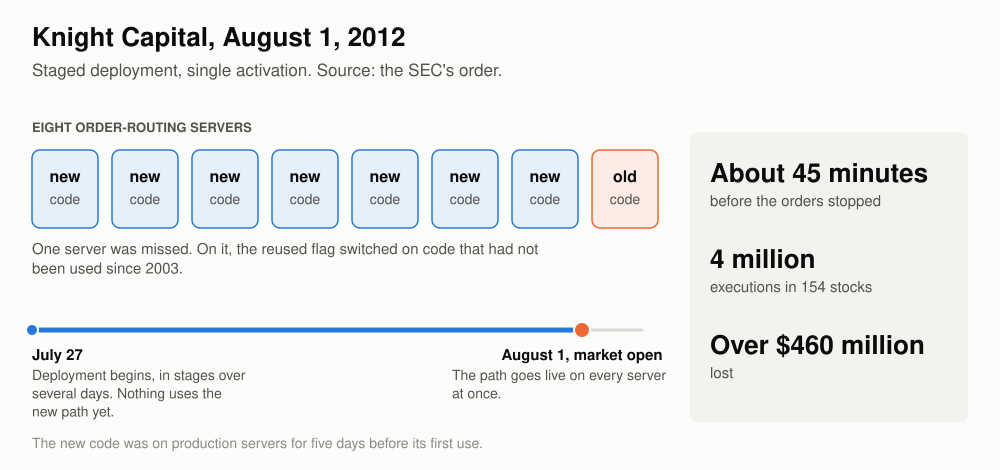

# Moving off the release train

*Why engineering teams should replace testing periods and scheduled releases with dark launches, feature flags, staged rollouts, and fast rollback.*

Some engineering organizations still deliver software through a release train: changes accumulate into a scheduled release, which is promoted through test environments, held in pre-production for a soak period, approved, and then released to every user at once. They should replace it with the model now used at most large internet companies, in which small changes reach production every day with their new behavior disabled, and each behavior is then released separately, in stages that can be reversed. The train delays every change by days regardless of its risk, and the safety it provides is narrower than it appears; separating deployment from release removes that trade-off, provided the supporting practices, both the tooling and the changes in who owns what, are adopted in full.

To **deploy** is to put code into production, to **release** is to expose new behavior to users, and a **train** is a scheduled bundle that does both at once.

## Structure of the article

- [The release train](#the-release-train) describes how a scheduled release works, what its soak period finds, and what it costs in lead time and batching.
- [How the industry got here](#how-the-industry-got-here) traces the published accounts from continuous integration and online experiments to continuous deployment at large internet companies and in regulated industries.
- [Separating deployment from release](#separating-deployment-from-release) explains feature flags, where a flag is read, the kinds of flag, and the changes a flag cannot guard.
- [The techniques](#the-techniques) covers dark launches and shadow traffic, canaries, rings and ramps, shared state and aggregate jobs, experiments, rollback, and deployment windows and freezes, with the limits of each.
- [Changes with effects that cannot be undone](#changes-with-effects-that-cannot-be-undone) covers changes whose effects, such as a payment sent or a message delivered, no rollback can reverse.
- [Changes that depend on an outside party](#changes-that-depend-on-an-outside-party) covers changes whose date and testing are set by a partner, a standards body or a payment scheme.
- [Ownership and culture](#ownership-and-culture) describes what changes for authors, service owners, testers, release managers and approvers, and how organizations have responded to failure.
- [Failure modes](#failure-modes) collects published failures that came from adopting only part of the model.
- [Data and models](#data-and-models) covers changes to tables, event streams, feature stores and machine-learning models, where state persists after a rollback.
- [Change control and audit](#change-control-and-audit) sets out what change-management rules and auditors require and how flag changes can be classified.
- [Evidence](#evidence) weighs the engineering record for and against the model.
- [What should change](#what-should-change) lists the changes in practice.
- [Getting started](#getting-started) covers measurement, a first service, stop conditions, cost and expansion.
- [Appendix: regulation of software change](#appendix-regulation-of-software-change) summarizes what regulators and audit frameworks accept and require, with notes by jurisdiction.
- [Appendix: tool support for data changes](#appendix-tool-support-for-data-changes) lists the tools that support each step of a data change.

## The release train

### How it works

A release train runs on a schedule, which may be monthly, weekly, or several times a week. Everything merged since the previous cut is bundled into a release candidate. The candidate is promoted through a series of environments, typically integration, performance and pre-production, with automated and manual tests at each stage. It is then held in pre-production for a fixed soak period, approved by a change board, and released in a scheduled window.

Microsoft's product teams in the 1990s [built daily and stabilized at milestones](https://www.cs.umd.edu/~atif/Teaching/Spring2003/cusumano.pdf) that were months apart, whereas Facebook's website shipped [a weekly release](https://people.engr.tamu.edu/pcr/courses/csce431/fall19/reading/FacebookDevelopment.pdf), cut on Sunday and pushed on Tuesday, into the 2010s.

The running example is a schedule of two trains a week, each taking three days from cut to release. On the first day the candidate is deployed to an integration environment and an automated regression pack runs against simulators for external dependencies, a few hours of machine time, much of which could run in parallel. The second day is a performance run, usually preceded by an environment reset and a data refresh that take longer than the test itself, followed by an overnight batch cycle. The third day goes to evidence assembly, change approval and the wait for a release window.

Only part of that time is work; the remainder is spent waiting for an environment, an approver, or a release window. When Amazon measured its own pipeline, before automating it, code took an average of 16 days to get from check-in to production, and for almost 14 of those days it was [waiting for someone to start a build, perform a deployment or run a test](https://aws.amazon.com/builders-library/going-faster-with-continuous-delivery/). A twice-weekly train has a far better ratio, but on the breakdown above the work is unlikely to come to more than one day of the three.



### The purpose of the soak

A soak finds faults that appear only with elapsed time or at a boundary, which short tests and short canaries do not reach. They include:

- database and message-queue connections that only misbehave after hours of idleness
- memory, file handles and log volumes that creep
- queues that slowly deepen
- date rollovers and other time-triggered work
- batch jobs running to completion on new code while online traffic continues
- a release that no longer holds peak throughput

Some of what happens in the three days has to be preserved in any replacement:

- one full batch cycle on the new code
- one daily peak, because capacity regressions do not appear at low traffic
- test windows with external partners, which run on the partner's calendar
- a second person's judgment on any high-risk change

### Lead time

With two evenly spaced trains a week, a finished change waits about 1.75 days on average for the next one and then spends three days in promotion. The total is about five days from finished to live, or six and a half for a change that has just missed a train, and the wait is the same for a one-line fix as for a change to core business logic.


The table below applies the five-day figure to the kinds of work a team does. The right-hand column is an estimate of the same work once deployment and release are separated.

| Kind of work | On the train | Deployed daily, released separately |
| --- | --- | --- |
| An ordinary change | About 5 days from finished to live | In production the next business day, on every node the day after |
| A fault found in production | 5 days, or a hotfix that skips most of the three days | The same as an ordinary change, through the normal path |
| A feature that needs three rounds of feedback from production | About 15 days of waiting | About 3 days |
| A high-risk change | 5 days, then every user at once | Evidence from production the next day; full release in four to eight weeks |

The last row shows a high-risk change deliberately taking longer under the new model. The gain comes from the other three rows, where ordinary work no longer queues behind the risky change.

The hotfix path shows that the three days are sometimes more than a change needs, and it means that the changes made under the most pressure receive the least verification.

### Batching

The second cost of the train is that each release carries half a week of other people's changes, so when a release misbehaves, the first job is to work out which change caused it.

A schedule with a cut-off also changes how people behave near it. LinkedIn's mobile team, releasing monthly behind a four-day manual regression pass, [described engineers rushing code in before the deadline](https://engineering.linkedin.com/blog/2016/02/3x3--speeding-up-mobile-releases) because missing it cost a month. Facebook measured the result on its own mobile releases and found that code pushed on the day of the cut was [of lower quality than code pushed on other days](https://www.eecg.toronto.edu/~stumm/Papers/Rossi-FSE-16.pdf). A train that leaves twice a week creates the same incentive, presumably weaker, since missing it costs half a week instead of a month.

Batching also keeps unfinished work out of the main branch. A change that takes three weeks cannot board a train until it is complete, so it lives on a branch and drifts from everyone else's work until it is merged.

The clearest account of what large batches do comes from OANDA, a currency-trading platform. OANDA deployed its own platform continuously, and also licensed the same software to large banks whose policies did not allow continuous updates, so the banks took it in periodic releases. In [a paper written with Facebook engineers](https://www.eecg.toronto.edu/~stumm/Papers/Savor-ICSE16.pdf), the authors report that each release to the banks bundled thousands of changes, that the size of the release raised anxiety and led to much more extensive testing, that failures were significantly harder to isolate, and that bugs judged non-critical went unfixed for many months because a fix had to wait for a release.

### Why the train cannot simply run faster

One obvious remedy is to shorten the three days, but that means cutting the soak and therefore no longer looking for the faults the soak finds.

The other is to run the train daily with the same three days, which does not work either, because three trains are then in promotion at once. That arrangement needs three sets of environments and three times the partner test windows. A fault found on the third day of one train is already in the two behind it. Every change still waits three days, and every release still reaches every user in the same instant.

Within the train model speed and safety trade against each other because the train deploys and releases in one act, so the caution that a risky change deserves is applied to every change on the train.

Google's Site Reliability Workbook states the constraint directly: ["If you release daily, you can't let your canary last for a week while running only one canary deployment at a time."](https://sre.google/workbook/canarying-releases/)

### Limits of pre-production testing

A soak does not detect faults that depend on the behavior of real dependencies, on code paths that are not yet in use, or on conditions that have not yet occurred.

A soak cannot show how real dependencies behave, because pre-production talks to simulators and stubs. A simulator can confirm that a request is well formed and that scripted error and timeout cases are handled, but it cannot show how a real third party responds to real traffic.

A soak also cannot find a fault on a code path that nothing exercises, because time in an environment proves nothing about code that is not being called. Knight Capital's new order-routing code went onto its production servers in stages from July 27, 2012, five days before it was first used. The [SEC's order against the firm](https://www.sec.gov/litigation/admin/2013/34-70694.pdf) records no incident in that time, because nothing was yet using the code, and a three-day soak would have observed no more than those five days in production did.

Elapsed time in any environment also does not find a fault whose trigger has not yet occurred. Stripe's outage of July 2019 came from a database version that had [passed testing, a phased rollout and about three months in production](https://stripe.com/rcas/2019-07-10) before a rare combination of conditions exposed it.

Staging environments differ from production in the data they hold. In April 2022 Atlassian ran a maintenance script that had been tested in staging under its normal change process and peer reviewed. It deleted the sites of 775 customers, some of whom were locked out for up to 14 days. [Atlassian's review](https://www.atlassian.com/engineering/post-incident-review-april-2022-outage) explains that staging could not have caught it, because the identifiers that triggered the fault did not exist there.

A long wait can also lose its purpose. Looking back at 2012, Netflix's engineers [wrote that their week-long canaries](https://netflixtechblog.com/full-cycle-developers-at-netflix-a08c31f83249) were "devolving into verifying endurance (“nothing broke after one week of canarying, let’s push it”) rather than correct functionality".

The FCA's evidence suggests that the size of a change matters more than the scrutiny it receives. In 2021 the UK's Financial Conduct Authority published [a review of how 23 financial firms had made more than a million production changes](https://www.fca.org.uk/publications/multi-firm-reviews/implementing-technology-change) during 2019. Changes the firms classed as major, which generally received more oversight, failed at 3.8%, against 1.6% for changes as a whole. Change advisory boards approved more than 90% of the major changes they reviewed, and at some firms did not reject a single one all year. The FCA's own summary was that "firms that deployed smaller, more frequent releases had higher change success rates than those with longer release cycles".



The figures are associations from a regulator's review of regulated firms and do not control for the fact that major changes are riskier by nature, and the review also found a slightly higher failure rate at firms that described more of their work as DevOps, on a sample too small to support a conclusion.

## How the industry got here

The practice grew out of two separate lines of work that met around 2008, and the figure below shows the main published accounts in order.


### Integration and experiments

The first line concerned merging, and in 2000 Martin Fowler and Matthew Foemmel wrote up [continuous integration](https://martinfowler.com/articles/originalContinuousIntegration.html). Under that practice everyone merges to one branch about once a day, and an automated build and test run tells them quickly whether their work fits together. It solved the problem of changes that had diverged for too long, but it did not address putting each change into production.

The second line concerned exposure, and it came from web companies that had learned to show a change to some users and not to others, and to measure the difference. By 2007 Ron Kohavi and colleagues at Microsoft were recommending, in [a guide to running experiments](https://exp-platform.com/Documents/GuideControlledExperiments.pdf), that a new treatment start with a small share of users, ramp up gradually, and be shut off automatically if it did harm, a safety mechanism set out in a paper about measurement.

Google's search team built the connection between measurement and safety into its infrastructure. Its [2010 paper on experiment infrastructure](https://research.google/pubs/overlapping-experiment-infrastructure-more-better-faster-experimentation/) describes a system first deployed in 2007 in which code shipped in binary pushes, while experiments and launches were controlled by separate, faster pushes of data and configuration. A feature moved through a canary, an experiment and a gradual launch before it became the default, so the binary and the behavior were already on different schedules.

### Dark launches and flags

In 2008 Facebook used the same separation for load. Two months before anyone could use Facebook Chat, the site's pages began [connecting to the new chat servers](https://engineering.fb.com/2008/05/13/web/facebook-chat/) and sending simulated messages, so that the backend carried production load while no interface was visible, which Facebook called a dark launch. Visible rollout began on April 6 and reached everyone on April 23, according to [Eugene Letuchy's later slides](https://www.erlang-factory.com/upload/presentations/31/EugeneLetuchy-ErlangatFacebook.pdf).

Frequent deployment with flags became public vocabulary in 2009, when John Allspaw and Paul Hammond gave a talk at the Velocity conference called [10+ Deploys Per Day](https://paulhammond.org/2009/06/velocity/10deploys.pdf) about Flickr. Later that year Ross Harmes described [how Flickr used feature flags](https://code.flickr.net/2009/12/02/flipping-out/), with everyone working on the main branch, the site deploying several times a day, and unfinished features sitting in production switched off. Timothy Fitz described [IMVU deploying about fifty times a day](https://timothyfitz.com/2009/02/10/continuous-deployment-at-imvu-doing-the-impossible-fifty-times-a-day/) behind an automated test suite, with deployment to a subset of machines first and automatic rollback.

Wealthfront is an early example from regulated finance. In 2010 the firm, which is regulated by the SEC, described [a deployment system](https://eng.wealthfront.com/?p=1273) in which the engineer who committed a change released it, the rollout went to one instance first and then outward, and an instance that failed its start-up self-test triggered a rollback that took about five seconds across a cluster of ten machines.

### Scale, and the first hard lessons

From 2012 the published accounts describe larger systems and are more open about failures. Facebook published a paper in 2015 on [how it managed configuration](https://sigops.org/s/conferences/sosp/2015/current/2015-Monterey/008-tang-online.pdf), which describes engineers who "release the new code into production early but in a disabled mode, and then use Gatekeeper" to widen exposure, and which acknowledges that configuration changes were causing a significant share of incidents and needed canaries of their own.

By 2017 Facebook's website had moved from scheduled pushes to [deploying continuously from the main branch](https://engineering.fb.com/2017/08/31/web/rapid-release-at-massive-scale/), and in 2020 Amazon published [a detailed description of its deployment pipelines](https://aws.amazon.com/builders-library/automating-safe-hands-off-deployments/).

### Regulated industries

Companies in regulated industries came later, and the first of them to write about working this way were built new. Starling Bank [told a conference in 2018](https://archive.qconlondon.com/system/files/presentation-slides/qcon_2018.pptx.pdf) that it released to production up to five times a day, and Monzo described [more than a hundred deployments a day](https://monzo.com/blog/2022/05/16/how-we-deploy-to-production-over-100-times-a-day) in 2022 and, later that year, [automated rollback across more than 2,100 services](https://monzo.com/blog/2022/11/02/argo-rollouts-at-scale). Financial supervisors in France, the United States and the European Union have since published texts that accept frequent, automated change, under conditions on approval, testing and records that are summarized in the [appendix on regulation of software change](#appendix-regulation-of-software-change).

## Separating deployment from release

### The idea

A change is written so that its new behavior sits behind a feature flag, and the flag is off when the code ships. The code is built, deployed and running in production alongside everything else, and no user sees anything different. Turning the behavior on is a separate decision, taken later, for whichever users are chosen.

Deployment can then be frequent and uneventful, because deploying disabled code is meant to change nothing a user can see. Release stays deliberate, and can be more careful than it is on a train, because it applies to one behavior at a time and to as few users as required. The long wait then applies to the one behavior that needs watching, and every other change proceeds without waiting for it.


### Flag evaluation

At its simplest a flag is a conditional that reads a value from configuration and runs the new code or the old code depending on the answer. Where each request stands alone, the flag can be read afresh on every request. Where a unit of work outlives a request, the point at which the flag is read and the behavior when the flag service is unavailable both need more care.

An order can run through fulfilment and returns for weeks, an insurance claim can stay open for months, and a payment passes through acceptance, submission, confirmation, returns, recalls, status inquiries and postings over days or months. If each of those steps reads the flag again, switching the flag partway through strands the work between two behaviors. The decision therefore has to be made once, when the work is accepted, and stored with its record. For a payment, the decision is the rail it will travel on:

```python
# At acceptance: decide once and record the decision.
payment.rail = decide_rail(payment)   # reads the flag here, and only here
ledger.record(payment)

# Everywhere else: follow the stored decision, never the flag.
gateway_for(payment.rail).submit(payment)
```

Downstream services follow the stored decision and do not read the flag again. A release train has the same hazard for work in flight when a release goes out, but a ramp that moves back and forth makes it routine, so the decision has to be stored.


An operator can still move work that is in flight, for example payments waiting on a payment rail that has failed, but does so through an explicit operation that rewrites the stored decision for the records it names, with its own approval and audit entry, and never by re-reading the flag. Because the decision is stored, discrepancies found later, such as reconciliation breaks, failed refunds or short shipments, can also be grouped by the path that produced them.

When the flag service is unavailable, a web feature can default to "off" without harm. Where some users have already been moved to the new behavior, a default of "off" would silently send their new orders or payments down the old path, and then down the new one again when the service recovered. The safer rule is to fall back to the last known value, and to the old behavior only when there is not one.

### Kinds of flag

Pete Hodgson's article on [feature toggles](https://martinfowler.com/articles/feature-toggles.html) separates four kinds of flag, which differ in how long they should live.

- Release flags hide unfinished or unproven behavior. Hodgson's guidance is that they should not stay much longer than a week or two.
- Experiment flags split users between variants to measure a difference. They live as long as the experiment.
- Operational flags, including kill switches, let operators turn something off under load or during an incident. Some of these are permanent.
- Permission flags give a behavior to particular customers as a matter of product, and are long-lived by design.

The model rests mainly on release flags. The other kinds use the same machinery, which is part of why flags accumulate.

### Canaries, ramps, and experiments

Canaries, flag ramps and experiments follow the same loop, in which a subset is exposed and compared with the rest, and the exposure is then widened or reverted. They differ in what varies, who is exposed and the question being asked.

| | Canary | Flag ramp | Experiment |
| --- | --- | --- | --- |
| What varies | The binary | One behavior inside the binary | One behavior inside the binary |
| Who is exposed | Some machines | Some users or accounts | Randomly chosen users or accounts |
| The question | Is it broken? | Is it broken? | Is it better? |

The same infrastructure therefore usually serves all three. Google's experiment system was also its launch system. [LinkedIn's experimentation platform](https://www.linkedin.com/blog/engineering/ab-testing-experimentation/xlnt-platform-driving-ab-testing-linkedin) ramps features independently of code releases. Uber built [automated rollouts with regression detection](https://www.uber.com/us/en/blog/autonomous-rollouts-regression-analysis/) on top of its experiment platform.

Wherever rules on the fair treatment of customers apply, as in lending, insurance, hiring or healthcare, the important difference is the question in the last row of the table. A safety ramp intends the same outcome for every customer and limits exposure in case something is wrong, whereas a product experiment deliberately gives customers different variants to learn which is better. The experiment raises questions about fair treatment that the ramp does not. A ramp that is described as an "experiment" attracts objections that apply only to real experiments, so the distinction should be stated explicitly, especially to risk and compliance.

### Changes a flag cannot guard

Some changes in a build cannot sit behind a flag. A library upgrade, a new database driver, a change to the runtime or a container base image belongs to the binary as a whole. Changes of this kind are the ones that leak memory and exhaust connection pools, which are the faults a soak exists to find.

The binary therefore still needs time under load, and under the new model it gets that time in production. The build goes to a small part of production first and stays there through a daily peak before it goes wider. This wait in production is usually called a **bake**, to distinguish it from a soak in pre-production.

In Amazon's pipeline, which is the best-documented example, each build goes to a single machine, then to one region, then outward in waves. Each stage has a minimum wait of between one and twelve hours and a minimum amount of real traffic that must be served before the build moves on. An alarm rolls the build back automatically. A change typically takes [four or five business days to reach every region](https://aws.amazon.com/builders-library/automating-safe-hands-off-deployments/).

Amazon's elapsed time is therefore no shorter than a three-day soak. The differences are that builds enter the pipeline one after another, each carries only the changes made since the last, and the waiting is done on real traffic at limited exposure.

Daily deployment also restarts every process every day, so a slow leak may not show until a change freeze leaves a build running for two weeks. For runtime and library upgrades a deliberate multi-day bake should be retained, and it need not hold up the daily deployment of application code. The upgrade goes to a small part of the fleet and stays there for the length of the bake, while that part keeps taking each day's application build, built on the new runtime, so that application changes reach it on the same schedule as the rest of production. Those daily builds still restart the processes, however, so a leak that appears only in a process left running for days would need a few hosts held back from daily deployment until the bake ends, an arrangement proposed here rather than taken from a published pipeline.

## The techniques

A testing period looks for regressions, exercises load and elapsed-time behavior, gives people a chance to accept the change, bundles approval, and provides a back-out point. Dark launches, canaries, ramps, experiments and rollback each take over part of that work, and each has limits that its own practitioners describe.

### Dark launches and shadow traffic

"Dark launch" refers both to dormant code and to shadow runs.


Dormant code is deployed behind a flag that is off. It has been merged, built and deployed, and has been shown not to disturb what is live, but nothing calls it. Dormancy allows unfinished work to merge to the main branch every day. Netflix used it to stop acceptance testing from blocking deployment, and the feature [stayed disabled in production](https://netflixtechblog.com/preparing-the-netflix-api-for-deployment-786d8f58090d) while testing continued.

In a shadow run, real traffic passes through the new code, the result is compared with what the old code produced, and the result is then discarded without any user seeing it. A shadow run tests correctness against real traffic and real data, which a soak against simulators cannot do. It reaches faults that need elapsed time only if it runs long enough at real volume, and it does not reach side effects or faults in the binary as a whole, which remain the work of the bake.

GitHub used a shadow run when it rewrote the code that merges pull requests. The team [ran the old and new implementations side by side](https://github.blog/2015-12-15-move-fast/) in production using a small library called Scientist, compared the results on tens of millions of merges, fixed mismatches for four days, and switched over after 24 hours with none. Square took a similar approach when it moved payment data to a new service, and reports that comparing the two paths ["actually caught a lot of subtle bugs"](https://developer.squareup.com/blog/breaking-up-with-your-monorail/).

Stripe's [migration of its subscriptions data](https://stripe.com/blog/online-migrations) applied the same idea to a data store, comparing reads from the old and new stores while the old one stayed authoritative, as one of the small reversible steps set out under [Two versions of a column or table](#two-versions-of-a-column-or-table).

Banks already know a version of this technique as a parallel run, in which two systems are fed the same input and their outputs are compared before the new one is trusted.

Shadow runs cannot be applied to code with side effects. GitHub's own post says that ["Scientist is not meant to be used for any code that has side-effects"](https://github.blog/2016-02-03-scientist/). A decision or a calculation can be shadowed, but sending an email, shipping an order or sending a payment cannot, so the shadow records what would have been sent and stops there. When Uber moved payment authorization to a new service, it could not call a payment provider twice for one authorization, so it [cached the old service's requests to each provider and the responses](https://www.uber.com/blog/migrating-functionality-between-production-systems), ran the new service on delayed copies of production requests, compared the request the new service would have sent with the one actually sent, and replayed the cached response to it. The comparison found dozens of mismatched arguments across providers, which took several iterations to fix.

Live comparison accumulates confidence slowly and does not reach data that is rarely read. When Uber moved its ledger to a new store, it set a bar that the new store be ["at least 99.99% complete and correct as measured by shadow validation"](https://www.uber.com/blog/migrating-from-dynamodb-to-ledgerstore/). Its engineers worked out that at a thousand records a second, six nines of confidence would take slightly more than a day of comparisons, and seven nines about twelve days, which they judged impractical. Live shadowing also missed records that were rarely read, so they compared stored data offline as well, 760 billion records in one job.

When a comparison harness writes mismatches to a table that nobody examines, the stage passes on elapsed time as a soak does, which is the failure Netflix described. Every mismatch needs an owner and a deadline, and the exit condition is zero unexplained mismatches over a stated volume.

### Canaries and bake time

A canary puts a new build on a small part of production and compares it with the rest before going further.

Early canaries were evaluated by hand. Netflix's account of its API in 2013 describes [a canary that ran for hours and was scored automatically](https://netflixtechblog.com/deploying-the-netflix-api-79b6176cc3f0) against a baseline on a set of metrics. By 2018 its [Kayenta system](https://netflixtechblog.com/automated-canary-analysis-at-netflix-with-kayenta-3260bc7acc69) compared a new cluster with a freshly launched copy of the old version under the same live traffic, and judged the difference statistically. Comparing against a fresh baseline matters, because a server that has been running for a week behaves differently from one that started ten minutes ago, for reasons that have nothing to do with the change.

Amazon's version is the one-box stage, in which one machine takes the new build and a small share of a region's traffic.

Google's SRE Workbook has [the most careful account of what canaries cannot do](https://sre.google/workbook/canarying-releases/). Canaries need representative traffic, so they are weak on paths that few requests take. For batch and other non-interactive work, a canary has to span at least "a single work unit", and the longer a canary runs, the fewer releases fit in a week. A Google engineer writing about the company's canary analysis service [states](https://queue.acm.org/detail.cfm?id=3194655) that canarying is no substitute for unit testing, integration testing or monitoring.

Low-volume, high-value flows add the problem of too little traffic. A 1% canary gives little information about a flow of a few hundred large payments or enterprise orders a day, because there is not enough traffic for a statistical comparison. The exposure therefore has to be chosen by customer or transaction type, and the judgment rests on correctness checks more than on rates.

Shared state weakens a canary because the nodes of a service often write to one store, as the nodes of a ledger posting engine write to one ledger and the nodes of an order service to one inventory store. Putting the new build on one node limits its share of traffic without limiting the damage a bad write can do.

### Rings and ramps

A ring is a canary assigned to a defined population of users. Microsoft's guidance describes a major team that [deploys through five tiers](https://learn.microsoft.com/en-us/devops/operate/safe-deployment-practices), starting with internal accounts that tolerate risk and bugs, with about a day's bake in each. Facebook's website [went to employees first](https://engineering.fb.com/2017/08/31/web/rapid-release-at-massive-scale/), then 2% of production, then everyone. Slack [deploys to its own staff, then a 2% canary, then 10, 25, 50, 75 and 100%](https://slack.engineering/deploys-at-slack/).


<details>
<summary>Sources for the figure</summary>

| Schedule | Source |
| --- | --- |
| Facebook website, 2017 | [Facebook](https://engineering.fb.com/2017/08/31/web/rapid-release-at-massive-scale/) |
| Facebook Android app, 2016 | [Rossi and colleagues, FSE 2016](https://www.eecg.toronto.edu/~stumm/Papers/Rossi-FSE-16.pdf) |
| Amazon services, 2020 | [Amazon Builders' Library](https://aws.amazon.com/builders-library/automating-safe-hands-off-deployments/) |
| Azure DevOps | [Microsoft](https://learn.microsoft.com/en-us/devops/operate/safe-deployment-practices) |
| Slack, 2020 | [Slack](https://slack.engineering/deploys-at-slack/) |
| Uber payment authorization, 2019 | [Uber](https://www.uber.com/blog/migrating-functionality-between-production-systems) |
| Uber ledger, 2020 | [Uber](https://www.uber.com/us/en/blog/money-scale-strong-data/) |

</details>

A ramp applies the same progression to one behavior, using a flag, where a ring applies it to a build. For a ramp, the unit of exposure matters more than the percentages, as Square found when it moved payment records to a new service using random percentages of requests. Its engineer wrote afterwards that this had hidden a regression which only appeared for a particular combination of client software versions, and that rolling out in a way that was [stable per merchant](https://developer.squareup.com/blog/breaking-up-with-your-monorail/) would have confined it to a few.

For a company whose customers are themselves businesses, the unit is the client, and a client has to agree to go first, which is a constraint a consumer website does not have. Stripe handles a related problem by [pinning each account to an API version](https://stripe.com/blog/api-versioning) and letting the account choose when to move. The size of each stage is still measured in the units by which harm is counted, such as transactions, value or end users, and seldom in the number of business clients, since one large client can carry more volume than hundreds of small ones.

How long to hold each step depends on how long the evidence takes to arrive. Microsoft studied this for Office and found that when an early-ring rollout moved a guardrail metric at all, [79% of those movements showed within the first three days](https://microsoft.com/en-us/research/uploads/prod/2020/06/Safe-Velocity-ICSE-SEI.pdf) and the rest by day seven. The slowest signals are often business outcomes, such as returns in retail, renewals in subscriptions, and reconciliation and period ends in payments, and where they apply they set the pace.

### Shared state and aggregate jobs

Some work computes one result from everyone's activity, and so cannot be given to a few customers first. A billing run, the allocation of stock across warehouses, a settlement netting calculation and an end-of-day batch each read the whole population and write one answer, and a new version run for 1% of customers would produce a different answer that every customer then sees.

Such a job is released by running the new version beside the old one on the same input, with only the old output used, until the two agree. The comparison should cover at least one real cycle, and it should include a period end such as a month-end or a year-end, because accruals, statements and fees often run only then. No organization that deploys continuously appears to have described how it validates changes to period-end jobs, although a three-day soak rarely covers a month-end either.

Shared components that serve every customer, such as the gateway to a payment scheme or a message broker, are ramped instead by partition, transaction type or amount band, so that each stage carries a bounded slice of the shared traffic.

### Experiments

An experiment gives a randomly chosen group the new behavior and measures the difference from everyone else.

Experiments are run because careful people are poor at predicting which changes help. At Microsoft, [only about a third of well-designed experiments](https://exp-platform.com/Documents/ExP_DMCaseStudies.pdf) improved the metric they were built to improve. Re-implementations are no exception, because a sign-off meeting cannot show that new code behaves like the old path. A later paper from the same group describes a re-implementation of an order pipeline at Amazon that was believed to be equivalent to the old one, [lost 2% of revenue in its A/B test, and shipped after five iterations](https://exp-platform.com/Documents/2013%20controlledExperimentsAtScale.pdf).

Booking.com applies the practice most broadly. Its engineers write that ["every change... is wrapped in an experiment"](https://arxiv.org/abs/1710.08217), with more than a thousand running at once.

Experiments on products whose outcomes for customers are regulated are published less often, and the published examples from banks are mostly about interfaces, support flows and communications. Monzo, a UK bank, describes [a set of launch tools](https://monzo.com/blog/2023/08/03/how-we-launch-new-products-at-monzo) that includes staff testing, an opt-in group, randomized experiments and staged rollouts, and says it ran an experiment on a change to a credit product's payment dates "to make sure it didn't lead to bad outcomes".

In the UK, the FCA's [guidance on the Consumer Duty](https://www.fca.org.uk/publication/finalised-guidance/fg22-5.pdf) says that customers' understanding "could be tested directly by conducting randomised controlled trials or A/B tests", and adds that a firm which tests its communications to maximize sales should test customer understanding to the same standard.

Experiments need enough traffic to detect a difference, and results that take weeks to mature need experiments that run for weeks. Most changes to a system's internals, such as a new ledger store or a rewritten payment router, are meant to leave every outcome unchanged, so they call for a safety ramp and do not need an experiment.

### Rollback

"Rollback" can mean switching traffic back to the old version, redeploying the kept build, or rebuilding the old source, and the third of these is unsafe under pressure.


Switching traffic back requires the old version to still be running. Netflix was [deploying this way by 2012](https://netflixtechblog.com/asgard-web-based-cloud-management-and-deployment-2c9fc4e4d3a1), bringing up the new version beside the old, moving traffic across, and keeping the old one until the new one was trusted. The switch takes seconds to minutes, and it costs the capacity to run two versions at once.

Redeploying the kept build depends on a rule from Jez Humble and David Farley's *Continuous Delivery*, which is to [build the binary once](https://www.informit.com/articles/article.aspx?p=1621865&seqNum=3) and deploy that same binary, identified by its hash, to every environment. One of their reasons was audit, since the rule proves that what was tested is what runs. It also means a rollback returns production to something that has already run there.

Rebuilding the old source means checking out an earlier revision and building it again. The result is the same as before only if the build is perfectly repeatable, and a team that has not verified this will learn of any difference during an incident.

Whichever kind is used, the previous build has to be able to read what the newer build wrote. With daily deployment and a bake, production is running two versions on the same queues and tables every day. Amazon's guidance on [rollback safety](https://aws.amazon.com/builders-library/ensuring-rollback-safety-during-deployments/) identifies protocol and format changes as the most common reason a rollback fails, and handles them in two deployments: the first teaches the software to read the new format, and the second, days later, starts writing it, so that either can be rolled back alone. Amazon also tests the rollback itself. In a production-like environment under simulated traffic, the new build is deployed to half the fleet, the deployment is completed, and then it is rolled back.

A rollback that has never been run is itself an untested change, and it is made during an incident. RBS experienced this in June 2012, when it backed out an upgrade to its batch scheduler and the back-out caused the incident. The [FCA's final notice](https://www.fca.org.uk/publication/final-notices/rbs-natwest-ulster-final-notice.pdf) says the bank "had only tested the consequences of backing out Version 2 to Version 1", and what was installed was a patched variant, Version 2A. More than six million customers were affected.

Google advises making rollback routine. Its guidance for cloud customers says that when a fault is suspected in a new release, Google's own releasing team ["rolls back first and investigates the problem second"](https://cloud.google.com/blog/products/gcp/reliable-releases-and-rollbacks-cre-life-lessons), and that a team that has gone a few weeks without a rollback should perform one deliberately. A Google engineer writing about [generic mitigations](https://www.oreilly.com/content/generic-mitigations/) puts the risk this way: "Far too many think they have safe rollbacks, only to learn otherwise during an outage."

Rollback restores the service but does not undo data the newer build wrote, a schema it changed, a message it sent or a payment it made.

Switching a flag off is a lighter reversal than any of these, and Facebook [preferred it to reverting a build](https://engineering.fb.com/2017/08/31/web/rapid-release-at-massive-scale/) where it could. A flag reverses only one behavior, however, and a flag that has been fully on for months has an off path that nobody has exercised.

### Automated rollback

The next step after rehearsing rollback is to have the pipeline perform it. [Amazon's engineers note](https://aws.amazon.com/builders-library/automating-safe-hands-off-deployments/) that an automatic rollback is often already under way by the time the on-call engineer has been paged, and [Monzo's rollbacks](https://monzo.com/blog/2022/11/02/argo-rollouts-at-scale) use the same application metrics that drive its alerts. Slack reports that [73% of its customer-facing incidents were triggered by its own changes](https://slack.engineering/deploy-safety/). By Slack's own figures, customer impact hours fell by 90% from their peak in early 2024 to January 2025, during a program in which automatic rollback was one of many parts.

Automated gates produce false alarms, and Meta's paper on [its deployment system](https://www.usenix.org/conference/osdi23/presentation/grubic) reports that a human allowed the deployment to proceed after health checks had flagged it in 11.5% of deploy actions for regular services and 41.3% for large ones. At those rates overriding becomes habit, and Facebook's earlier configuration paper records an engineer overriding a correct canary rejection on the assumption that the tool was wrong.

The order in which these capabilities are adopted matters as well. Slack built alerts with manual remediation first and automatic rollback second, and Monzo automated rollback in late 2022, after daily deployment was already established.

### Deployment windows and freezes

Daily deployment still runs within set hours, and Amazon's pipelines deploy only in [time windows](https://aws.amazon.com/builders-library/automating-safe-hands-off-deployments/) chosen so that engineers are available to respond, which exclude nights, weekends and holidays, and many of its teams also exclude Fridays and late afternoons. The same guidance warns that windows that are too short let changes pile up, which raises the chance that one of them causes harm. A payment system would add the cut-off times of the schemes it uses and the windows in which its batches run to the calendar that its pipeline enforces, because a fault introduced then has little time to be found and rolling back can leave a batch step half done.

Shopify, which [deploys about 40 versions a day](https://www.shopify.com/news/preparing-the-back-end-for-black-friday-and-cyber-monday) in normal times, narrowed its pace before its seasonal peak, for November and December 2020, by putting fewer pull requests in each deploy, keeping each deploy longer in canaries and requiring a director or general manager to approve features that merchants would see, and then [locked deploys for a week](https://shopify.engineering/organizing-2000-developers-bfcm-remotely) around the Black Friday weekend. Its engineers wrote that the arrangement cost them developer productivity.

A freeze of this kind is compatible with the model as long as switching a flag off and rolling back a build remain available throughout, since those are the actions that contain an incident during the freeze.

## Changes with effects that cannot be undone

Switching a flag off stops new work from taking the new path and leaves in place whatever the new path has already done: a payment sent, an email delivered, an order shipped or a record deleted. The sites that Atlassian's 2022 maintenance script deleted, described under [Limits of pre-production testing](#limits-of-pre-production-testing), took up to 14 days to restore. Kent Beck, writing about Facebook's habit of making decisions reversible, [set such cases aside explicitly](https://newsletter.kentbeck.com/p/taming-complexity-with-reversibility): "Decisions affecting people's privacy, trust, and money; and decisions affecting the Facebook brand aren't reversible."

Organizations whose actions cannot be recalled work this way nevertheless, and payment systems have the most detailed published record, from the banks under [Regulated industries](#regulated-industries) to Uber, which ramped its [new payment-authorization service](https://www.uber.com/blog/migrating-functionality-between-production-systems) one payment method at a time after the shadow run. Adyen describes ["a centralized and systematic approach to the separation of code deployment and activation"](https://www.adyen.com/knowledge-hub/from-0-100-billion-scaling-infrastructure-and-workflow-at-adyen), and Wise reported [more than 150 deployments a day](https://medium.com/wise-engineering/state-of-our-ci-cd-pipeline-part-2-29bd17515e6f) in 2022, with a feature service that stages each release to a share of users or a region.

Exposure is limited by the decision made once and stored, by a shadow run before the new path acts, and by a ramp that caps the value each account can move through the new path in a day, or the number of messages a new mailing path may send. A cap bounds the flagged behavior, while a fault in processing that every path shares, such as a retry that submits a payment twice, is covered by idempotency keys and by invariant checks running continuously in production. Monzo's [coherence checks](https://monzo.com/blog/2022/02/08/processing-payments-safely-at-scale) fire when an object reaches an invalid state and can catch a bug that affects 0.1% of payments without raising any error.

Faults that raise no error surface in reconciliation, which compares the ledger with what actually settled and arrives far more slowly than an error rate. Monzo [reconciles daily](https://monzo.com/blog/2022/02/08/processing-payments-safely-at-scale) and Stripe [verifies 99.99% of its dollar volume within four days](https://stripe.dev/blog/ledger-stripe-system-for-tracking-and-validating-money-movement), so a stage on such a path lasts at least one reconciliation cycle. Two ramps feeding the same reconciliation make a break impossible to attribute, so each reconciliation domain should carry one ramp at a time, and because the path is stored with each payment, a break can be grouped by path.

Some outcomes arrive weeks or months after the action, such as a retail return or a subscription cancellation, and under [PSD2](https://eur-lex.europa.eu/eli/dir/2015/2366/oj/eng) a payer may claim an unconditional refund of an authorized direct debit for eight weeks, or report an unauthorized one up to 13 months after the debit. The old path therefore stays deployed until the late outcomes of the new path's early transactions have arrived, and each stage is sized so that the worst of them would be a loss the organization can absorb.

## Changes that depend on an outside party

Some changes cannot be released on the organization's own schedule, because another party has to accept, certify or install them.

### Interfaces that others depend on

An interface that other teams or customers call changes in stages, in which the provider accepts both the old and the new form, consumers move at their own pace, and the old form is removed once the last has moved. Only the interface is paced, and the code behind it deploys every day provided each deployment keeps both forms working. Stripe [pins each account to the API version](https://stripe.com/blog/api-versioning) current at its first request and lets the account choose when to upgrade.

Contract tests check compatibility between the two sides without an end-to-end environment. Nubank [removed its end-to-end suite](https://building.nubank.com.br/why-we-killed-our-end-to-end-test-suite/) after finding 42 failures in every 1,000 runs, only one of them a bug, and afterward its time from merge to production fell from hours or days to about 20 minutes while deployments rose from at most a hundred a week to around a thousand. It also found that "Contract Tests can catch structural incompatibilities, but they are not good in testing behavior", and added in-memory acceptance tests. GOV.UK Pay [made the same move](https://technology.blog.gov.uk/2019/01/29/lessons-learnt-using-contract-testing-in-gov-uk-pay/) while still running its old end-to-end tests during the conversion.

Notice periods attach to changes customers can see, which are releases, so a deployment that leaves everyone on the old behavior needs no notice. A per-customer flag lets each customer's release date fall at the end of that customer's notice period, whereas a train that releases to everyone at once must wait for the longest notice period or break the shortest.

### Payment schemes and other shared networks

A payment scheme is the body that runs a payment network and sets its rules and message formats, as Pay.UK does for the UK's Faster Payments and the European Central Bank does for TIPS, its instant-payment settlement service. A participant passes the scheme's certification tests when it joins and again when it takes up new functionality. The ECB's [TIPS test cases](https://www.ecb.europa.eu/paym/target/target-professional-use-documents-links/tips/shared/pdf/tips_certification_test_cases_participant.pdf) apply according to the functions a participant will use, and Pay.UK requires Faster Payments gateway vendors to [re-accredit](http://www.wearepay.uk/what-we-do/third-party-assurance/technical-aggregator-solution-providers-and-consultants/fpsl-fee-structure-technical-accreditation/) annually and after any new version of the gateway software. Neither requires recertification for a participant's internal releases behind a certified gateway.

Schemes and networks change on fixed dates, for which every participant has to be ready at once, and that is the strongest case for dark deployment. The code for a new rule or format ships weeks early with its behavior off and switches on at the effective time, preferably on a future timestamp every service reads, as in Noah's ledger switch under [Two versions of a column or table](#two-versions-of-a-column-or-table). Some network changes still go out as big bangs, and the ECB's consolidation of TARGET2 allowed ["No co-existence of ISO20022 and MT messages"](https://www.ecb.europa.eu/paym/groups/shared/docs/7e0e7-ami-pay-2018-11-20-joint-ami-pay-ami-seco-item-03.2-4-t2-t2s-consolidation-big-bang-mitigation.pdf). The Bank of England renewed its settlement system in stages that could each stand alone, but it still [switched the core over one weekend](https://www.nao.org.uk/wp-content/uploads/2025/12/the-bank-of-englands-real-time-gross-settlement-system-renewal-programme.pdf) because the old and new systems could not run together.

### Test windows on another party's calendar

Of the changes an organization makes, only a change to its interface with a partner has to wait for the partner's test window. That change ships dark, is enabled in the partner's test environment when the partner allows, and goes live first on the organization's own account at low volume. Pay.UK's [onboarding for Bacs](https://www.wearepay.uk/wp-content/uploads/2026/02/Pay.UK-Bacs-System-Principles-V18-Jan-2026.pdf), the UK scheme that carries Direct Debits, ends with the same step. After a go/no-go call among all parties, the new participant sends or receives a first live transaction on a Monday, which must create a non-zero settlement position before its first settlement on the Wednesday. Every other change, including one behind the partner interface that leaves its messages unchanged, deploys and ramps on the organization's own schedule.

### Software the organization does not run

Phone apps, card terminals, desktop and on-premise software, and a vendor's core system run where the organization cannot withdraw an update once it is installed, and an app store reviews every update before it ships. Apple's [phased release](https://developer.apple.com/help/app-store-connect/update-your-app/release-a-version-update-in-phases/) reaches 1%, 2%, 5%, 10%, 20%, 50% and then 100% of users with automatic updates over seven days, and on Google Play, users who already received a halted [staged rollout](https://support.google.com/googleplay/android-developer/answer/6346149) remain on that version until a new release replaces it. Facebook kept a [three-day soak on employees](https://www.eecg.toronto.edu/~stumm/Papers/Rossi-FSE-16.pdf) for its iOS app and typically rolled its Android app out on Google Play to 20%, 50% and 100% of users over three days.

Behavior inside such software ships dark in the binary and is switched on from the server, as Facebook did in [its apps](https://www.eecg.toronto.edu/~stumm/Papers/Rossi-FSE-16.pdf) with its Gatekeeper flags. The regression that Square's random-percentage ramp hid, described under [Rings and ramps](#rings-and-ramps), appeared only in a [Register client version about six months old](https://developer.squareup.com/blog/breaking-up-with-your-monorail/), so a ramp of server behavior that installed clients depend on should be keyed by client version as well as by account.

A vendor's core keeps its own release cadence, which the organization cannot ramp. The decision made once at acceptance would still let it route a share of traffic around the core to a new service, or into an upgraded instance of the core, although no organization appears to have published an account of doing so.

## Ownership and culture

The mechanics are the smaller part of the work, and most of what the published accounts describe is a change in who is responsible for what.

### Authors own the flag

Under this model the author's job no longer ends at the merge, as it does on a train. The author of a change decides what the flag guards and how the disabled path behaves, builds the shadow comparison, writes the ramp plan with its stop conditions, and deletes the flag when the ramp is done.

This is more work per change, and it asks people to plan for being wrong. The existence of a tool does not produce the habit, which follows what code review asks about, what counts as done, and what is recognized in performance reviews. Microsoft's experimentation team [wrote in 2009](https://exp-platform.com/Documents/ExP_DMCaseStudies.pdf), after three years of trying to spread a related habit, that most goals in the company were still about shipping, and doubted they had changed many people's objectives.

The mechanism should also be built by the engineers who use it. John Allspaw ran operations at Flickr, and when he left he wrote [a letter to the management above him](https://www.kitchensoap.com/2012/01/05/convincing-management-that-cooperation-and-collaboration-was-worth-it/) explaining how the site had stayed up while changing many times a day. He stated explicitly that the dark launches and flags were built by the developers and not by operations.

### Service ownership and on-call

Werner Vogels stated the principle in 2006: ["You build it, you run it."](https://queue.acm.org/detail.cfm?id=1142065) The reasoning is that the people who feel a service's failures are the people who can fix their cause.

Netflix's account is the most useful, because it records an intermediate model failing. For a period its developers could deploy but a release specialist remained. The developers often deferred to the specialist, and the specialists found it hard to make time to automate the job. Full ownership worked when it was backed by central tooling teams, training and spare capacity. [The post says](https://netflixtechblog.com/full-cycle-developers-at-netflix-a08c31f83249) that without those, "teams risk overload and burnout".

### Testers and release managers

This model does not make testers or release managers redundant, and the companies best known for it retained both.

Google moved testers out of product teams' reporting lines and turned many of them into tool builders. James Whittaker, who ran testing there, [wrote that](https://testing.googleblog.com/2011/01/how-google-tests-software.html) "it's the product teams that own quality, not testers". Google nevertheless kept test engineers, and the change took about five years and was driven at first [by volunteers without executive backing](https://martinfowler.com/articles/testing-culture.html).

Microsoft's Azure DevOps group merged its development and test organizations and rewrote its tests over more than two years. Brian Harry, who ran the group, [described the cost](https://devblogs.microsoft.com/bharry/testing-in-a-cloud-delivery-cadence/). A separate test discipline had given the organization a measurable, controllable investment in testing and a career path for testers, and both were given up. He also admits that eighteen months in, he started asking when it would be finished.

Facebook, which is often said to have no QA, had a release engineering team with the power to refuse and revert changes.

The people who run the train today have the most knowledge of where faults occur. Their work moves to the comparison tooling, the pipeline and the review of ramp plans, and they should be told so early.

### Approvers

Flickr's operations team held a go or no-go decision on launches, alongside the other groups involved. Allspaw's letter describes what he did with it: "A significant part of my job was working towards saying 'go', not 'no-go'." Speed remained conditional on safety, and in his words, "When it wasn't safe, we slowed, and everyone was fine with that happening".

A change board can work the same way. Its members keep the authority to refuse, and their work shifts to approving ramp plans, setting stop conditions, and deciding which kinds of change are pre-authorized.

### Rollback authority

Whoever is on call needs the authority to switch a flag off or roll back a build without asking, and should be recognized for using it. Google's guidance says nobody should be asked to justify a rollback as long as its record describes the problem. Booking.com's rule is that ["Everyone in the company must be able and feel empowered to stop harmful experiments of their own accord."](https://arxiv.org/abs/1710.08217)

A kill switch is a control only if the people on call can find and operate it. In November 2014 Microsoft's service had an outage of seven and a half hours caused by a change in the database service beneath it. Harry's [write-up](https://devblogs.microsoft.com/bharry/outage-on-monday-nov-24) says that once the change was identified, it took approximately 45 minutes to work out how to turn off the flag behind it, because of tooling problems and missing documentation.

### Responding to failure

The response to the first serious incident can decide whether the program continues.

OANDA had deployed continuously for several years when a major failure, in the words of [the paper that describes it](https://www.eecg.toronto.edu/~stumm/Papers/Savor-ICSE16.pdf), "cost the company a significant amount of money within seconds". Senior management's first reaction was to ask for more approvals and a separate, traditional testing team. The post-mortem found that the unit tests had caught the bug and that their failures had been ignored among false alarms. Additional approvers would have been approving a change whose own tests had already failed. The engineers argued instead for a renewed focus on automated testing, and prevailed.

The same paper records the effect of a change in leadership. In mid-2012, executives more inclined to traditional process took over, and although the engineering team was much the same, deployments fell by 23%.

John Allspaw's essay on [blameless post-mortems](https://www.etsy.com/codeascraft/blameless-postmortems) explains the mechanism from a manager's side. An engineer who expects to be punished stops supplying detail, and management knows less about how the work is done. The first question asked after a failure sets the direction of the response. Asking "Who approved this?" leads to more approvers, and asking "What did we know, and why did nobody act on it?" leads to a better control.

The 2019 State of DevOps report found the same pattern across its survey: organizations ["often respond to problems with software releases by introducing additional process and more heavyweight approvals"](https://dora.dev/research/2019/dora-report/2019-dora-accelerate-state-of-devops-report.pdf), and its analysis suggested that this makes things worse.

### How long the transition takes

Published accounts of this transition describe it as taking years. On the morning Microsoft launched Visual Studio 2013, Harry's team switched on a batch of feature flags. The service became unresponsive at peak, and switching the flags off did not bring it back. Harry [wrote it up](https://devblogs.microsoft.com/bharry/a-rough-patch/) in detail. One lesson he drew was that the service ran as a single instance, so that, flags aside, "all customers are affected or none", and a flag could therefore not confine a fault to a subset of customers.

One remedy was to deploy at weekends, which he called a mitigation rather than a fix. Another was [a separate instance for accounts that volunteered](https://devblogs.microsoft.com/bharry/visual-studio-online-update-feb-10/) to take every deployment first, and Harry said his own account would be on it. By 2017, by his own account, the change had taken about six years and was not finished. His judgment was that trying to do it all at once would have failed.

LinkedIn took a different route and [stopped feature development](https://www.linkedin.com/blog/engineering/architecture/brief-history-scaling-linkedin) for a period in late 2011 to rebuild its tooling. Eight years later it wrote that its teams had [traditionally relied on a manual release process](https://engineering.linkedin.com/blog/2019/learnings-from-the-journey-to-continuous-deployment), and described moving key services from a few releases a week to several a day.

## Failure modes

Most of the published failures below come from adopting only part of the model, such as flags without removal, staged deployment without staged activation, or staging that some kinds of change bypass.

### Flag debt

Flags are cheap to add, but each one carries a continuing cost. Every flag that is on for some users and off for others means production is running more than one system, while the regression pack tested one. Every change made near a live flag has to work in both states. The old path stops being exercised on the day the flag reaches everyone, and after that, switching it off is an untested change.

A study of Chrome found its flags growing [from 263 to 1,040](https://users.encs.concordia.ca/~pcr/paper/Rahman2016MSR.pdf) over the releases it examined. Uber eventually [built a tool to remove stale flags](https://manu.sridharan.net/files/ICSE20-SEIP-Piranha.pdf) and deleted 1,381.

A release flag is meant to be removed, along with the old code path, once it reaches 100%, and flag debt builds up when that last step is skipped. Tooling can prevent it by giving every flag an owner and an expiry date, warning in the build as the date approaches and failing the build once it has passed, with kill switches meant to be permanent registered as such and exempt. A per-service limit on live release flags, and a rule that a flag name is never reused for a different purpose, keep the count down.


### A reused flag and an incomplete deployment

According to the SEC's order, Knight's new code reused a flag that had once activated an old function called Power Peg, which had not been used since 2003 and had been left in the code. The new code was deployed in stages over several days. A technician did not copy it to one of the eight servers, and no second person checked. Before the market opened on August 1, the system sent 97 automated emails referring to the problem, and nobody acted on them. When orders carrying the flag arrived, seven servers ran the new code and the eighth ran Power Peg. In about 45 minutes Knight executed 4 million trades in 154 stocks and ended up with positions that cost it more than $460 million. During the incident, the firm uninstalled the new code from the seven servers where it had been deployed correctly, and in the SEC's words, "This action worsened the problem."



Each step of the failure has a control under this model, which never reuses a flag name, deletes dead code, has a machine check confirm before any flag moves that every node runs a build containing the flagged code, and rolls back by a rehearsed procedure. The controls the SEC said could have prevented the event were a second person checking the deployment, monitoring of the warning messages, and a clear rule for when to disconnect.

### Dormant code activated everywhere at once

In June 2025 a Google Cloud outage came from code that had been rolled out region by region and never exercised, and was then triggered everywhere at once by a policy change. The staged deployment controlled where the binary was installed, and because the code was never executed during that deployment, the stages provided no evidence about it. Google's [incident report](https://status.cloud.google.com/incidents/ow5i3PPK96RduMcb1SsW) says the code "did not have appropriate error handling nor was it feature flag protected", and commits that all changes to critical binaries will be "feature flag protected and disabled by default".

### Change types that bypass the ramp

Configuration, flags, reference data and operator scripts are changes too, and any of them that can reach every system at once carries the same risk as an unstaged release. CrowdStrike staged the rollout of its software but not of the content files the software reads. Its [analysis of the July 2024 outage](https://www.crowdstrike.com/wp-content/uploads/2024/08/Channel-File-291-Incident-Root-Cause-Analysis-08.06.2024.pdf) concludes that each such file "should be deployed in a staged rollout". Cloudflare's 2019 outage came through a channel for firewall rules whose procedure, [in Cloudflare's words](https://blog.cloudflare.com/details-of-the-cloudflare-outage-on-july-2-2019/), "allowed a non-emergency rule change to go globally into production without a staged rollout". The flag service, the configuration system and the rollback tooling are themselves production systems and need their own staged rollout.

### Single-event migration without rollback

The opposite failure is a single large migration with no way back. TSB moved 5.2 million customers to a new platform over a single weekend in 2018, with testing cut short and no ability to roll back. It received 225,492 complaints and was fined £48.65 million by the FCA and the PRA together. The [FCA's final notice](https://www.fca.org.uk/publication/final-notices/tsb-bank-plc-2022.pdf) found that fuller testing of the bank's two-data-center configuration would likely have found the fault, so TSB's failure was one of testing as well as of batch size.

### Program-level failures

The overall effort can also stall without any single incident.

A pilot on an internal reporting service can be declared a success after two quarters without teaching anything about stored decisions, irreversible actions or reconciliation. A change board can approve each ramp step as if it were a release, so that the ramp takes longer than the train did. Deployment frequency, once it becomes a target, is inflated with trivial deployments, and the 2017 State of DevOps survey found that its lowest-performing group had [sped up and reported more failures](https://dora.dev/research/2017/2017-state-of-devops-report.pdf).

## Data and models

Many software changes are changes to data: a column split in an operational database, a new derivation in a reporting table, a feature recomputed for a model, or a model retrained on a different schema. These changes can also be released progressively. The mechanics differ from those for code at almost every step, because rolling back the code that wrote a new version of a dataset does not bring the old version back.

### Differences between data and code changes

A code change can be ramped because each request is handled on its own and the previous build still exists. A data change alters stored state that outlives the process that wrote it, and that state is read by jobs, tables, dashboards and models, many of which belong to other teams, so the effect of a bad change can go unnoticed for weeks. At Uber, an app experiment changed how fares were logged, and a fare component went missing from a critical fares dataset for a share of sessions in key US cities until a data scientist [found the gap by hand 45 days later](https://www.uber.com/blog/d3-an-automated-system-to-detect-data-drifts/). Sculley and colleagues at Google traced this class of fault to the situation that arises ["when the engineering ownership of the input signal is separate from the engineering ownership of the model that consumes it"](https://papers.nips.cc/paper/2015/file/86df7dcfd896fcaf2674f757a2463eba-Paper.pdf).

A percentage ramp still works for reads from an operational store and for traffic to a model, and Aircall [moved reads to a new search cluster at 5%, 25%, 50% and 100%](https://aircall.io/en-gb/blog/tech-team-stories/elasticsearch-to-opensearch/). A derived table cannot be ramped that way, because a table whose rows are 5% computed under a new derivation and 95% under the old one gives no reader a coherent answer. What is ramped instead is a parallel copy of the data, a second stream job or a model, and exposure grows by consumer or by batch of jobs. Meta, for example, [moved tens of thousands of ingestion jobs to a new system in batches](https://engineering.fb.com/2026/05/12/data-infrastructure/migrating-data-ingestion-systems-at-meta-scale/).

The main control for data is therefore a check before anything is published, together with a period in which the old and new versions are both available, because rollback reaches only one table at a time. [Iceberg](https://iceberg.apache.org/docs/latest/spark-procedures/) rolls a table back by moving its snapshot pointer, and Delta Lake writes the earlier version as a new commit, so [streaming readers process the restored files again as if they were new data](https://docs.delta.io/latest/delta-utility.html). Either way, an earlier version can be restored only until table cleanup has removed its files, and every derived table, feature and trained model built from the bad version keeps its contents until each is recomputed.


### Versions as the unit of release

If both versions are to be available at once, each needs its own name. LinkedIn's Dali system exposes shared datasets as more than 300 versioned views, and its engineers wrote that ["multiple versions of the same View can happily coexist"](https://engineering.linkedin.com/blog/2017/11/dali-views--functions-as-a-service-for-big-data). Consumers move to the new version when they choose, before a deprecation date, which dbt's [model versions](https://docs.getdbt.com/docs/mesh/govern/model-versions) record as a `deprecation_date` on each version.

Versioning matters more for features, because a model learns the meaning of each input during training. Sculley and colleagues wrote in 2015 that ["One common mitigation strategy for unstable data dependencies is to create a versioned copy of a given signal"](https://papers.nips.cc/paper/2015/file/86df7dcfd896fcaf2674f757a2463eba-Paper.pdf). Chronon, the feature platform that Airbnb open-sourced and Stripe adopted, enforces the practice in its compiler, and its documentation states that ["Once a groupBy is marked online, the compiler compile.py will prevent you from updating it"](https://chronon.ai/authoring_features/GroupBy.html) and recommends creating a `_v2` instead.

Each model is then bound to the exact versions of the data and features it was trained on. Feast's [design note on feature versioning](https://feast.dev/blog/feature-view-versioning) starts from a model A that uses v1 features and a model B that uses v2 features. It rejects a shared table with a version column because "a model trained against v1 of a feature must retrieve v1 rows, not v2 rows that happen to occupy the same table".

A schema registry, a dbt contract or a compiler check will catch a renamed column or a changed type. None of them detects a semantic change, in which the type stays the same and the meaning moves, so the author of such a change has to declare it as a new version. LinkedIn's example is [a time field that changes from seconds to milliseconds](https://engineering.linkedin.com/blog/2017/11/dali-views--functions-as-a-service-for-big-data), and dbt's guidance lists [changes to the logic, granularity or filters behind a metric](https://docs.getdbt.com/best-practices/how-we-mesh/mesh-6-coordinate-versions) as changes that may break consumers and that its contracts do not catch. Nubank wrote that "we rarely run into issues due to upstream data schema changes breaking analysis downstream", and [described changes to upstream data values as the harder problem](https://building.nubank.com/microservices-at-nubank-an-overview/).

The [2015 paper](https://papers.nips.cc/paper/2015/file/86df7dcfd896fcaf2674f757a2463eba-Paper.pdf) also named the running cost of versioning: "potential staleness and the cost to maintain multiple versions of the same signal over time." Old versions accumulate in the same way as flags, because removal waits for the last consumer and is done by hand, and Feast's design record notes that it has [no mechanism to prune old versions](https://docs.feast.dev/project/adr/adr-0008-feature-view-versioning).

### Two versions of a column or table

Keeping two versions of one column in an operational database is the most thoroughly documented case. Ambler and Sadalage described it in 2006 as a transition period during which the database supports both schemas, and warned that "Typical transition periods last for several quarters, if not years" when several applications share the database ([Red Gate excerpt](https://www.red-gate.com/simple-talk/databases/sql-server/database-administration-sql-server/refactoring-databases-the-process/)). When one team owns every reader, as in the recent accounts below, the transition can be much shorter.

Whether to refactor the database first depends on whether the obstacle is physical or logical. Rewriting a large table without locking it is a physical problem, which online schema-change tools such as [GitHub's](https://github.blog/news-insights/company-news/gh-ost-github-s-online-migration-tool-for-mysql/) gh-ost handle. Keeping old and new code correct against the same data is a logical problem, and it requires every read and write to pass through one place where a flag can choose the target. [Figma](https://www.figma.com/blog/how-figmas-databases-team-lived-to-tell-the-scale/) created Postgres views for each future shard on its still unsharded database and routed reads and writes through them with flags and percentage rollouts. Before any data had moved, it could therefore roll back "within seconds by just rerouting traffic back to the main table".

Migrations of this kind run the same steps in the same order, and the figure below shows, for each step, which copy is written, which is read and which is authoritative.

![Seven steps for running two copies of a column or table, showing for each step which copy is written, read and authoritative. The old copy stays authoritative through expand, keep both populated, backfill, compare reads and switch reads; a flag may gate writes to the new copy, and later a flag or percentage moves reads to it. At step 6 a flag chooses the authoritative store, the new copy becomes authoritative, and changes are copied back to the old copy so that rollback stays possible. At contract, writes to the old copy stop and it is deleted after enough releases.](figures/22-two-copies.svg)

1. Expand. Add the new column or table beside the old one, where existing code ignores it.
2. Keep both copies populated, with a database trigger, with application writes to both that a flag or percentage controls, or by replaying a change log. [Stripe](https://stripe.com/blog/online-migrations) raised the share of objects written to both stores gradually while watching operational metrics.
3. Backfill historical rows, throttled against the health of the database. Notion's backfill took about three days and Discord's nine.
4. Compare reads from both copies while still returning the old result. Notion called these dark reads and accepted the added API latency for "confidence that the switch-over would be seamless."
5. Switch reads by flag or percentage. LinkedIn moved reads one customer at a time.
6. Make the new copy authoritative for writes, and keep copying changes back to the old copy if rollback is to remain possible.
7. Contract. Stop writing the old column and delete it once enough releases have passed. [GitLab](https://docs.gitlab.com/development/database/avoiding_downtime_in_migrations/) spreads a drop over three releases, partly because "dropping a column is a destructive operation that can't be rolled back easily", and Uber kept its old ledger store for about a month after writes to it stopped.

<details>
<summary>Sources for each step</summary>

| Step | Sources |
| --- | --- |
| 1. Expand | [GitLab](https://docs.gitlab.com/development/database/avoiding_downtime_in_migrations/) |
| 2. Keep both copies populated | [Stripe](https://stripe.com/blog/online-migrations); change-log replay from an audit-log table: [Notion](https://www.notion.com/blog/sharding-postgres-at-notion) |
| 3. Backfill | [Notion](https://www.notion.com/blog/sharding-postgres-at-notion) (about three days on a 96-CPU machine), [Discord](https://discord.com/blog/how-discord-stores-trillions-of-messages) (nine days) |
| 4. Compare reads | [Notion](https://www.notion.com/blog/sharding-postgres-at-notion); a system that read both copies and reported differences: [Slack](https://slack.engineering/scaling-datastores-at-slack-with-vitess/) |
| 5. Switch reads | [Aircall](https://aircall.io/en-gb/blog/tech-team-stories/elasticsearch-to-opensearch/) (5%, 25%, 50% and 100% for each cluster), [LinkedIn](https://engineering.linkedin.com/blog/2021/new-recruiter---jobs--the-largest-enterprise-data-migration-at-l) |
| 6. Make the new copy authoritative | [Stripe](https://stripe.com/blog/online-migrations) (write order reversed, new store first, changes copied back to the old one) |
| 7. Contract | [GitLab](https://docs.gitlab.com/development/database/avoiding_downtime_in_migrations/), [Uber](https://www.uber.com/blog/migrating-from-dynamodb-to-ledgerstore/) |

</details>

The flag that chooses the authoritative store needs stronger guarantees than an ordinary feature flag. [Noah](https://noah.com/blog/zero-downtime-migration-of-noahs-internal-ledger) moved its ledger between two databases behind boolean flags, and because of caching and deployment timing, "different parts of the system occasionally had conflicting views of which ledger was active". Noah replaced the flag with a timestamp set in the future, at which every service switched together. [Stripe's](https://stripe.com/blog/how-stripes-document-databases-supported-99.999-uptime-with-zero-downtime-data-migrations) document-database platform switches with a routing token and keeps replication running in both directions, and reports that "The entire traffic switch protocol takes less than two seconds to execute". [GitHub](https://github.blog/engineering/infrastructure/partitioning-githubs-relational-databases-scale/) pauses writes for a few tens of milliseconds, and Notion and LinkedIn used scheduled maintenance windows.

Request-by-request comparison is used only for reads, because a candidate that wrote to the same database would change the data that the production code path reads. [GitHub](https://github.blog/developer-skills/application-development/scientist/) states that "we only use Scientist on read operations", and [Uber](https://www.uber.com/blog/schemaless-rewrite/) validated its read endpoints by running both implementations, covered writes with tests, and then moved write traffic by percentage.

The migration machinery can itself cause an outage. On 27 November 2021 the final rename step of a schema migration on a large table put a significant portion of [GitHub's](https://github.blog/news-insights/company-news/github-availability-report-november-2021/) read replicas into deadlock and crash recovery, and core services were unavailable for 2 hours 50 minutes. [GoCardless](https://gocardless.com/blog/zero-downtime-postgres-migrations-the-hard-parts/) took "around 15 seconds of unexpected API downtime" during a planned migration when a foreign-key lock queued behind a long-running read. [Aircall's](https://aircall.io/en-gb/blog/tech-team-stories/elasticsearch-to-opensearch/) backfill tool reported zero failures for a run that "would have silently overwritten 13.5M newer documents with stale copies". At [LinkedIn](https://engineering.linkedin.com/blog/2021/new-recruiter---jobs--the-largest-enterprise-data-migration-at-l) the old and new data models did not map one to one, so "it is not practical to go back and forth between the two systems".

### Changing a table that has downstream dependents

Before a shared table changes, its owner needs a list of everything that reads it, including consumers that a lineage tool cannot see, such as notebooks, exports and feature pipelines in another system. [LinkedIn](https://engineering.linkedin.com/blog/2021/evolving-linkedin-s-analytics-tech-stack) built lineage and usage pipelines before a warehouse migration and used them to cut its scope from 1,424 datasets to 450, after an earlier attempt had left both warehouses running with "double the maintenance cost and complexity, along with very confused consumers".

The new version of each table is then written where consumers cannot see it, checked, and only afterward made visible, a pattern known as write-audit-publish. Netflix presented it in a 2017 talk, ["Whoops, The Numbers Are Wrong! Scaling Data Quality @ Netflix"](https://www.slideshare.net/slideshow/whoops-the-numbers-are-wrong-scaling-data-quality-netflix/77278406). Ryan Blue of Netflix [built support for it into Apache Iceberg](https://github.com/apache/iceberg/pull/342) in 2019, and by 2023 [Netflix's workflow scheduler](https://netflixtechblog.com/incremental-processing-using-netflix-maestro-and-apache-iceberg-b8ba072ddeeb) offered it as a template. [Lyft](https://eng.lyft.com/from-big-data-to-better-data-ensuring-data-quality-with-verity-a996b49343f6) built its own version, which stages data and promotes it only after a blocking check, after bad data "caused tainted experimentation metrics, inaccurate machine learning features, and flawed executive dashboards".

On [Iceberg](https://iceberg.apache.org/docs/latest/branching/) the audit can run on a branch and publishing moves a pointer; on open-source [Delta Lake](https://docs.delta.io/latest/delta-utility.html) the documented route is a staging table or shallow clone, the checks, and a write back into production. For a chain of tables, as in the figure below, each v2 table is checked on its own and one commit can then make all of them visible together. [Databricks](https://docs.databricks.com/aws/en/transactions/) supports this as a transaction across many tables that aborts if a final check fails, but a table restore cannot run inside such a transaction, so rollback after a joint publish still proceeds table by table.


The v2 chain is then built beside the v1 chain and the outputs are compared. In [Meta's ingestion migration](https://engineering.fb.com/2026/05/12/data-infrastructure/migrating-data-ingestion-systems-at-meta-scale/), the new jobs first read the same source as the old ones and wrote to shadow tables, and the team compared row counts and checksums, landing latency and resource use. In a second phase, which Meta calls reverse shadow, the new job wrote the production table and the old job wrote the shadow table, so comparison continued and rollback did not require the old job to be recreated. Change data capture also carried any problem in previously landed data forward into the new tables.

A v2 table is of no use until its history has been rebuilt, and in a chain the rebuilds run in dependency order. [Airbnb](https://medium.com/airbnb-engineering/airbnb-metric-computation-with-minerva-part-2-9afe6695b486) splits two years of history into 24 monthly batches that run in parallel, and wrote that "In practice, backfills often could not catch up with user changes, especially when updates affect many datasets". [Netflix](https://netflixtechblog.com/incremental-processing-using-netflix-maestro-and-apache-iceberg-b8ba072ddeeb) reports that reprocessing a lookback window for late data costs almost X times as much, where X is the window's length in days.

Consumers then cut over one at a time, before the v1 deprecation date. Streaming consumers need particular care, because a plain Delta streaming source accepts only appends: "Structured Streaming does not handle input that is not an append and throws an exception if any modifications occur on the table being used as a source" ([Delta Lake](https://docs.delta.io/latest/delta-streaming.html)).

### Event streams

A schema registry rejects a new event schema that breaks the topic's compatibility mode, and the mode decides whether producers or consumers upgrade first. Under BACKWARD compatibility, [Confluent's](https://docs.confluent.io/platform/current/schema-registry/fundamentals/schema-evolution.html) documentation tells teams to "upgrade all consumers before you start producing new events"; under FORWARD the producers go first, and under FULL the two can be upgraded independently. The default, BACKWARD, checks a new version only against the one before it, so a consumer that replays a long-retention topic from the start would need a transitive mode. Kafka Streams applications also read state and changelog topics that still hold old-schema data, and Confluent's guidance for them is that "The Kafka Streams apps must be upgraded first, then it's safe to upgrade the upstream producer".

Event pipelines either forbid a breaking change or move it to a new topic. [Shopify](https://shopify.engineering/capturing-every-change-shopify-sharded-monolith) avoids breaking schema changes wherever it can, and [LinkedIn's](http://sites.computer.org/debull/A12june/pipeline.pdf) 2012 pipeline allowed only additive changes with a default value for each new field. [Yelp's](https://engineeringblog.yelp.com/2016/08/more-than-just-a-schema-store.html) rule is that "Only compatible schemas can use the same topic", so registering an incompatible schema creates a new topic automatically, and consumers move to it on their own timeline. Each consumer then has to switch topics without skipping events or processing them twice, which [Confluent](https://docs.confluent.io/platform/current/schema-registry/fundamentals/data-contracts.html) describes as complex.

To change the logic of a stream job, Jay Kreps [proposed in 2014](https://www.oreilly.com/radar/questioning-the-lambda-architecture/) to "start a second instance of your stream processing job that starts processing from the beginning of the retained data" and write its output to a new table. The application switches to that table once the second job has caught up, and the old job is then stopped and the old table deleted. While both tables exist, reverting the change means pointing the application back at the old one. Kreps added that for important changes "you can control the cut-over with an automatic A/B test or bandit algorithm".


A second job can rebuild only what the log still holds. Uber keeps Kafka data for only a few days, and its engineers [wrote](https://arxiv.org/pdf/2104.00087) that "Therefore, we're unable to adopt the Kappa architecture", so it runs the same streaming code against archived Hive data instead. [Wise](https://developer.confluent.io/podcast/running-hundreds-of-stream-processing-applications-with-apache-kafka-at-wise) keeps its original event streams in compacted topics so that a new version of a job can consume, for example, a year of data, although [compaction keeps only the latest value for each key](https://github.com/apache/kafka/blob/trunk/docs/design/design.md).

Job state limits what can change in place, because [Flink](https://nightlies.apache.org/flink/flink-docs-stable/docs/ops/upgrading/) cannot evolve the schema of keys, and changing the input or output type of a window, join or aggregation prevents an upgrade. A principal engineer at [Wise](https://developer.confluent.io/podcast/running-hundreds-of-stream-processing-applications-with-apache-kafka-at-wise) said in 2021 that "in the Kafka Streams right now, there is no way to roll back your state in a consistent manner". [Grab](https://engineering.grab.com/enchancing-flink-shadow-testing) built an automated shadow stage for its Flink jobs because new versions sometimes could not resume from the old version's savepoint, a failure that had caused about ten minutes of downtime before automatic rollback. The new version consumes a full copy of the stream, writes to a separate shadow cluster and is judged on job health.

Change data capture publishes a table's changes as events, which makes the table's schema the event schema. Gunnar Morling, formerly Debezium's lead, [summarized the risk](https://www.morling.dev/blog/change-data-capture-breaks-encapsulation-does-it-though) as "Your table model becomes your API", and described an outbox table, written in the same database transaction as the business change, whose event contract evolves separately from the table. Without an outbox or a contracted republishing job each step of an expand-and-contract change to a source column would reach every stream consumer.

Rolling back a producer or a stream job changes only the events written afterward. A compacted topic keeps a bad value for a key until a newer value replaces it, and [Kafka's](https://github.com/apache/kafka/blob/trunk/docs/design/design.md) transactions give exactly-once processing only within Kafka. Returning a producer to an older schema would mean registering that schema again as a new version, which can fail under BACKWARD compatibility, so a team that wants to roll producers and consumers back independently would need FULL compatibility. Events that a consumer cannot process also stay in the log. [Monzo](https://monzo.com/blog/how-we-built-a-queue-on-top-of-kafka), which writes that "it's only a matter of time before a partition contains a poison pill", moves events that keep failing to a dead-letter topic for each consumer group and replays them after the fix.

### Feature stores

A feature store holds the inputs that models read, computed offline for training and served online at decision time, and versioning a feature there also requires point-in-time correctness and agreement between the offline and online values. [Point-in-time correctness](https://chronon.ai/authoring_features/Join.html) means that a training row may use only events that preceded its timestamp. Databricks notes that the point-in-time functionality of its feature store ["is not related to Delta Lake time travel"](https://docs.databricks.com/aws/en/machine-learning/feature-store/time-series), so a v2 feature needs its history backfilled under the v2 logic before any model can be trained on it.

Agreement between online and offline values [failed at Google Play](https://stevenwhang.com/tfx_paper.pdf), where some features were always missing from serving logs and always present in training. An A/B experiment showed that removing this skew raised the install rate on the store's main landing page by 2%. [Chronon](https://chronon.ai/test_deploy_serve/Online_Offline_Consistency.html) measures the gap by logging a sample of online requests and responses, recomputing the same features offline and reporting a mismatch rate, with the caveat that "While 100% consistency is desirable, it is not always possible". [Stripe](https://stripe.com/blog/shepherd-how-stripe-adapted-chronon-to-scale-ml-feature-development) integrated this monitoring for a SEPA fraud model with more than 200 features. The same check would allow a v2 feature to be materialized online with no model reading it and compared with its backfill, which is the feature-store equivalent of a dark launch, although no one has described doing so.

The alternative to a backfill is to log feature values at serving time and train on the logs. Google's [Rules of ML](https://developers.google.com/machine-learning/guides/rules-of-ml) recommends this as Rule #29 and reports that the YouTube home page switched to it with significant quality improvements, and [Uber](https://www.uber.com/blog/taming-ml-firehose/) Eats built a new training table from logged features beside its older ETL table. Logging removes skew by construction and costs calendar time, since a model cannot be trained until [enough history has accumulated](https://raw.githubusercontent.com/airbnb/chronon/main/README.md). A 90-day streaming aggregate needs 90 days of history before its v2 can be trusted. Kafka retention rarely covers that period, so the history would have to come from an archive and a batch backfill, which brings back the second code path.

![Two routes to the history a v2 feature needs before a model can be trained on it. Backfill: history from an archive is recomputed in a batch backfill under the v2 logic with point-in-time joins, and the offline values are compared with those served online and a mismatch rate reported; the backfill is a second code path. Logging: the v2 feature is computed at serving time and its values are logged; training data then matches what was served, but no model can be trained until the history has accumulated, and a 90-day aggregate needs 90 days of logs.](figures/25-feature-history.svg)

The binding between a model and its feature versions is held in the model's configuration or artifact. [Databricks](https://docs.databricks.com/aws/en/machine-learning/feature-store/train-models-with-feature-store) binds a logged model to table and feature names and documents no parameter for a table version, so v1 and v2 must exist as separate tables or views for as long as either model serves. [Uber](https://content.hopsworks.ai/hubfs/Feature%20Store%20Summit%202022/FS%20Summit%2022%20-%20Uber.pdf) allows a feature to be removed only when no model references it, and [DoorDash waits](https://www.infoq.com/presentations/fabricator-ml) until a feature's usage has been zero for about 30 days.

### Releasing models

Model releases at Uber, Monzo and Nubank begin with shadow scoring. [Uber's](https://www.uber.com/blog/continuous-integration-deployment-ml/) prediction service runs shadow models on all or part of the primary model's traffic, usually for days or weeks, and fetches for them only the features the primary model does not already use. [Monzo](https://monzo.com/blog/2022/04/26/monzos-machine-learning-stack) writes that "we use shadow mode deployments extensively". Its former machine-learning lead [gives fraud monitoring](https://nlathia.github.io/2020/07/Shadow-mode-deployments.html), where volume is low and the impact of a mistake is high, as a case in which a team may not want to send a share of traffic down an untried path. Nubank [runs its fraud models in shadow](https://building.nu.com/practices-to-scale-machine-learning-operations/) and [advises](https://building.nu.com/de-risking-real-time-ml-projects-addressing-common-failure-modes/) "Deploy the model in shadow mode as early as possible".

The flag or experiment selects a model, and the features follow from that model's configuration. [LinkedIn's](https://www.linkedin.com/blog/engineering/machine-learning/scaling-machine-learning-productivity-at-linkedin) model registry records each artifact's dependencies on code and features, checks automatically "are all the features available both offline and online?", and is tied to the experimentation platform so that every active experiment has the artifacts it needs.

[Booking.com published a design](https://doi.org/10.1145/3292500.3330744), shown in the figure below, that keeps a live comparison of two models fair. Its control group "invokes and uses the output from model 1, the current baseline, and also works as a safety net". In both treatment arms "the outputs from both models are required", and each arm acts on one of them, so the two treatments carry the same computational load and latency drops out as a confounder. The analysis covers only the subjects for whom the models disagree.


[Adyen](https://www.adyen.com/knowledge-hub/the-ai-behind-uplift) names the stages of a model's life ghost, challenger, principal and retired, where a ghost is a model for which "we only log telemetries and statistics but we do not influence outcomes". Every model runs on an experimentation service that compares several arms against one shared control group, which still receives a market baseline such as blocking cards known to be stolen, and a challenger replaces the principal when it performs better with statistical confidence.

Google's [ML Test Score](https://static.googleusercontent.com/media/research.google.com/en//pubs/archive/46555.pdf) counts among its production-readiness tests that an automated system "must either bless the model or veto it" before the model affects real traffic, that models pass through a canary, and that "Models can be quickly and safely rolled back to a previous serving version". [Uber's](https://www.uber.com/blog/raising-the-bar-on-ml-model-deployment-safety/) deployments roll back automatically to the last known good version when error rates, latency or utilization breach thresholds. These rollbacks respond to a broken model. No company describes rolling back automatically on business outcomes, so the judgment that a model performs worse appears still to rest with people reading experiment results.

For one of [Booking.com's](https://doi.org/10.1145/3292500.3330744) models, the label those results depend on arrives after the guest's stay, "which can be months later". A fraud model also hides the outcome of its own decisions, since, as [Stripe](https://stripe.com/guides/primer-on-machine-learning-for-fraud-protection) writes, payments its model scores above the threshold "are blocked, and so we can't know what their outcomes would have been", and [Adyen](https://www.adyen.com/knowledge-hub/the-ai-behind-uplift) says the same of transactions it blocks for fraud. Since a deployed model shapes the data its successor trains on, a loop that [Bottou and colleagues analyzed](https://jmlr.org/papers/v14/bottou13a.html), reverting a bad model would still leave a training set labelled only where that model let outcomes be seen.

Live tests lose power as models improve, because the rate at which a model and its successor disagree falls, and the exposed population with it. Offline metrics cannot stand in for live tests. In [Booking.com's](https://doi.org/10.1145/3292500.3330744) 23 comparisons involving 46 models, offline gains correlated with business gains at a Pearson coefficient of -0.1, with a 90% confidence interval from -0.45 to 0.27; the company concluded that "Offline model performance metrics are only a health check".

### Worked example: from a source table to two models

Suppose a payment company's `transactions` table stores each merchant's category as free text, and the company replaces it with a merchant identifier and a category from a proper code set. Ten lakehouse tables are derived from `transactions`, a fraud feature called `merchant_risk_30d` is computed from the last of them, and the fraud model in production, model A, uses that feature. A new model, B, is to be trained on features computed from the new category, and the company wants to test it against model A on live traffic. The figure below shows the steps in order. No company has published the whole sequence, although a company has described doing most of its steps.

![A swimlane of the worked example's eleven steps, with lanes for the transactions table, the ten derived tables, the feature store, model A and model B. The new columns are added to the transactions table. In the derived tables lane, the team finds who reads the ten tables, builds and backfills a v2 of each, and checks each before publishing; publishing all ten together rests partly on vendor documentation. The v2 feature is added to the feature store with no model reading it. Model B is trained and model A retrained on the same dates, model B is shadowed, the three-arm experiment runs, and model B is ramped up with model A as the fallback. Finally the old chain is removed from the feature store, the derived tables and the transactions table. The feature, shadow, experiment and ramp steps include a hold or limit set by the author.](figures/27-worked-example.svg)

Model A is retrained on the old data over the same dates as model B, so that the training window is the same and the experiment measures only the change in data, which is how [Uber Eats](https://www.uber.com/blog/taming-ml-firehose/) compared an old table with a new one. The experiment is capped in size, because a challenger that lets more fraud through raises the company's overall fraud rate, on which, under the PSD2 standard on strong customer authentication, the exemption of low-risk transactions for every customer depends ([regulation appendix](#appendix-regulation-of-software-change)). Rollback stays cheap only while the v1 chain is still running, and even then it cannot undo the decisions model B made while it was live, such as a payment it declined.

<details>
<summary>Sources for each step</summary>

| Step | Documented by |
| --- | --- |
| 1. Add the new columns | [Stripe](https://stripe.com/blog/online-migrations), [GitLab](https://docs.gitlab.com/development/database/avoiding_downtime_in_migrations/); event schemas: [Morling](https://www.morling.dev/blog/change-data-capture-breaks-encapsulation-does-it-though), [Yelp](https://engineeringblog.yelp.com/2016/08/more-than-just-a-schema-store.html) |
| 2. Find who reads the ten tables | [LinkedIn](https://engineering.linkedin.com/blog/2021/evolving-linkedin-s-analytics-tech-stack), [Uber](https://www.uber.com/blog/ubers-journey-toward-better-data-culture-from-first-principles/), [Nubank](https://building.nubank.com/scaling-data-analytics-with-software-engineering-best-practices/) |
| 3. Build a v2 of each derived table | [LinkedIn](https://engineering.linkedin.com/blog/2017/11/dali-views--functions-as-a-service-for-big-data), [Airbnb](https://medium.com/airbnb-engineering/how-airbnb-achieved-metric-consistency-at-scale-f23cc53dea70), [dbt](https://docs.getdbt.com/docs/mesh/govern/model-versions) |
| 4. Backfill the v2 tables | [Airbnb](https://medium.com/airbnb-engineering/airbnb-metric-computation-with-minerva-part-2-9afe6695b486), [Beauchemin](https://maximebeauchemin.medium.com/functional-data-engineering-a-modern-paradigm-for-batch-data-processing-2327ec32c42a) |
| 5. Check each v2 table, then publish | [Netflix](https://www.slideshare.net/slideshow/whoops-the-numbers-are-wrong-scaling-data-quality-netflix/77278406), [Lyft](https://eng.lyft.com/from-big-data-to-better-data-ensuring-data-quality-with-verity-a996b49343f6), [Meta](https://engineering.fb.com/2026/05/12/data-infrastructure/migrating-data-ingestion-systems-at-meta-scale/); one commit for all ten tables: vendor documentation only ([Databricks](https://docs.databricks.com/aws/en/transactions/)) |
| 6. Add merchant_risk_30d_v2 | [Chronon](https://chronon.ai/authoring_features/GroupBy.html), [Stripe](https://stripe.com/blog/shepherd-how-stripe-adapted-chronon-to-scale-ml-feature-development); serving it with no model reading it until online and offline values agree is the author's proposal |
| 7. Train B, and retrain A on the same dates | [Uber](https://www.uber.com/blog/taming-ml-firehose/), [Feast](https://feast.dev/blog/feature-view-versioning), [LinkedIn](https://www.linkedin.com/blog/engineering/machine-learning/scaling-machine-learning-productivity-at-linkedin) |
| 8. Shadow model B | [Uber](https://www.uber.com/blog/continuous-integration-deployment-ml/), [Nubank](https://building.nu.com/de-risking-real-time-ml-projects-addressing-common-failure-modes/), [Adyen](https://www.adyen.com/knowledge-hub/the-ai-behind-uplift); two-week length is judgment |
| 9. Run the three-arm experiment | [Booking.com](https://doi.org/10.1145/3292500.3330744); treatment cap is judgment |
| 10. Ramp up model B | [Uber](https://www.uber.com/blog/raising-the-bar-on-ml-model-deployment-safety/); promotion on matured labels is judgment |
| 11. Remove the old chain | [Uber](https://content.hopsworks.ai/hubfs/Feature%20Store%20Summit%202022/FS%20Summit%2022%20-%20Uber.pdf), [DoorDash](https://www.infoq.com/presentations/fabricator-ml), [GitLab](https://docs.gitlab.com/development/database/avoiding_downtime_in_migrations/) |

</details>

### Ownership of shared data

Versioned tables, write-audit-publish and consumer cut-over all depend on someone knowing who reads a table and someone having the authority to change it. Google's [Rules of ML](https://developers.google.com/machine-learning/guides/rules-of-ml) asks teams to "Give feature columns owners and documentation".

A data contract puts the producer of a dataset under a written obligation. Andrew Jones introduced contracts at GoCardless in 2021, and in [a post on the blog of the monitoring vendor Monte Carlo](https://www.montecarlodata.com/blog-data-contracts/) he describes contracts that provision BigQuery and Pub/Sub resources when merged, with a change process that "is intentionally heavy". [Adevinta](https://adevinta.com/techblog/creating-source-aligned-data-products-in-adevinta-spain/) Spain's rule is that "For any change, including schema changes, whether minor or major, a new contract version should be created", and automating pipelines from its contracts cut its time to usable data from about five days to about 30 minutes. [Monzo](https://monzo.com/blog/a-meshy-approach-to-data), where more than 100 teams contribute to more than 12,000 dbt models, found that "A schema change here broke downstream models there." It made selected models interfaces, which a team declares as governed contracts for other teams, and enforces an explicit owner team and freshness tests on every pull request.

[Uber](https://www.uber.com/blog/ubers-journey-toward-better-data-culture-from-first-principles/) made ownership mandatory where it could not be inferred and made reviewers mandatory for schema changes, and producers and consumers of mobile analytics events can add themselves as reviewers. [Nubank](https://building.nubank.com/scaling-data-analytics-with-software-engineering-best-practices/) requires each dataset's owner in structured metadata and passing integration tests before a table is published or changed, and it places tables that feed models in a stricter class with different expectations about who validates changes.

[LinkedIn](https://engineering.linkedin.com/blog/2021/evolving-linkedin-s-analytics-tech-stack) deprecated datasets by identifying those with no dependencies and low usage, emailing their users, and locking, archiving and deleting them after a grace period. On-call for data takes the form of alerts routed to owners and subscribers, and [LinkedIn's](https://engineering.linkedin.com/blog/2022/towards-data-quality-management-at-linkedin) Data Health Monitor watches about 150,000 critical datasets, emails more than 2,000 consumer subscriptions within roughly 30 minutes, and names email alert fatigue as its problem.

Changes inside a team can stay small and frequent while the interface between teams is versioned and paced for its consumers, with the producer bearing the cost of the slower cadence, which is what Monzo's interfaces and LinkedIn's Super Tables suggest. LinkedIn's 2022 post on Super Tables starts from the observation that "Changes to the datasets or their sources are usually made without consulting with or even notifying all downstream consumers", and for its most widely shared tables [LinkedIn](https://engineering.linkedin.com/blog/2022/super-tables--the-road-to-building-reliable-and-discoverable-dat) put changes on a fixed schedule. It adopted "committed change velocity (e.g., monthly deployment of changes)", a governing body that includes producers and consumers, an availability target above 99%, and a migration guide for the dozen tables and views each Super Table replaces.

No published source measures a reduction in incidents after contracts or mandatory ownership were introduced. The outcomes that were measured are delivery speed at Adevinta, alert latency at LinkedIn and detection coverage at [Uber](https://www.uber.com/blog/operational-excellence-data-quality/).

### Regulation of data and model changes

Model-risk rules in the United States, the United Kingdom and the EU expect a model to be validated before it is used, and European supervisors treat a shadow run that takes no decisions as expected, or as good practice, before sign-off. A live challenger arm makes decisions, so it counts as use and needs validation before it starts, and the [regulation appendix](#appendix-regulation-of-software-change) gives the texts, including the notification rules for capital models and the effect of a challenger on a provider's fraud rate.

## Change control and audit

A common objection is that auditors and regulators require the existing process. The rules on change and an organization's own change policy are different documents, and it is usually the policy that describes the train.

### What the rules require

The rules on software change, general and financial alike, ask for broadly the same things:

- a record of every change
- testing in proportion to the risk
- approval by someone other than the author
- segregation of duties
- a way back

None of the texts behind them, which include the controls that auditors test for SOX and SOC 2, ISO 27001, the UN regulation on vehicle software updates, the FDA's guidance on planned changes to medical device software, and financial rules such as the EU's Digital Operational Resilience Act (DORA), requires a soak period, a release train or fixed release windows, as the [regulation appendix](#appendix-regulation-of-software-change) sets out text by text.

### What auditors test

Auditors test an organization against its own change policy and control descriptions, and at a company that runs a train those documents describe the train. The work is therefore to rewrite the policy, with risk and audit as co-authors from the start. Published accounts from regulated firms describe the controls in these terms:

- Authorization is a reviewer other than the author, enforced by the pipeline. Monzo describes a policy that requires [at least one other person to review every change](https://monzo.com/blog/2022/03/31/how-we-secure-monzos-banking-platform).
- Segregation is the absence of standing human access to production, with the pipeline as the only way in. A Capital One technology governance director [wrote about this arrangement](https://www.capitalone.com/tech/software-engineering/governance-in-a-devops-environment/), and the company's pipeline has [sixteen gates](https://www.capitalone.com/tech/software-engineering/focusing-on-the-devops-pipeline/), among them an automated change order and automated rollback.
- Evidence is an immutable log that ties commit, review, test results and deployment together.
- Exceptions are break-glass access with alerts and a review afterwards.

Human gates can stay in such a pipeline. In 2025 Starling Bank [required three approvals for every release](https://technology.starlingbank.com/blog/how-we-made-everyone-a-release-engineer), the last of them a business approval from an engineering lead, director or executive, and was releasing several times a day.

### Classifying flag changes

A flag change in production is a change under these rules, since DORA's standards, for example, set no threshold of materiality, and the rules that ask for a way back are met by a kill switch, abort criteria fixed in the ramp plan and a rehearsed rollback ([Constraints in the EU standards](#constraints-in-the-eu-standards)).

The figure below gives one classification that fits these provisions. The code that introduces a flag is an ordinary change, the ramp plan is approved once, and each step within the plan is a standard change under dual control, while a step outside the plan is a normal change. Switching a flag off or rolling back is pre-authorized, so the on-call engineer can do either without asking and the action is reviewed afterwards, and the state of every flag on any date can be produced as evidence.


## Evidence

The best-supported claim is that small, frequent, carefully exposed change is compatible with high stability, which is what the [FCA's review](https://www.fca.org.uk/publications/multi-firm-reviews/implementing-technology-change) under [Limits of pre-production testing](#limits-of-pre-production-testing) found. Between 2008 and 2014 Facebook's developers grew roughly twentyfold and its deployments with them, and [the paper on Facebook and OANDA](https://www.eecg.toronto.edu/~stumm/Papers/Savor-ICSE16.pdf) reports that "the number of critical issues arising from deployments was almost constant regardless of the number of deployments". One group at the Financial Times, the newspaper, went from about twelve releases a year, of which one or two failed, to about 2,500 in 2017 with, [by its own count](https://www.infoq.com/presentations/microservices-financial-times/), fewer than 25 failures. Companies that move money [work the same way](#changes-with-effects-that-cannot-be-undone).

The record also supports a second claim, that heavy external approval does not improve stability, although the support consists of surveys and associations and includes no experiments. The State of DevOps surveys found in [2014](https://dora.dev/research/2014/2014-state-of-devops-report.pdf) and again in [2019](https://dora.dev/research/2019/dora-report/2019-dora-accelerate-state-of-devops-report.pdf) that external change approval slowed delivery with no measurable benefit to stability, and the change-board approval rates in the FCA's review point the same way.

The record has gaps. No organization in a regulated industry that left a release train has published a before-and-after incident record, and the banks that release many times a day were built new, with no mainframe core to move off. There is also no published figure for how many faults a soak catches per day of waiting, or how many a canary catches, so whether the approach would improve a particular organization's numbers can be established only by that organization's own trial.

The positions of regulators and auditors on software change are summarized in the [regulation appendix](#appendix-regulation-of-software-change).

## What should change

1. Deploy small changes every day, with new behavior disabled by default.
2. Release each behavior separately: to no one first, then in a shadow run, then to a small named group, then to everyone.
3. Move the soak into production as a bake at limited exposure, and keep a pre-production hold only for changes that cannot be ramped.
4. Make rollback routine. Restore a retained build, rehearse the procedure, and allow on-call engineers to execute it without prior approval.
5. Make the author of a change responsible for its flag, its ramp plan and the removal of the flag afterward.
6. Make the team that writes a service responsible for deploying and operating it.
7. Move approval from scheduled meetings to peer review, pipeline evidence and pre-authorized change types, defined jointly with risk and audit.
8. Treat flags, configuration and reference data as changes, and stage them as code is staged.
9. For data and models, release new versions beside old ones: publish tables only after checks pass, give every changed feature a new version, bind each model to the data versions it was trained on, and shadow a model before it makes decisions.

## Getting started

These first steps can all be taken while the train keeps running.

### Measurement before and after

The answers to these questions show how much the current process costs and what it catches.

1. Of the three days, how many hours are work, and how many are waiting for an environment, a window or a person?
2. What did the soak catch in the last year, by class of fault, and what reached production in spite of it?
3. How many changes were in the train behind each of the last five incidents, and how long did it take to find the one responsible?
4. How many changes did the change board reject or send back last year?
5. How long did the last real rollback take, who authorized it, and had that path been rehearsed?
6. How do hotfixes, which skip most of the three days, compare with trains in failure rate?

If the soak proves to catch faults that nothing else would, and most of the three days prove to be work, the gain from leaving the train is smaller than the estimate under [Lead time](#lead-time).

After the first service has run under the new model for two quarters, the same measures are taken again, for that service and for comparable services still on the train:

- lead time from finished to live
- the share of changes that cause an incident or a rollback
- the time to restore service after a failed change
- deployment frequency, reported only beside the change failure rate
- the number of release flags past their expiry date

The first three are measured as the [State of DevOps surveys](https://dora.dev/research/2019/dora-report/2019-dora-accelerate-state-of-devops-report.pdf) define them, so that the results can be compared with the surveys' published figures. Deployment frequency is reported only beside the failure rate because a team can raise it with trivial deployments.

### A pipeline for the existing process

Encode today's process in a pipeline, manual approvals included, as Amazon told its skeptical teams to do, ["manual steps and all"](https://aws.amazon.com/builders-library/going-faster-with-continuous-delivery/), and automate one step at a time as confidence grows. Doing so removes no control, produces the record that auditors ask for on every change, and shows where the waiting is.

### A first service

Choose a service the team owns outright, with no vendor package or mainframe in its path, and one that matters, so that the trial teaches something about the organization's real risks, for example a service that moves real money at low value or takes real orders. Agree its change policy with whoever owns risk and audit before any code moves, with dark deployment, shadow runs, flag steps and rollback as defined kinds of change. Where a regulation treats testing in production as an exception, record any stage that might count as one as an approved instance. The first users are the organization's own accounts, followed by one customer willing to go first, and the monitoring, idempotency and rollback the service needs are built before either.

### Stop conditions

The trial stops on any irreversible harm traced to a ramp, such as money lost or data corrupted, on any break in reconciliation or an equivalent correctness check traced to a ramp, or if the measures taken after two quarters are no better than the baseline, in which case the trial has cost a small team two quarters and measured what the organization's three days buy.

### Cost

The tooling has a continuing cost. When [Savor and colleagues](https://www.eecg.toronto.edu/~stumm/Papers/Savor-ICSE16.pdf) wrote their paper, about 5% of Facebook's engineers and 15% of OANDA's were building and maintaining deployment tools, and the authors observed that continuous deployment is harder for smaller companies, because those tools take a larger share of their engineering. OANDA spent two years perfecting continuous deployment for its mission-critical systems. Uber's move of its money-movement ledger platform to a new system, ramped by percentage within each country, was [a two-year cross-team effort by more than 40 people](https://www.uber.com/us/en/blog/money-scale-strong-data/). Monzo wrote that for automated rollback ["migration and tooling work was >90% of the effort"](https://monzo.com/blog/2022/11/02/argo-rollouts-at-scale). No organization has published what a shorter lead time was worth to it, and the measurements taken before and after the first service are how a single organization would estimate that value for itself.

### Expansion

An organization can keep its train until the evidence from its own systems says it can be retired. Amazon still has [pre-production stages and deployment windows](https://aws.amazon.com/builders-library/automating-safe-hands-off-deployments/), and Google still [runs release trains for some products](https://abseil.io/resources/swe-book/html/ch24.html).

## Further reading

- Clare Liguori, [Automating safe, hands-off deployments](https://aws.amazon.com/builders-library/automating-safe-hands-off-deployments/). The most complete description of a production pipeline with bake times.
- Savor et al., [Continuous Deployment at Facebook and OANDA](https://www.eecg.toronto.edu/~stumm/Papers/Savor-ICSE16.pdf). Continuous deployment measured at a social network and a trading platform.
- Pete Hodgson, [Feature Toggles (aka Feature Flags)](https://martinfowler.com/articles/feature-toggles.html). The kinds of flag, how long each should live, and how to manage them in code.
- Google's Site Reliability Workbook, [Canarying Releases](https://sre.google/workbook/canarying-releases/). How to run a canary and what it cannot show.
- Brian Harry, [A Rough Patch](https://devblogs.microsoft.com/bharry/a-rough-patch/). A detailed account of a public outage caused by flags.
- The SEC's order on [Knight Capital](https://www.sec.gov/litigation/admin/2013/34-70694.pdf). The primary source for the incident.

The stage durations, prerequisites and controls proposed here are recommendations, not findings of the cited sources. Source-by-source research notes are in [research_notes](research_notes/Testing%20gates%20to%20ramping%20culture/), with [a synthesis report](reports/Testing%20gates%20to%20ramping%20culture.md).

## Appendix: regulation of software change

The notes below summarize what each text says about software change, as of November 2026. They are not legal advice.

### What regulators and auditors accept

Besides the requirements listed under [What the rules require](#what-the-rules-require), the texts below ask for separation of production from development and an audit trail, and none of them asks for promotion over several days.

Outside finance, the standard for SOX audits of internal control, [PCAOB AS 2201](https://pcaobus.org/oversight/standards/auditing-standards/details/AS2201), treats automated controls as lower risk "if relevant information technology general controls are effective", and lets an auditor rely on a baseline according to "the strength of the company's program change controls" and whether "the application is stable (i.e., there are few changes from period to period)" (paragraphs .47, .B29 and .B31). Frequent change therefore raises the evidence the auditor needs, and the standard prescribes no change procedure. The AICPA's [Trust Services Criteria](https://www.aicpa.org/content/dam/aicpa/interestareas/frc/assuranceadvisoryservices/downloadabledocuments/trust-services-criteria.pdf) for SOC 2 reports require, under CC8.1, that "The entity authorizes, designs, develops or acquires, configures, documents, tests, approves, and implements changes" to meet its objectives; the points of focus, which are not mandatory, include authorization "prior to development", testing and approval "prior to implementation", and a path for emergency changes. [ISO/IEC 27001:2022](https://www.iso.org/standard/27001), in Annex A control 8.32, makes changes subject to change management procedures without specifying them. [UN Regulation No. 156](https://eur-lex.europa.eu/legal-content/EN/TXT/HTML/?uri=CELEX:42021X0388) on vehicle software updates requires a process to "confirm the compatibility of a software update with the target vehicle(s) configuration before it is issued" (7.1.1.7) and records of the configuration before and after an update, and for over-the-air updates the ability to "restore systems to their previous version in case of a failed or interrupted update" (7.2.2.1.1); it sets no cadence or soak. The FDA's nonbinding [guidance on predetermined change control plans](https://www.fda.gov/media/166704/download) for AI-enabled device software functions, issued in December 2024 and revised in August 2025, asks for a plan that describes the planned modifications, a modification protocol and an impact assessment, with update procedures that say whether updates are automatic or manual and "deployed globally or locally", so a staged rollout is allowed if it is planned in advance.

In finance, the texts include the US examiners' handbook, Singapore's [technology risk guidelines](https://www.mas.gov.sg/-/media/MAS/Regulations-and-Financial-Stability/Regulatory-and-Supervisory-Framework/Risk-Management/TRM-Guidelines-18-January-2021.pdf) and, in the EU, the [Digital Operational Resilience Act](https://eur-lex.europa.eu/legal-content/EN/TXT/PDF/?uri=CELEX:32022R2554) (DORA), which has made change management a binding requirement for banks, payment institutions and investment firms, together with its [technical standards on ICT risk management](https://eur-lex.europa.eu/legal-content/EN/TXT/PDF/?uri=CELEX:32024R1774). None of the financial texts mentions feature flags or staged rollouts, and only the US handbook mentions canary releases. Some ask for more. Singapore's guidelines expect a change advisory board and signed-off test results, and Singapore and the US handbook both expect quality assurance that is independent of development.

Several supervisors have described or accepted ways of working close to the one in this article. The EU standards apply ["regardless of the ICT project management methodology chosen by the financial entity"](https://eur-lex.europa.eu/legal-content/EN/TXT/PDF/?uri=CELEX:32024R1774), and they permit testing in production as an approved exception, a concession they attribute to "current ICT system development practices". The 2024 edition of the [handbook that US bank examiners work from](https://business.cch.com/BFLD/FFIEC-IT-DevelopmentAcquisitionMaintenance-Hankbook-08292024.pdf), published by the FFIEC, mentions canary releases and observes that "in a DevOps environment, the same number and type of changes can be made daily or even hourly". France's banking supervisor, the ACPR, described in a [2018 discussion paper](https://acpr.banque-france.fr/system/files/import/acpr/medias/documents/818013_acpr_risque-informatique_web_fr_v3.pdf) change policies under which releases are grouped into batches and scheduled outside normal service hours, at weekends for example, and its [2021 notice](https://acpr.banque-france.fr/system/files/import/acpr/media/2021/07/08/20210707_notice_risque_it.pdf) accepted agile project methods and automated change processes, provided that automation does not reduce control over the changes made. BaFin's 2024 [notice on cloud outsourcing](https://www.bafin.de/SharedDocs/Downloads/DE/Anlage/Aufsichtsmitteilung/dl_2024_02_01_Aenderung_Orientierungshilfe_Cloud.pdf?__blob=publicationFile&v=4) accepts that CI/CD pipelines and automated tests can support segregation of duties, with manual review still needed on a risk basis.

The Dutch markets supervisor, the AFM, published [ten principles for change management](https://www.afm.nl/~/profmedia/files/rapporten/2024/changemanagement-overkreditering.pdf) at consumer and mortgage lenders in 2024, after errors in automated credit checks, which it said could [often be traced to changes in those IT systems](https://www.afm.nl/en/sector/actueel/2023/december/kredietaanbieders-acceptatieprocessen), had required remediation for more than 10,000 consumers. Alongside approval by at least two people, separated systems and a test plan, whose incompleteness the AFM found at the root of most incidents, the principles ask lenders to monitor deviations directly after a change, automatically where possible, and to consider running the changed system in parallel with the old one as a fallback, and as good practice they suggest checking the first new loans by hand. The AFM also warns that falling back to old lending norms can itself cause over-lending, in which case it is better to hold orders until the error is fixed, a caution that applies to the rollback of any decision logic.

Supervisors' own data shows how much of their incident load comes from change. The ECB has reported [since 2023](https://www.bankingsupervision.europa.eu/press/publications/newsletter/2023/html/ssm.nl231115.en.html) that IT changes are a leading cause of downtime of critical services, and in 2024 described them as ["still by far the most important reason for downtime"](https://www.bankingsupervision.europa.eu/ecb/pub/pdf/annex/ssm.nl241113_4_annex.en.pdf) at the banks it supervises, which is an argument for making each change smaller. A member of its Supervisory Board [wrote in 2026](https://www.bankingsupervision.europa.eu/press/interviews/date/2026/html/ssm.in260324_5~3d0837ff0e.en.html) that "38% of the major incidents reported by banks in 2025 had 'IT change' as their root cause", and the ECB's [priorities for 2026 to 2028](https://www.bankingsupervision.europa.eu/framework/priorities/pdf/ssm.supervisory_priorities202511.en.pdf) include a targeted review of ICT change management.

A supervisor's response to an incident can nevertheless be less change, and some assessment tools assume the traditional process. After a series of outages at DBS in 2023, Singapore's regulator, MAS, [directed the bank to suspend changes to its IT systems](https://www.mas.gov.sg/news/media-releases/2023/mas-imposes-six-month-pause-on-dbs) for six months, apart from those needed for security, regulatory compliance and risk management. The ECB's [IT risk questionnaire](https://www.bankingsupervision.europa.eu/activities/srep/2025/html/ssm.srep_ITRQ2025.en.pdf) asks whether significant changes are approved by a dedicated management committee and deployed only by authorized production teams, and a bank that deploys through a pipeline should expect to explain how the pipeline fills that role, using its failure rate and the reach of each change as evidence. Where the criteria for pre-approved changes are loose, risky changes pass through the simplified route, which Norway's supervisor warned about in its [2026 risk report](https://www.finanstilsynet.no/publikasjoner-og-analyser/risiko--og-sarbarhetsanalyse/risiko--og-sarbarhetsanalyse-2026/risiko--og-sarbarhetsanalyse-2026/risiko--og-sarbarhetsanalyse-2026).

There appears to be no published account of what an examiner or external auditor concluded about a process like this.

### Constraints in the EU standards

Several provisions in the EU standards affect how the model has to be built, and comparable expectations appear in other jurisdictions.

On approval, [Article 17(1)(b)](https://eur-lex.europa.eu/legal-content/EN/TXT/PDF/?uri=CELEX:32024R1774) requires "mechanisms to ensure the independence of the functions that approve changes and the functions responsible for requesting and implementing those changes". The standards do not define a function, and BaFin notes in its [guidance on DORA](https://www.bafin.de/SharedDocs/Downloads/EN/Anlage/dl_2024_07_08_Aufsichtsmitteilung_Umsetzungshinweise_DORA_en.pdf?__blob=publicationFile&v=3) that the provision "does not describe or require the implementation of a concrete process". A reasonable reading, which no supervisor has confirmed, is that an approver who neither requested nor wrote the change satisfies it, with the pipeline as the implementer.

[Article 8(2)](https://eur-lex.europa.eu/legal-content/EN/TXT/PDF/?uri=CELEX:32024R1774) permits testing in production only where the instances "are clearly identified, reasoned, are for limited periods of time," and are "approved by the relevant function", and Article 16 restricts the use of production data outside production. No supervisor has said whether a canary or a ramp step counts as testing in production. A firm can document each change as tested before deployment and treat the ramp as the managed transition that Article 17(1)(c) asks for, or it can record each ramp as an approved instance under Article 8(2), and its change policy should say which.

The standards cover "all changes to software, hardware, firmware components, systems, or security parameters", with no threshold of materiality, so a flag change in production is a change. Change procedures must include "procedures and responsibilities for aborting changes or recovering from changes not successfully implemented" (Article 17(1)(e)), error handling must include "rollback" (Article 8(2)(c)(iii)), and emergency changes may be approved "after their implementation" (Article 17(1)(g)).

### European Union

- DORA, [Regulation (EU) 2022/2554](https://eur-lex.europa.eu/legal-content/EN/TXT/PDF/?uri=CELEX:32022R2554), applies from January 17, 2025. Its technical standards on ICT risk management, [Delegated Regulation (EU) 2024/1774](https://eur-lex.europa.eu/legal-content/EN/TXT/PDF/?uri=CELEX:32024R1774), contain the change-management requirements: independent approval (Article 17(1)(b)), fall-back and aborting changes (Article 17(1)(e)), emergency changes approved after implementation (Article 17(1)(g)), separation of production from development and testing in production as an approved, time-limited exception (Article 8(2)), rollback in error handling (Article 8(2)(c)(iii)), and restrictions on production data in non-production environments (Article 16). Smaller entities follow a simplified framework (Article 38) without the independence clause.
- The EBA's [guidelines on ICT and security risk management](https://www.eba.europa.eu/sites/default/files/document_library/Publications/Guidelines/2020/GLs%20on%20ICT%20and%20security%20risk%20management/872936/Final%20draft%20Guidelines%20on%20ICT%20and%20security%20risk%20management.pdf) set change-management expectations from 2020. The EBA [deleted that section](https://eba.europa.eu/sites/default/files/2026-05/c8fb6168-0aef-42f6-8da9-114a8baf21b9/Consolidated%20version%20of%20EBA%20ameding%20Guidelines%20on%20ICT%20and%20security%20risk%20management.pdf) for firms within DORA's scope from May 20, 2025.
- Under DORA's incident rules, [Delegated Regulation (EU) 2024/1772](https://eur-lex.europa.eu/legal-content/EN/TXT/PDF/?uri=CELEX:32024R1772), an incident affecting critical services is major when it meets two or more thresholds (Article 8(1)). The client thresholds are more than 10% of the clients using the service, more than 100,000 clients, or any client identified as relevant (Article 9(1)); the others include a duration of more than 24 hours from when the incident began, more than two hours of downtime for a service supporting critical or important functions, any impact on data integrity that harms business objectives or compliance (Article 9(5)(a)), and costs over EUR 100,000 (Article 9(6)). Recurring incidents with the same root cause within six months are aggregated. A small ramp stage therefore does not keep a defect below the thresholds at a firm with few large clients, where one client can be more than 10% of a service's clients or be identified as relevant, and a defect that damages data integrity can meet that threshold whatever its exposure; no supervisor has addressed how ramps and classification interact.
- For algorithmic trading, [RTS 6](https://eur-lex.europa.eu/legal-content/EN/TXT/PDF/?uri=CELEX:32017R0589) requires predefined limits before an algorithm is deployed (Article 8), immediate "kill functionality" (Article 12) and a person designated by senior management to authorize deployment (Article 5(2)).
- The [Instant Payments Regulation](https://eur-lex.europa.eu/legal-content/EN/TXT/PDF/?uri=CELEX:32024R0886) requires instant credit transfers to be receivable "24 hours a day and on any calendar day", with penalties waived only for short, foreseeable, pre-announced maintenance.

### European Central Bank

- The ECB's [IT risk questionnaire](https://www.bankingsupervision.europa.eu/activities/srep/2025/html/ssm.srep_ITRQ2025.en.pdf) also asks whether a release management team exists. Its [2020 methodology report](https://www.bankingsupervision.europa.eu/ecb/pub/pdf/ssm.aroutcomesrepitriskquestionnaire202007~9ed9aaa17d.en.pdf) scores the inherent risk of IT change by the frequency of changes to critical systems.
- A July 2026 [letter on AI-enabled cyber threats](https://www.bankingsupervision.europa.eu/press/letterstobanks/shared/pdf/2026/ssm.2026_letter_on_AI_enabled_cybersecurity_threats.en.pdf) refers to change management that enables "rapid, risk-based remediation while maintaining operational stability", in the context of patching.

### Germany

- BaFin's circular on bank IT, [BAIT](https://www.bafin.de/SharedDocs/Downloads/EN/Rundschreiben/dl_rs_1710_ba_BAIT_en.pdf?__blob=publicationFile&v=6), expected testers independent of developers, acceptance tests by business units and plans for reverting to an earlier version, and allowed lighter process rules for low-risk configuration and parameter changes. BaFin [removed banks within DORA's scope](https://www.bafin.de/SharedDocs/Downloads/DE/Anlage/dl_250110_Informationsschreiben.pdf?__blob=publicationFile&v=1) from BAIT with effect from January 17, 2025, and BAIT lapses entirely at the end of 2026.

### Other European supervisors

- Italy: the Bank of Italy's [Circular 285](https://www.dirittobancario.it/wp-content/uploads/2022/11/Circolare-Banca-dItalia-n.-285-del-17-dicembre-2013-Aggiornamento-n.-40-del-2-novembre-2022.pdf) placed ICT change under a unit independent of development until its [51st update](https://www.dirittobancario.it/wp-content/uploads/2026/02/Atto-di-emanazione-del-51mo-aggiornamento-Banca-dItalia-03-febbraio-2026.pdf) of February 2026 repealed those sections in favor of DORA.
- Netherlands: De Nederlandsche Bank's [Good Practice Information Security 2023](https://www.dnb.nl/media/13jpibjp/good-practice-ib-2023-eng.pdf), which it describes as non-mandatory, recommends that no one requests, approves and implements a change to a critical system alone, that the impact analysis of a change take a fallback scenario into account, and that access to test and production systems be strictly separated, and it names DevOps alongside ITIL, Agile and Scrum. DNB has said that DORA replaces this guidance for firms within DORA's scope from January 17, 2025. The AFM's 2024 [change-management principles for consumer and mortgage lenders](https://www.afm.nl/~/profmedia/files/rapporten/2024/changemanagement-overkreditering.pdf), which also reach lenders outside DORA's scope, are summarized under [what regulators and auditors accept](#what-regulators-and-auditors-accept). For trading algorithms the AFM has written that having kill functionality alone is not enough and that firms should define a trading algorithm consistently across development, testing and deployment.
- Sweden: Finansinspektionen [fined Swedbank SEK 850 million](https://fi.se/en/published/news/2023/20232/swedbank-receives-a-remark-and-an-administrative-fine) in March 2023 for a 2022 change made "without following internal procedures", which left almost one million customers with incorrect balances.
- Norway: Finanstilsynet's [2026 risk report](https://www.finanstilsynet.no/publikasjoner-og-analyser/risiko--og-sarbarhetsanalyse/risiko--og-sarbarhetsanalyse-2026/risiko--og-sarbarhetsanalyse-2026/risiko--og-sarbarhetsanalyse-2026) traces many of the 313 ICT incidents reported in 2025 to changes.
- Switzerland: [FINMA's circular on operational risks](https://www.finma.ch/en/~/media/finma/dokumente/dokumentencenter/myfinma/rundschreiben/finma-rs-2023-01-20221207.pdf) requires separate development and test environments and testing based on criticality.

### Data and models

In the United States, SR 26-2, issued in April 2026, replaces SR 11-7 ([SR 26-2](https://www.federalreserve.gov/supervisionreg/srletters/SR2602.htm)). Its attachment states that "Validation generally occurs prior to a model's first use.", and the words "parallel", "champion" and "challenger" do not appear in it ([SR 26-2 attachment](https://www.federalreserve.gov/supervisionreg/srletters/SR2602a1.pdf)). The UK PRA's SS1/23 asks banks to compare development output "with the output of available challenger models" where practicable, and to compare output before and after a material change against actual outcomes, which it calls "parallel outcomes analysis" ([PRA SS1/23](https://www.bankofengland.co.uk/-/media/boe/files/prudential-regulation/supervisory-statement/2023/ss123.pdf)). The [ECB](https://www.bankingsupervision.europa.eu/ecb/pub/pdf/ssm.supervisory_guide_egim_202606.en.pdf) and the [EBA](https://www.eba.europa.eu/sites/default/documents/files/document_library/Final%20Report%20on%20Big%20Data%20and%20Advanced%20Analytics.pdf) treat a parallel run that takes no decisions as expected or as good practice before sign-off, and in Europe a live challenger arm also carries customers' rights over automated decisions and the change controls of DORA. None of these texts defines or forbids a traffic-split experiment. The AFM has [described banks and insurers running A/B tests on customers that last only a few days](https://www.afm.nl/~/profmedia/files/rapporten/2025/rapport-verkenning-toepassing-gedragsinzichten-banken-verzekeraars.pdf), and its concerns were with their method and the reading of their results, while it raised none about the practice itself.

BCBS 239 accepts more than one data model where there are "robust automated reconciliation procedures where multiple models are in use" ([BCBS 239](https://www.bis.org/publications/201301-guidelines-principles-effective-risk-data-aggregation-and-risk-reporting.pdf)), which is the closest any banking standard comes to accepting two schemas side by side. The ECB's 2024 guide on risk data aggregation expects "complete and up-to-date data lineages on data attribute level", automated quality controls with tolerances, and governance involvement in material changes, and names no deployment method ([ECB](https://www.bankingsupervision.europa.eu/ecb/pub/pdf/ssm.supervisory_guides240503_riskreporting.en.pdf)).

For internal ratings-based (IRB) capital models, Delegated Regulation 529/2014 requires notification at least two months before implementation for a "change of the data sources used in the process of allocating exposures to grades or pools or for parameter estimation" ([529/2014](https://eur-lex.europa.eu/legal-content/EN/TXT/HTML/?uri=CELEX:32014R0529)), so swapping the upstream table under an IRB model is a notifiable change even if the numbers do not move. The ECB's guide to internal models expects a bank applying for a material change to replicate the model and the capital calculation in "a parallel version of a live production environment that is already in place" ([ECB](https://www.bankingsupervision.europa.eu/ecb/pub/pdf/ssm.supervisory_guide_egim_202606.en.pdf)). The EBA's 2023 report states that the change framework "does not constrain the use of self-training and self-development model challengers" while the rating system used for capital is unchanged ([EBA](https://www.eba.europa.eu/sites/default/files/document_library/Publications/Reports/2023/1061483/Follow-up%20report%20on%20machine%20learning%20for%20IRB%20models.pdf)), and its 2020 report describes an optional period in which a challenger "runs in parallel with the old system to enable a comparison of the results" ([EBA](https://www.eba.europa.eu/sites/default/documents/files/document_library/Final%20Report%20on%20Big%20Data%20and%20Advanced%20Analytics.pdf)).

The EU AI Act treats credit scoring of natural persons as high-risk, excluding systems used to detect financial fraud ([AI Act](https://eur-lex.europa.eu/legal-content/EN/TXT/HTML/?uri=CELEX:32024R1689)), and Regulation 2026/1744 moved those obligations to "2 December 2027" ([2026/1744](https://eur-lex.europa.eu/legal-content/EN/TXT/HTML/?uri=CELEX:32026R1744)). A change that affects compliance and was not foreseen in the initial conformity assessment is a substantial modification and needs a new assessment, so a model retrained on a new upstream schema with redefined features is likely to need one unless the change plan foresaw it, although the regulation does not say so directly.

No EU text forbids serving two credit models to different applicants, and each applicant keeps the GDPR Article 22 rights of the subject of a solely automated decision, including human intervention ([GDPR](https://eur-lex.europa.eu/legal-content/EN/TXT/HTML/?uri=CELEX:32016R0679)). The CJEU held in SCHUFA that a credit score is such a decision where a lender "draws strongly on that probability value" ([SCHUFA](https://eur-lex.europa.eu/legal-content/EN/TXT/HTML/?uri=CELEX:62021CJ0634)), and from November 20, 2026 the Consumer Credit Directive entitles consumers to an explanation of the logic of an automated creditworthiness assessment ([CCD](https://eur-lex.europa.eu/legal-content/EN/TXT/HTML/?uri=CELEX:32023L2225)). The explanation has to describe the model that actually scored each applicant, so in practice the model version must be logged with each decision.

For fraud models, the PSD2 standard on strong customer authentication lets a provider exempt low-risk remote transactions only while its fraud rate over a rolling 90 days stays at or below reference rates (for remote card payments, 0.13% up to EUR 100, 0.06% up to EUR 250 and 0.01% up to EUR 500), and a provider above the rate for two consecutive quarters "shall immediately cease to make use of the exemption" ([Delegated Regulation 2018/389](https://eur-lex.europa.eu/legal-content/EN/TXT/HTML/?uri=CELEX:32018R0389)). A challenger's fraud counts in the same provider-wide rate, so a worse challenger on a share of traffic puts the exemption at risk for every customer in that band, a consequence the regulation does not spell out, and an experiment with a fraud challenger should be capped in size for that reason.

The DORA standard on ICT risk management adds one constraint specific to data. Its [Article 16](https://eur-lex.europa.eu/legal-content/EN/TXT/HTML/?uri=CELEX:32024R1774) requires that "non-production environments only store anonymised, pseudonymised, or randomised production data", so an unanonymised clone of a production table used for validation elsewhere needs a derogation, and a shadow run in production may need the approval that Article 8 describes, although the standard addresses neither case directly. Under the incident classification standard, an impact on the integrity of data is one criterion for a major incident ([RTS 2024/1772](https://eur-lex.europa.eu/legal-content/EN/TXT/PDF/?uri=CELEX:32024R1772)).

Dutch supervisors' model guidance is principles-based. DNB's 2019 [principles for the use of AI](https://www.dnb.nl/media/jkbip2jc/general-principles-for-the-use-of-artificial-intelligence-in-the-financial-sector.pdf) suggest documented criteria for a significant change and comparing material AI models with conventional ones, and the AFM's [2023 study of trading algorithms](https://www.afm.nl/~/profmedia/files/rapporten/2023/report-machine-learning-trading-algorithms.pdf) asks when a retrained algorithm becomes a new algorithm.

## Appendix: tool support for data changes

Each table lists the tools that support one step of the workflow for data changes, with versions, limits, retention defaults and release status as of November 2026. Sources marked "vendor documentation" are the vendor's own; the others are open-source project documentation or engineering posts.

### Publishing a table only after checks pass

| Tool | How it supports the step | Version and status | Limits | Source |
| --- | --- | --- | --- | --- |
| Apache Iceberg write-audit-publish | `write.wap.enabled` with `spark.wap.id` stages a snapshot without making it current; `spark.wap.branch` writes to an audit branch, and the `fast_forward` procedure publishes it | WAP identifiers since 2019 ([PR #342](https://github.com/apache/iceberg/pull/342)); branches in current releases | `publish_changes` and `cherrypick_snapshot` work only for append and dynamic-overwrite snapshots | [Iceberg branching](https://iceberg.apache.org/docs/latest/branching/), [procedures](https://iceberg.apache.org/docs/latest/spark-procedures/) |
| Delta Lake (open source) | No native write-audit-publish, because the protocol has no branches or named tags. The documented pattern is a staging table or shallow clone, checks, then MERGE, INSERT or `replaceWhere` back into the production table | Releases up to 4.4.1 (October 5, 2026). Branching with write-audit-publish exists only as protocol RFC #7439 (August 2026), not accepted ([issue](https://github.com/delta-io/delta/issues/7439)) | Publishing rewrites or re-commits data instead of moving a pointer, so its cost grows with the data changed | [Delta utilities](https://docs.delta.io/latest/delta-utility.html), [protocol](https://github.com/delta-io/delta/blob/master/PROTOCOL.md) |
| Delta Lake constraints | `NOT NULL` and `CHECK` constraints reject violating writes | `CHECK` since 0.8.0 (February 2021) | Row-level predicates only, with no aggregate checks such as row-count drops or null-rate spikes; adding a constraint upgrades the writer protocol | [Delta constraints](https://docs.delta.io/latest/delta-constraints.html) |
| Delta Lake `replaceWhere` | Atomically overwrites the rows that match a predicate | DataFrames since 1.1.0, SQL since 2.4.0 | Validates written data against the predicate by default | [Delta batch](https://docs.delta.io/latest/delta-batch.html) |
| Databricks pipeline expectations | `warn`, `drop` or `fail` on each record in Lakeflow pipelines (formerly Delta Live Tables) | Databricks | Per-record SQL predicates; each table commits separately | [Databricks](https://docs.databricks.com/aws/en/ldp/expectations), vendor documentation |
| Databricks data quality monitoring | Freshness and completeness anomaly detection (formerly Lakehouse Monitoring) | Databricks | Observes data after commit and does not block a publish | [Databricks](https://docs.databricks.com/aws/en/data-quality-monitoring/), vendor documentation |
| Nike Spark-Expectations | Rules applied in flight move failing rows to an `_error` table before the write to Delta | Open source published by Nike | Filters rows; does not stage and publish a whole table | [GitHub](https://github.com/Nike-Inc/spark-expectations) |
| lakeFS hooks | Checks run on a branch before merge | Current documentation | One writer per Delta table | [lakeFS](https://docs.lakefs.io/integrations/delta/), vendor documentation |
| AWS Glue Data Quality with Iceberg branches | Reference implementation of write-audit-publish | Blog post, 2024 | Worked example uses a sample dataset; the post names added latency as the pattern's main cost | [AWS](https://aws.amazon.com/blogs/big-data/build-write-audit-publish-pattern-with-apache-iceberg-branching-and-aws-glue-data-quality/), vendor documentation |

### Publishing several tables together

| Tool | How it supports the step | Version and status | Limits | Source |
| --- | --- | --- | --- | --- |
| Databricks multi-statement, multi-table transactions | `BEGIN ATOMIC ... END;` or `BEGIN TRANSACTION; ... COMMIT;`, with `SIGNAL` to abort and roll back | Public Preview March 9, 2026; catalog commits generally available May 8, 2026; generally available for Unity Catalog managed Delta tables July 22, 2026 ([release notes](https://docs.databricks.com/aws/en/release-notes/product/2026/july)); Iceberg tables still in Private Preview | Every written table must be a Unity Catalog managed table with the `catalogManaged` feature; runs on SQL warehouses, serverless or DBR 18.0+; no DDL inside a transaction; no time travel inside; up to 100 tables, 100 views and 100 intermediate commits per table; repeatable-read snapshot with row-level conflict detection for non-interactive transactions; automatic rollback after 48 hours, or 10 minutes idle for interactive transactions; lineage events persist after rollback; RESTORE cannot run inside a transaction | [Databricks](https://docs.databricks.com/aws/en/transactions/), vendor documentation |
| Databricks catalog commits | Prerequisite for multi-table transactions | DBR 16.4+ to read or write, 18.0+ to enable on existing tables | Cannot be switched on or off through `CREATE OR REPLACE TABLE`; an interrupted upgrade can lock the table | [Databricks](https://docs.databricks.com/aws/en/tables/features/catalog-commits), vendor documentation |
| Delta Lake (open source) | No multi-table transaction API; catalog-managed tables are the foundation for one | Catalog-managed tables in preview in 4.0.0 (June 2025, not for production tables), renamed in 4.0.1, full Kernel support in 4.1.0; multi-table transactions exist only as open RFC #7437 ([issue](https://github.com/delta-io/delta/issues/7437)) | "Filesystem-based access to catalog-managed tables is not supported"; manual VACUUM blocked on them from 4.1.0 | [Delta protocol](https://github.com/delta-io/delta/blob/master/PROTOCOL.md), [releases](https://github.com/delta-io/delta/releases) |
| lakeFS | A branch merge spans many Delta tables | Current documentation | "lakeFS currently supports a single writer for Delta Lake tables"; path-based access, so it cannot serve catalog-managed tables (judging from the two sets of documentation) | [lakeFS](https://docs.lakefs.io/integrations/delta/), vendor documentation |
| Project Nessie | Multi-table commits for Iceberg | Project documentation | Delta integration removed in 0.62.0 (June 2023) ([PR #7108](https://github.com/projectnessie/nessie/pull/7108)) | [Nessie](https://projectnessie.org/guides/about/) |
| Iceberg REST catalog | Specification endpoint to commit updates to multiple tables in one atomic operation | Specification | Which catalogs and engines implement it unconfirmed | [Specification](https://github.com/apache/iceberg/blob/main/open-api/rest-catalog-open-api.yaml) |
| Snowflake swap, or dbt blue/green | `ALTER TABLE ... SWAP WITH`, or `alter database prod swap with stage` after building and testing the whole project in a staging database | Current documentation | Views compiled with a schema prefix still point at the old schema after a swap; incremental models lose their latest batch | [Snowflake](https://docs.snowflake.com/en/sql-reference/sql/alter-table), vendor documentation; [dbt Discourse](https://discourse.getdbt.com/t/performing-a-blue-green-deploy-of-your-dbt-project-on-snowflake/1349) |

### Keeping v1 and v2 side by side

| Tool | How it supports the step | Version and status | Limits | Source |
| --- | --- | --- | --- | --- |
| Online schema-change tools for operational databases | gh-ost (GitHub) copies a table by tailing the binary log; Facebook's OnlineSchemaChange, Shopify's LHM and Vitess VReplication rewrite large tables without long locks; PostgreSQL `ADD CONSTRAINT ... NOT VALID` defers validation of existing rows | Open source | Applications still see one schema; Shopify showed that LHM can lose rows for one combination of NOT NULL, default, unique index and strict mode ([Shopify](https://shopify.engineering/add-not-null-colums-to-database)) | [gh-ost](https://github.blog/news-insights/company-news/gh-ost-github-s-online-migration-tool-for-mysql/), [OSC](https://github.com/facebookincubator/OnlineSchemaChange/wiki/How-OSC-works), [PostgreSQL](https://www.postgresql.org/docs/current/sql-altertable.html) |
| GitLab migration helpers | Trigger-based `rename_column_concurrently`, batched background migrations that pause on database health signals, and ignore-column helpers for a three-release drop | Current documentation | Driven by release order, not by a per-user flag | [GitLab](https://docs.gitlab.com/development/database/avoiding_downtime_in_migrations/), [batched migrations](https://docs.gitlab.com/development/database/batched_background_migrations/) |
| pgroll | Serves each schema version as a Postgres schema of views and keeps old and new physical columns in sync with triggers; a client chooses a version with `search_path` | Open source published by a vendor | Version choice is per connection; no independent production account at scale has been published | [pgroll](https://github.com/xataio/pgroll), vendor documentation |
| GitHub Scientist | Runs old and new code paths, returns the old result, and records mismatches | Open source | GitHub uses it on read operations only | [GitHub](https://github.blog/developer-skills/application-development/scientist/) |
| LaunchDarkly migration flags | Six stages: off, dualwrite, shadow, live, rampdown, complete | Current documentation | Describes the product's design; no outcome report published | [LaunchDarkly](https://launchdarkly.com/docs/guides/flags/migrations), vendor documentation |
| Delta Lake, additive column | `mergeSchema` on a write, or `WITH SCHEMA EVOLUTION`; old readers ignore the new column | Open source | The documentation advises against enabling evolution for a whole session; `overwriteSchema` rewrites the table and breaks all readers at once | [Delta batch](https://docs.delta.io/latest/delta-batch.html) |
| Delta Lake, column mapping (rename and drop) | Metadata-only rename and drop | Rename since 1.2.0, drop since 2.0.0; documentation still says "experimental with known limitations" | "This protocol upgrade is irreversible"; readable only by Delta 1.2+ (reader version 2, writer version 5); streaming reads after a rename or drop need `schemaTrackingLocation` (3.0+); batch change-feed reads across a non-additive change fail. Databricks can remove the feature with `DROP FEATURE` from DBR 15.4 LTS ([Databricks](https://docs.databricks.com/aws/en/delta/column-mapping), vendor documentation) | [Delta column mapping](https://docs.delta.io/latest/delta-column-mapping.html) |
| Delta Lake, type widening | `ALTER COLUMN ... TYPE` to a wider type without rewriting files | Preview in 3.2, generally available in 4.0; Databricks DBR 15.4 LTS+ | Readers need Delta 3.3+ (or DBR 15.4 LTS+); disabling the property does not remove the feature; integer-to-decimal changes are manual; Databricks streaming support needs DBR 16.4 LTS+ ([Databricks](https://docs.databricks.com/aws/en/delta/type-widening), vendor documentation) | [Delta type widening](https://docs.delta.io/latest/delta-type-widening.html) |
| Delta Lake, views | `t_v1` and `t_v2` views over one table | Open source | Views derived from the table must be recreated after a schema change | [Delta batch](https://docs.delta.io/latest/delta-batch.html) |
| Databricks, any schema update | Applies the change to a Delta table | DBR | "Updating a table schema terminates any streams reading from that table" | [Databricks](https://docs.databricks.com/aws/en/delta/update-schema), vendor documentation |
| Apache Iceberg schema evolution | Add, drop, rename and widen columns by column identifier without rewriting files; a branch can hold a different schema state | Open source | Changes one current schema; behavior of schemas on branches not documented in detail | [Iceberg](https://iceberg.apache.org/docs/latest/evolution/) |
| dbt model versions and contracts | Consumers pin a model version; `deprecation_date` marks the end of the migration window; enforced contracts check column names and types before a build | Versions and contracts generally dated to dbt Core 1.5 (unconfirmed); `deprecation_date` 1.6; constraint changes treated as breaking from 1.6; deleting or renaming a contracted model checked from 1.9 | Contracts check structure and not logic; a contracted model cannot be deleted before its `deprecation_date` | [dbt versions](https://docs.getdbt.com/docs/mesh/govern/model-versions), [contracts](https://docs.getdbt.com/docs/mesh/govern/model-contracts), [deprecation_date](https://docs.getdbt.com/reference/resource-properties/deprecation_date), vendor documentation |
| Iceberg branches | Zero-copy named branches, each with its own retention | Open source | Per table | [Iceberg branching](https://iceberg.apache.org/docs/latest/branching/) |
| Delta Lake shallow clone | `SHALLOW CLONE` copies metadata only, so changes affect only the clone | Open source since 2.3 (April 2023); no deep clone in open source | The clone fails with `FileNotFoundException` if the source is vacuumed; its history starts at version 0, so change-feed and stream offsets do not carry over | [Delta utilities](https://docs.delta.io/latest/delta-utility.html) |
| Unity Catalog shallow clone | As above, with separate permissions | Managed tables DBR 13.3 LTS+, external tables DBR 14.3 LTS+; Delta only | VACUUM on the source does not break the clone; managed clones only to managed tables; `DROP TABLE ... FORCE` on a protected base breaks clones; UNDROP window 7 days by default | [Databricks](https://docs.databricks.com/aws/en/delta/clone-unity-catalog), vendor documentation |
| Databricks deep clone | Copies data and metadata, with incremental sync | Databricks only | Streaming tables and materialized views cannot be cloned | [Databricks](https://docs.databricks.com/aws/en/delta/clone), vendor documentation |
| lakeFS branches | Zero-copy branch over a whole repository of Delta or other tables | Current documentation | Single writer per Delta table; path-based access; VACUUM must be followed by lakeFS garbage collection; Unity Catalog access only through a read-only export | [lakeFS](https://docs.lakefs.io/integrations/delta/), vendor documentation |

### Rolling back a table, and the retention that bounds it

| Tool | How it supports the step | Version and status | Limits and retention defaults | Source |
| --- | --- | --- | --- | --- |
| Apache Iceberg | `rollback_to_snapshot`, `rollback_to_timestamp` and `set_current_snapshot` move the current-snapshot pointer | Open source | Snapshot expiry default 5 days (`history.expire.max-snapshot-age-ms` = 432000000), applied only when `expire_snapshots` runs; `min-snapshots-to-keep` 1; tags and branches can retain snapshots longer | [Iceberg procedures](https://iceberg.apache.org/docs/latest/spark-procedures/), [configuration](https://iceberg.apache.org/docs/latest/configuration/) |
| Delta Lake (open source) | `RESTORE TABLE ... TO VERSION AS OF` or `TIMESTAMP AS OF` writes a new data-changing commit | Since 1.2.0 | Fails if the target version's files were vacuumed; streaming readers reprocess the restored files; `deletedFileRetentionDuration` 7 days and `logRetentionDuration` 30 days by default; VACUUM is not automatic; with no named tags, keeping a known-good version beyond 7 days needs raised retention or a clone (following from the documentation) | [Delta utilities](https://docs.delta.io/latest/delta-utility.html) |
| Databricks Delta | The same RESTORE, plus partial restore with `spark.sql.files.ignoreMissingFiles` | DBR | Time travel blocked beyond `deletedFileRetentionDuration` in DBR 18.0+ (Unity Catalog managed tables from DBR 12.2 LTS); predictive optimization can run VACUUM automatically ([VACUUM](https://docs.databricks.com/aws/en/sql/language-manual/delta-vacuum)); RESTORE not allowed inside a transaction | [Databricks](https://docs.databricks.com/aws/en/delta/history), vendor documentation |
| lakeFS | `lakectl branch revert` or a HEAD reset across many tables | Current documentation | Limits not confirmed in the documentation | [lakeFS](https://docs.lakefs.io/guides/rollback/), vendor documentation |
| Delta Change Data Feed | Records inserts, updates (pre- and post-image) and deletes with each commit, so downstream tables can apply a restore or publish as row changes | Since 2.0.0; 4.2.0 allows change-feed writes for non-data-changing operations | Purged by VACUUM; once enabled, Delta 1.2.1 and earlier cannot write the table; the feed uses the latest table schema | [Delta](https://docs.delta.io/latest/delta-change-data-feed.html) |
| Delta Lake as a streaming source | Reads appends | Open source | Non-append commits throw an exception unless `skipChangeCommits` (which drops them) or the deprecated `ignoreChanges` (which emits duplicates) is set; a stream that lags past log retention can drop data | [Delta streaming](https://docs.delta.io/latest/delta-streaming.html) |
| Iceberg as a streaming source | Reads appends; `create_changelog_view` builds a view of changes | Open source | Overwrite snapshots cause an exception by default; skip options exist | [Iceberg streaming](https://iceberg.apache.org/docs/latest/spark-structured-streaming/), [procedures](https://iceberg.apache.org/docs/latest/spark-procedures/) |

### Schema compatibility for events

| Tool | How it supports the step | Default and status | Limits | Source |
| --- | --- | --- | --- | --- |
| Confluent Schema Registry | Rejects schema versions that break the configured mode: BACKWARD, FORWARD, FULL, their transitive variants, or NONE | Default BACKWARD, non-transitive; BACKWARD_TRANSITIVE recommended for Protobuf | The default TopicNameStrategy ties one schema to one topic, which is why a breaking change usually means a new topic; ksqlDB uses only that strategy ([Confluent](https://docs.confluent.io/platform/current/schema-registry/fundamentals/serdes-develop/index.html)) | [Confluent](https://docs.confluent.io/platform/current/schema-registry/fundamentals/schema-evolution.html), vendor documentation |
| Confluent migration rules | Consumers pin `application.major.version`; JSONata or CEL rules transform messages between major versions on read (UPGRADE, DOWNGRADE or both) | Confluent Enterprise and Confluent Cloud with Stream Governance Advanced; Platform 7.4+ | Not in the Community edition; JavaScript and .NET clients lack Protobuf migration rules; consumers see rule changes only after the cache TTL (300 seconds in the example); no production field report published | [Confluent](https://docs.confluent.io/platform/current/schema-registry/fundamentals/data-contracts.html), vendor documentation |
| Apache Pulsar | Eight compatibility strategies; automatic schema update on by default | FULL for Avro and JSON, ALWAYS_INCOMPATIBLE for other types | Native Protobuf checks compare root message names unless field checks are enabled | [Pulsar](https://pulsar.apache.org/docs/next/schema-understand/) |
| Google Pub/Sub | Schema revisions; each topic validates against a range of revisions | Avro revisions must be fully compatible; Protobuf allows only adding or removing optional fields | Maximum 20 revisions; range changes can take a few minutes to apply | [Pub/Sub](https://cloud.google.com/pubsub/docs/commit-schema-revision), vendor documentation |
| AWS Glue Schema Registry | Eight modes, with a movable checkpoint version | BACKWARD recommended | | [AWS](https://docs.aws.amazon.com/glue/latest/dg/schema-registry.html), vendor documentation |
| Zalando Nakadi | `compatible`, `forward` and `none` modes; the major version is part of the event type's name | Default forward; full compatibility encouraged | Compatible mode allows only new optional attributes | [Nakadi](https://nakadi.io/manual.html) |
| Buf | Breaking-change rules applied to Protobuf source files in continuous integration | FILE category by default | Compares source files with a previous version and has no knowledge of the data already in a topic | [Buf](https://buf.build/docs/breaking/rules/) |
| Apache Flink | Savepoint, change state types, restore | Stable documentation | State schema evolution only for POJO and Avro types; no key evolution; no Kryo; operator `uid()` strongly recommended; unmatched state skipped only with `--allowNonRestoredState`; default restore mode NO_CLAIM; cannot revert writes to external systems | [Flink schema evolution](https://nightlies.apache.org/flink/flink-docs-stable/docs/dev/datastream/fault-tolerance/serialization/schema_evolution/), [upgrading](https://nightlies.apache.org/flink/flink-docs-stable/docs/ops/upgrading/), [savepoints](https://nightlies.apache.org/flink/flink-docs-stable/docs/ops/state/savepoints/) |
| Spark Structured Streaming | Restart from a checkpoint | Current documentation | No changes to stateful operations, or to the number or type of input sources; changing subscribed Kafka topics generally not allowed | [Spark](https://spark.apache.org/docs/latest/streaming/apis-on-dataframes-and-datasets.html) |
| Kafka Streams | Reset tool for reprocessing; explicit internal naming (`ensure.explicit.internal.resource.naming`) | Trunk documentation | Reset is irreversible, needs every instance stopped, and does not reset output topics; adding an operator can rename internal stores and prevent a rolling redeploy; deserialization-handler defaults differ between the old and new configuration names in trunk and should be checked against a released version | [Reset tool](https://github.com/apache/kafka/blob/trunk/docs/streams/developer-guide/app-reset-tool.md), [naming](https://github.com/apache/kafka/blob/trunk/docs/streams/developer-guide/dsl-topology-naming.md) |
| Apache Kafka | Transactions and log compaction | Trunk documentation | Exactly-once only within Kafka; compaction keeps the latest value per key; tombstones visible within `delete.retention.ms` (default 24 hours) | [Kafka design](https://github.com/apache/kafka/blob/trunk/docs/design/design.md) |
| Debezium | The MySQL connector's schema history topic records DDL with binlog positions; the outbox event router publishes from an outbox table | Stable 3.x documentation | The history topic must have one partition; the schema change topic format is "in an incubating state"; the Postgres connector cannot report DDL, cannot handle schema changes during an incremental snapshot, and its `pgoutput` plugin does not capture generated columns | [MySQL](https://debezium.io/documentation/reference/stable/connectors/mysql.html), [Postgres](https://debezium.io/documentation/reference/stable/connectors/postgresql.html), [outbox](https://debezium.io/blog/2019/02/19/reliable-microservices-data-exchange-with-the-outbox-pattern/) |

### Feature versioning

| Tool | How it supports the step | Version and status | Limits | Source |
| --- | --- | --- | --- | --- |
| Chronon | Online feature groups are locked against edits and a `_v2` is recommended; a consistency job logs sampled queries to `query_logs` (90-day retention) and reports mismatch rates; bootstrap combines logged and backfilled values | Open source (Airbnb, used at Stripe) | Consistency is never 100% for streaming features | [GroupBy](https://chronon.ai/authoring_features/GroupBy.html), [consistency](https://chronon.ai/test_deploy_serve/Online_Offline_Consistency.html), [bootstrap](https://chronon.ai/authoring_features/Bootstrap.html) |
| Feast | Version-qualified feature references (for example `driver_stats@v2:trips_today`), a separate online table per version, and `feast apply --no-promote` to save a version without activating it | 2026, experimental | Version-qualified reads only on SQLite initially; each version needs its own materialization; no mechanism to prune old versions | [ADR-0008](https://docs.feast.dev/project/adr/adr-0008-feature-view-versioning), [blog](https://feast.dev/blog/feature-view-versioning) |
| Tecton | Immutable objects, `:v2` variants, and one feature service per deployed model | Current documentation | Will not apply in place a change that would invalidate a stream aggregate's checkpoint; re-materialization incurs cost and downtime | [Tecton](https://docs.tecton.ai/docs/running-in-production/production-best-practices), [costs](https://docs.tecton.ai/docs/manage-costs/suppress-recreates), vendor documentation |
| Hopsworks | Version bump followed by a backfill; feature views tie a model to the versions it reads | Current documentation | | [Hopsworks](https://docs.hopsworks.ai/latest/concepts/fs/feature_group/versioning/), vendor documentation |
| Databricks Feature Engineering | Any Unity Catalog Delta table with a primary key is a feature table; point-in-time joins by timestamp key; `log_model` binds a model to its feature lookups | Client needs DBR 13.2+; simple views as feature tables from client 0.7.0 and DBR 16.0 ML | Binding is to table and feature names, with no documented table-version parameter; point-in-time joins are unrelated to Delta time travel; deleting a feature table drops the Delta table; publishing v1 and v2 online side by side not documented | [Feature tables](https://docs.databricks.com/aws/en/machine-learning/feature-store/uc/feature-tables-uc), [point-in-time](https://docs.databricks.com/aws/en/machine-learning/feature-store/time-series), [training](https://docs.databricks.com/aws/en/machine-learning/feature-store/train-models-with-feature-store), vendor documentation |
| Vertex AI Feature Store | Managed feature store | Current documentation | Supports only version 0 for features | [Google Cloud](https://cloud.google.com/vertex-ai/docs/featurestore/latest/overview), vendor documentation |
| SageMaker Feature Store | Managed feature store | Current documentation | Features can be added but not removed, and added features are not backfilled | [AWS](https://docs.aws.amazon.com/sagemaker/latest/dg/feature-store-update-feature-group.html), vendor documentation |
| MLflow model signatures | Validates a model's input schema when it is loaded or served | Open source | Checks names and types at the model boundary, not whether values came from the same feature definition; Unity Catalog rejects models without signatures | [MLflow](https://mlflow.org/docs/latest/ml/model/signatures/) |

### Model shadow and traffic split

| Tool | How it supports the step | Version and status | Limits | Source |
| --- | --- | --- | --- | --- |
| SageMaker shadow tests | Copies inference requests to a shadow variant on the same endpoint; only the production variant's responses are returned | Current documentation | Not available for serverless, asynchronous, multi-model or multi-container endpoints, Marketplace containers, or Inf1 instances | [AWS](https://docs.aws.amazon.com/sagemaker/latest/dg/shadow-tests.html), vendor documentation |
| SageMaker production variants | Weighted split per request, or the caller pins a variant with `TargetVariant` | Current documentation | Randomization is per request, so keeping a user on one variant is the caller's job (following from the documented mechanism) | [AWS](https://docs.aws.amazon.com/sagemaker/latest/dg/model-ab-testing.html), vendor documentation |
| SageMaker deployment guardrails | Blue/green deployment with all-at-once, canary or linear traffic shifting, and rollback when an alarm fires during a baking period | Current documentation | Uses operational alarms, not experiment statistics | [AWS](https://docs.aws.amazon.com/sagemaker/latest/dg/deployment-guardrails.html), vendor documentation |
| Databricks Model Serving | Serves models logged with feature lookups and fetches their features automatically | Current documentation | Serving v1 and v2 models side by side through separate endpoints or a split is not documented and is assumed possible | [Databricks](https://docs.databricks.com/aws/en/machine-learning/feature-store/train-models-with-feature-store), vendor documentation |
| TensorFlow Extended Evaluator and InfraValidator | The Evaluator blesses a candidate only if it meets configured criteria against the currently serving model on every metric and slice; InfraValidator checks that the model loads and answers in the serving infrastructure | Current documentation | Thresholds are set by the user; the documentation gives examples and no recommended values | [Evaluator](https://www.tensorflow.org/tfx/guide/evaluator), [InfraValidator](https://www.tensorflow.org/tfx/guide/infra_validator) |
