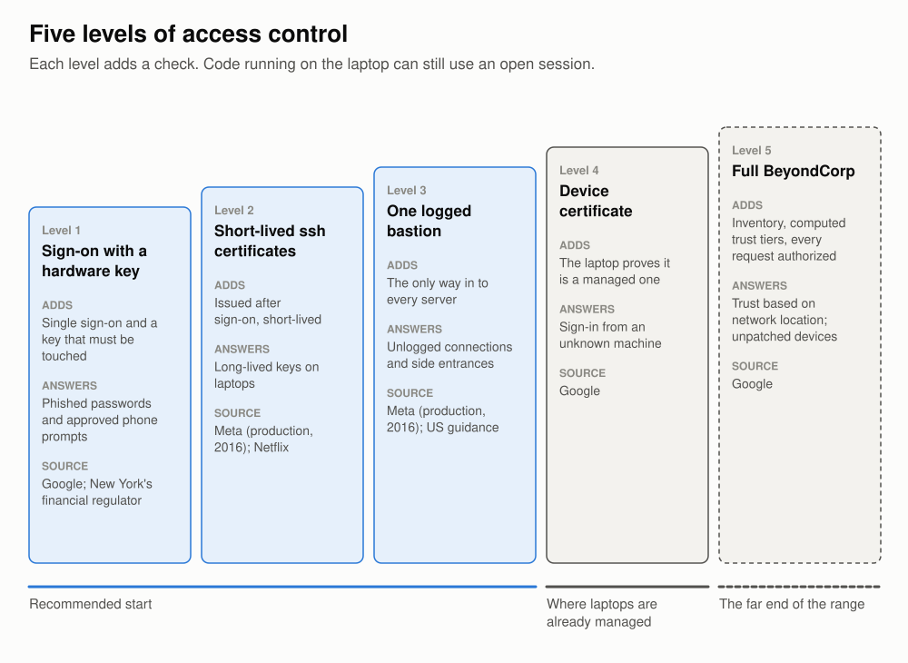

# Moving development off the laptop

On their first day at Facebook in 2012, engineers in bootcamp met their mentor and set up a development server for the web codebase. In a talk about keeping development fast, David Mortenson showed his own screen. A terminal on his Mac had a PHP file open on his dev server. Beside it, a browser showed his Facebook profile as served by that same machine. When he wanted to run the unit tests, he had a shell there too. [Mortenson’s QCon slides, pp. 12, 19 and 31](https://qconsf.com/sf2012/dl/qcon-sanfran-2012/slides/DavidMortenson_BuildingForABillionUsersFromSiliconValleyMOVEDTOBALLROOMBC.pdf#page=19)

For teams building server software, I would put each engineer's working copy, build tools and running services on a Linux development server. The engineer can keep a familiar editor on the laptop and connect over SSH. A coding agent can then work on its own copy under the same test conditions. Giving it a shell also means deciding which source it may read, where it may send a file and whether a failing test could put customer data in its output.

## Structure of the article

- [Working copies and editors](#working-copies-and-editors) describes what engineers keep on each machine. [A working day on a Stripe devbox](#a-working-day-on-a-stripe-devbox) follows the arrangement through a task.
- [Access to the server](#access-to-the-server) covers how an engineer gets in. [What the server can reach](#what-the-server-can-reach) and [Agents on the server](#agents-on-the-server) cover the permissions a person or program has once there.
- [Failure modes](#failure-modes) and [Staffing and cost](#staffing-and-cost) cover what it takes to operate the service. [Getting started](#getting-started) describes how to decide whether to make it the default for an application. The appendix compares [the protections and remaining exposure for each threat](appendix.md#threats-and-remaining-exposure).

## Working copies and editors

Daniel Roseman described his setup at Google in a 2012 post about a small annoyance. He did almost all his development in Vim on a machine he reached over SSH. Its terminal windows appeared as tabs on his Mac, and he could disconnect and come back to them later. What still took some work was copying a line from Vim into a Mac application. The file lived on the development machine. The selected text needed to reach the Mac’s clipboard. [Roseman’s notes on editing in Vim](https://blog.roseman.org.uk/2012/02/04/improving-vim-terminal-development-environment/)

A server can also run code while the working copy stays on the laptop. In Stripe’s earlier setup, a file watcher copied edits from the laptop to the server. A former engineer recalled debugging a change that was visible in the editor while the server was still running the old file. Both machines held a copy. [Nelson Elhage on Stripe’s file synchronization](https://blog.nelhage.com/post/stripe-dev-environment/) · [A former colleague on missed updates](https://news.ycombinator.com/item?id=41291111)

## The case for a development server

The performance case depends on what an engineer has to wait for. At Slack, a fresh clone of the application took nearly half an hour, and running the backend competed with other applications on the laptop. Uber measured its longer, more complex Go builds running about 2.5 times as fast on its development servers as on laptops. Fullscript reached a different conclusion for its Rails application. It replaced both local and hosted Kubernetes environments with a simpler setup that engineers could run on their laptops, and support requests fell. [Slack Engineering](https://slack.engineering/remote-development-at-slack/) · [Uber Engineering](https://www.uber.com/en-US/blog/devpod-improving-developer-productivity-at-uber/) · [Fullscript Engineering](https://builders.fullscript.com/posts/local-first-dev-environments-at-medium-scale)

The security case starts with what an engineer can open from the development machine. In May 2026, GitHub reported that a malicious editor extension had compromised an employee device and that an attacker had copied internal repositories. Some internal repositories held excerpts from customer support conversations. Moving a checkout off the laptop can spare the engineer a local copy, but a compromised laptop can still have an open session to the server, and a repository can contain more than code. The server should get credentials limited to the engineer's work, with separate authorization for customer data and production changes. [GitHub's incident report](https://github.blog/security/investigating-unauthorized-access-to-githubs-internal-repositories/)

## A working day on a Stripe devbox

A Stripe engineer can ask for a fresh machine for each task. Stripe keeps a pool of Linux virtual machines called devboxes, each with a recent checkout and warm build caches. Its target is ten seconds from request to handoff. The engineer opens the checkout from an editor on the laptop over SSH and can run a test or start the service on the devbox. In February 2026 Stripe said its engineers wrote most of their code this way. [Stripe's account](https://stripe.dev/blog/minions-stripes-one-shot-end-to-end-coding-agents-part-2)

Consider what happens when a colleague asks for a review in the middle of a change. Stripe used to synchronize a laptop checkout to a server. Switching branches could copy a large set of files and wake up file watchers that restarted services. Stripe built preview devboxes that followed a pull request as its author pushed changes. A reviewer could open the proposed dashboard in a browser and try the interaction while their own branch and services stayed where they were. [Soam Vasani's talk on Stripe's development environment](https://www.infoq.com/presentations/stripe-dev-env-infrastructure/)

The same arrangement suits a coding agent. Stripe can give it a devbox of its own, with the code and tools already there. The agent runs in Stripe's test environment with no access to real user data or production services and with restricted outbound connections. An engineer reviews the pull request it produces. [Stripe's agent design](https://stripe.dev/blog/minions-stripes-one-shot-end-to-end-coding-agents-part-2)

## The development server

For a small platform team, I would start with one persistent Linux virtual machine per engineer. The laptop runs the editor window. The server holds the working tree, runs the language tools and builds the service. Keystrokes can go straight into a local editor buffer while the editor sends changes over SSH. When the engineer reconnects the next morning, the uncommitted changes are in the same checkout. [Stripe's editor design](https://www.infoq.com/presentations/stripe-dev-env-infrastructure/)

Keeping the checkout there also reduces the amount of source code routinely stored on laptops. Eleven current and former Google engineers have publicly described restrictions on laptop copies of Google's main repository, with exceptions for work such as mobile development. An open editor still receives the contents of the files the engineer reads. [One engineer's account](https://news.ycombinator.com/item?id=33112061) and [the collected accounts](research/ledger_a_server.md#s31-where-the-code-lives-whether-it-may-be-on-the-laptop)

### State and capacity

Last.fm gave each web developer a hosted virtual machine built from a common image. In 2010, when disk corruption took out David Singleton's machine, he got a replacement, pulled the source again and restarted Apache. He was back at work in under an hour. The uncommitted code and a few shell scripts he had kept on the old machine were gone. [Singleton's account](https://dsingleton.co.uk/blog/virtualised-development-environments/)

Separate the disk holding unfinished work from the machine that runs it. Stripe described turning off idle devboxes, then attaching the saved volume to a fresh instance when its owner came back. Discord preserves the home directory, where engineers keep repositories, dotfiles and personal tools. On an ordinary rebuild, reattaching the volume puts the engineer’s files back in place. If the volume itself fails, the engineer can recover unfinished work only as far as the last usable copy on separate storage. Test that restore with an uncommitted change. After a suspected compromise, reattaching the old volume can also bring back an untrusted program or configuration file. [Stripe's volume design](https://www.infoq.com/presentations/stripe-dev-env-infrastructure/) and [Discord's workspace design](https://discord.com/blog/how-discord-moved-engineering-to-cloud-development-environments)

A team can add a warm pool when waiting for a clean workspace starts to interrupt work. Until then, a personal VM backed by a maintained image gives each engineer room to install a debugger or change a system package. I would grant root inside that VM and keep the network rules and access logs under separate administration. An engineer who helped build Instacart's environment described giving developers full sudo access there. [Instacart engineer's account](https://news.ycombinator.com/item?id=37943645)

Machine size should follow the work. GitHub chose 32 cores and 64 GB of memory for engineers developing github.com. A team debugging GPU code can allocate the accelerator separately, as Shopify does with interactive jobs on its shared cluster. Its engineers can connect to a job over SSH and debug on one GPU. [GitHub's account](https://github.blog/engineering/infrastructure/githubs-engineering-team-moved-codespaces/), [Shopify's GPU jobs](https://shopify.engineering/skypilot) and [other published machine sizes](appendix.md#machine-sizes-seen-in-public)

## Access to the server

An engineer should be able to open the editor, touch a hardware security key and connect. Behind that action, the company's sign-on service authenticates the engineer and a certificate authority issues a short-lived SSH certificate. The connection goes through a bastion, a server that admits the engineer to the assigned machine and records the connection. A team that already manages its laptops can check the device certificate at the same point.

Each check answers a different question. The hardware key protects the sign-in against phishing. A short certificate lifetime limits how long a stolen credential can open new connections. The bastion can record who connected, when and to which machine. An open editor reads and writes files over that same connection, so even a shell transcript would give an incomplete account of what the engineer did. [New York's report on the Twitter intrusion](https://www.dfs.ny.gov/Twitter_Report), [Facebook's SSH certificate design](https://engineering.fb.com/2016/09/12/security/scalable-and-secure-access-with-ssh/) and [Google on session auditing](https://google.github.io/building-secure-and-reliable-systems/raw/ch05.html)

Google's BeyondCorp goes further. It uses a device inventory and the security state of each machine to decide which applications a request may reach. Google spent years migrating its own systems, including SSH. A small team can start with the logged bastion and hardware-backed sign-on while it decides which services warrant a fresh device check on each request. [Google's account of the migration](https://www.usenix.org/publications/loginonline/beyondcorp-and-long-tail-zero-trust) and [the path from a Google laptop to production](appendix.md#from-a-google-laptop-to-production)

A valid session on a compromised laptop still carries the engineer's authority. In the CircleCI intrusion disclosed in 2023, an attacker stole an engineer's session after the engineer had completed two-factor authentication. A development platform should set a lifetime for open sessions as well as for certificates, give operators a way to close them and limit what anyone using that session can reach. [CircleCI's incident report](https://circleci.com/blog/jan-4-2023-incident-report/)

## What the server can reach

An engineer with root on a development server can change its firewall. Put the network rules outside the machine. In the design below, a developer can install a package, look up documentation and submit a patch. Each request goes to a service with the authority for that job. Pull-request tests run the author's code without deployment credentials. Only a separate release job gets authority to deploy the reviewed revision. The development server has no direct route to production or to another engineer's machine.

### Packages, source and the public web

A package install can still feel ordinary on a machine with no public internet connection. The package manager asks an internal registry for the dependency. That registry fetches it and can scan it before serving it. DZ BANK and its cloud provider describe this arrangement for private developer workstations. The editor needs updates too. VS Code can download its server component on the laptop and transfer it over the existing connection. Workspace extensions can run beside the checkout and deserve the same review as build dependencies. [DZ BANK workstation design](https://cloud.google.com/blog/products/application-modernization/dz-bank-improves-developer-productivity-with-cloud-workstations) · [VS Code remote development FAQ](https://code.visualstudio.com/docs/remote/faq)

Allowing a connection to a public code host leaves open which account can receive a push. With enterprise-managed users on GitHub.com, a corporate proxy can restrict authentication to accounts in the enterprise. That setting applies to HTTPS. A network using it must also close other routes to the host, including SSH. [GitHub enterprise proxy controls](https://docs.github.com/en/enterprise-cloud@latest/admin/configuring-settings/hardening-security-for-your-enterprise/restricting-access-to-githubcom-using-a-corporate-proxy)

A person can read a library manual in the laptop browser while the checkout stays on the server. For an agent, provide a search service outside the server that returns documentation as text. An indexed search limits which pages it can retrieve, though the search provider still receives the query. Model requests also carry data out. Cloudflare routes its engineers' model calls through a proxy that holds the provider credentials. Choose a provider approved for the code and test output a job can send. If the checkout contains material the provider may not receive, narrow what the job can read before connecting it to that model. [Cloudflare's model proxy](https://blog.cloudflare.com/internal-ai-engineering-stack/)

### Internal tools

A support ticket may hold a customer's description of a failed payment and an attachment from their browser. Give the agent a work item with a case reference and steps that reproduce the failure with test values. The engineer can follow the reference to the original ticket when the investigation calls for it. A gateway can let the agent read the prepared work item while withholding access to the support queue and permission to post in chat. At Uber, each tool starts disabled until its owner enables it. [Uber's gateway](https://www.uber.com/blog/designing-mcp-gateway/)

### Customer data in development

An engineer reproducing a failed payment may need two systems to agree on an account number. At ING, engineers trained a generator on 5,000 production payments. Its test messages looked plausible, but the bank's back-end systems could not recognize the invented accounts. The team used masked account data already present in its acceptance environment to supply numbers that the receiving systems knew. That gave the testers a way to exercise the payment flow with synthetic messages. [ING engineer's account](https://medium.com/ing-blog/how-ai-powered-synthetic-data-boosts-software-engineering-d89ad77ca2e7)

Keep ordinary tests on fixtures or generated records. Singapore's privacy regulator found personal data for 3,916 real users alongside 248,897 dummy records in a PINC Interactive staging dataset. Before releasing a refreshed dataset to developers, its owner should check which fields it contains and whether the identifiers can still be linked to customers. Keep any copy that can still identify customers in restricted staging. If a particular test needs those records, authorize the people and the test separately from ordinary development. Support attachments need their own review. Okta found active session credentials in files customers supplied to diagnose browser problems. [PINC decision, paragraphs 2–5](https://www.pdpc.gov.sg/-/media/files/pdpc/pdf-files/commissions-decisions/decision---pinc-interactive-pte-ltd---04022022.pdf) · [Okta's incident report](https://sec.okta.com/articles/2023/11/unauthorized-access-oktas-support-case-management-system-root-cause/)

When a ticket really does require a customer's record, give the engineer a separate place to inspect it. A broker can check who is asking, limit access to the transactions named in the ticket, expose the fields needed for the investigation and expire the grant. Record who inspected each transaction without copying its raw values into the ticket or debug log. Keep unredacted results in that interface, outside the shell and the agent's context. GitLab's database access runbook requires an issue link and manager review for a temporary grant. Cloudflare's data platform blocks queries against unreviewed tables, masks sensitive columns in results, and records when an authorized user requests raw values. [GitLab database access](https://runbooks.gitlab.com/teleport/Connect_to_Database_Console_via_Teleport/) · [Cloudflare data platform](https://blog.cloudflare.com/our-unified-data-platform/)

### Source transfers and investigations

In 2009, Goldman Sachs programmers working from home could log in to their office desktops to use the source repository. Goldman required the files to stay on company computers. A departing programmer who had access to the trading system's full source copied code from his work computer. Security staff discovered the transfers weeks later and recovered command history from a snapshot kept on the company network. [New York Court of Appeals, facts at 386–390](https://www.nycourts.gov/Reporter/3dseries/2018/2018_03174.htm)

The editor and SSH session both carry source back to the laptop. Restricting outbound traffic from the server still leaves those paths open to a person authorized to read the file. If a project restricts direct clones to managed servers, enforce that rule at the code host. Test it with the same account on both machines. The engineer should be able to clone the repository on the assigned server and be denied on the laptop.

At CrowdSec, a departing developer kept repository access to finish some work after losing infrastructure access. CrowdSec attributed the copying of roughly 170 private repositories to someone who compromised that account. [CrowdSec postmortem](https://www.crowdsec.net/blog/tanstack-supply-chain-attack-analysis)

When project access ends, revoke repository grants, close live sessions and withdraw access to saved workspaces and their snapshots. An existing checkout stays readable to anyone who can still mount the disk.

Keep repository and gateway audit records outside the workspace. A clone event can identify the account that requested the code. Tracing a copy beyond that point takes evidence from the client or the receiving service. Decide who will investigate before enabling broad data loss prevention alerts. Symantec described an early configuration of its own product that generated about 10,000 alerts a day across source code and other confidential material. Its six reviewers had to leave many unexamined. [GitHub audit events](https://docs.github.com/en/organizations/keeping-your-organization-secure/managing-security-settings-for-your-organization/audit-log-events-for-your-organization#git) · [Symantec's account, p. 3](https://docs.broadcom.com/doc/customerone-source-code-security-the-symantec-way-en) · [Appendix on transfer channels](appendix.md#channels-out-of-a-development-server)

## Agents on the server

An engineer can ask an agent to fix a failing test in the checkout where the failure is already reproducible. The agent sees the engineer’s uncommitted changes and can rerun the test after each edit. If it runs under the engineer’s account, it may also read unrelated files and use credentials available to that account, even while the engineer watches.

To hand the job off for the afternoon, give it a fresh workspace built from the same image, access to the affected repository and its own identity that expires with the job. For the payment bug, that workspace needs the prepared failing test and the code that handles the message.

Spotify’s background maintenance agent edits the checkout and calls a tool that builds and tests the change. A separate service pushes the result and handles communication on Slack. I would have that service open the pull request in the repository chosen when the engineer submitted the job, record who requested the change and send it to another engineer for review. The credential that can publish the change stays with the service. [Spotify on the agent’s tools](https://engineering.atspotify.com/2025/11/context-engineering-background-coding-agents-part-2) · [Spotify on publishing the change](https://engineering.atspotify.com/2025/12/feedback-loops-background-coding-agents-part-3)

### Untrusted instructions

Even a bug description stripped of customer details can contain instructions aimed at the agent. If the tracker grants permission to post a comment, an agent that follows those instructions could disclose private code before anyone sees a pull request. For this job the tracker only needs to return the prepared description. Postman describes how its proxy can expose an approved read operation even when the upstream credential also permits deletes, and record the developer, agent and run responsible for the call. [Meta on untrusted input and external communication](https://ai.meta.com/blog/practical-ai-agent-security/) · [Postman’s account of its proxy](https://blog.postman.com/how-postman-governs-ai-agent-access-to-42-production-systems/)

## Failure modes

On February 2, 2026, engineers using GitHub Codespaces went several hours without being able to create or resume a workspace in any region. An individual laptop failure costs one person the use of a machine. A provisioning failure can strand an entire on-call team when someone needs a fresh checkout to fix an incident. In a recovery drill, leave a fix unfinished and take the usual provisioning path out of service. A second engineer should be able to recover that fix in a fallback workspace, run its test and submit it for review. [GitHub’s incident report](https://github.blog/news-insights/company-news/github-availability-report-february-2026/)

An engineer can lose much of the benefit of a faster build while waiting for a terminal to echo a keystroke. Uber placed its development environments in five regions to keep them close to engineers. During Stripe’s trials, VS Code buffered typing on the laptop, while an Emacs user editing remote files with TRAMP could feel the round trip. Try the editors people actually use from the places they work, including the office farthest from the region. [Uber’s account](https://www.uber.com/en-US/blog/devpod-improving-developer-productivity-at-uber/) · [Stripe’s engineering talk](https://www.infoq.com/presentations/stripe-dev-env-infrastructure)

Keeping two ways to develop the same application also costs time. At Shopify, three engineers were moving an application to Spin while colleagues using the old tools kept committing changes that broke the remote setup. [Shopify’s migration](https://shopify.engineering/sfn-team-cloud-development-spin)

Choose a default for each application. Discord eventually retired macOS for backend development while many frontend engineers still needed a local checkout. A team that keeps code on the laptop for device work should count that copy when deciding who can read the repository and how it handles a lost laptop. [Discord’s account](https://discord.com/blog/how-discord-moved-engineering-to-cloud-development-environments)

## Staffing and cost

For a small team I would put one engineer in charge of a pilot on ordinary virtual machines or a hosted service, with someone else able to restore it. That estimate assumes the company already runs its own sign-on, code host and package service. Two people at separate small companies describe maintaining a shared Codespaces configuration. At Slack two engineers started the project with much of the infrastructure already in place. Neither experience establishes what it takes for one person to operate a fleet around the clock. [First administrator](https://news.ycombinator.com/item?id=37935523) · [Second administrator](https://news.ycombinator.com/item?id=37935463) · [Slack engineer on staffing](https://www.daytona.io/dotfiles/remote-development-productivity-lessons-from-slack) and [existing infrastructure](https://getdx.com/podcast/remote-development-at-slack/)

Machine time is easier to price. At GitHub’s November 2026 list price of $2.88 an hour, a 32-core codespace costs about $7,500 in compute for ten hours each weekday over 52 weeks, or $25,200 if it runs all year. Storing 1,000 GB for the year adds $840 in either case. Instacart’s machines hibernated outside each engineer’s working hours. Use measured compute, storage and support hours to price a year for the team. Engineers still need laptops. Count savings from local infrastructure and support work the team can actually retire, and report the change in build time separately. [GitHub’s rates](https://docs.github.com/en/billing/concepts/product-billing/github-codespaces) · [Instacart builder’s account](https://news.ycombinator.com/item?id=37943512)

## Getting started

Pick a backend application that fits on one machine and has a build or test suite that regularly keeps engineers waiting. Give a few volunteers a Linux machine each, with a persistent disk and their usual editor. Their first assignment should be an ordinary change they already need to ship. At Slack, volunteers tried the web application in August 2021. By the October general release, 30% of backend engineers had already switched completely. Engineers who used Vim and Emacs also wanted to bring those editors to the new machines. [Slack engineer’s account](https://getdx.com/podcast/remote-development-at-slack/)

Keep sign-in and SSH connection records from the first day. Include a maintainer and an engineer who takes production calls, and have someone try the service from the location with the longest round trip. Compare the time from an edit to a test result with the same work on a laptop. Before changing the default, the application owner and the platform team should agree who answers when an on-call engineer loses a workspace and how soon they need to be editing again. Time the recovery drill against that commitment. Keep a supported local path for tasks that still require one.

A team can stop after moving the application. For its first unattended job, hand over the prepared failing test. The engineer accepting the fix should be able to find the pull request in the assigned repository, see which tools the job used and confirm that a new call is denied after its grant expires.
